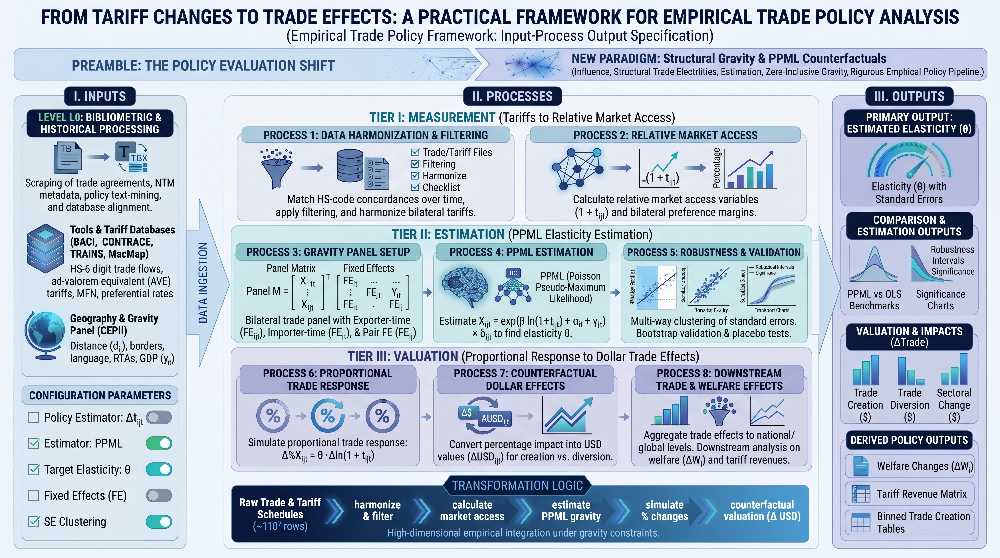

# **`README.md`**

# From Tariff Changes to Trade Effects: A Practical Framework for Empirical Trade Policy Analysis

<!-- PROJECT SHIELDS -->
[](https://opensource.org/licenses/MIT)
[](https://github.com/chirindaopensource/from_tariff_changes_to_trade_effects)
[](https://github.com/chirindaopensource/from_tariff_changes_to_trade_effects)
[](https://peps.python.org/pep-0008/)
[](https://peps.python.org/pep-0484/)
[](https://arxiv.org/abs/2610.36171)
[](https://arxiv.org/abs/2610.36171)
[](https://arxiv.org/abs/2610.36171)
[](https://arxiv.org/abs/2610.36171)
[](https://arxiv.org/abs/2610.36171)
[](https://arxiv.org/abs/2610.36171)
[](https://arxiv.org/abs/2610.36171)
[](https://github.com/chirindaopensource/from_tariff_changes_to_trade_effects)
[](https://github.com/chirindaopensource/from_tariff_changes_to_trade_effects)
[](https://github.com/chirindaopensource/from_tariff_changes_to_trade_effects)
[](https://github.com/chirindaopensource/from_tariff_changes_to_trade_effects)
[](https://github.com/chirindaopensource/from_tariff_changes_to_trade_effects)
[](https://github.com/chirindaopensource/from_tariff_changes_to_trade_effects)
[](https://github.com/chirindaopensource/from_tariff_changes_to_trade_effects)
[](https://github.com/chirindaopensource/from_tariff_changes_to_trade_effects)
[](https://github.com/chirindaopensource/from_tariff_changes_to_trade_effects)
[](https://github.com/chirindaopensource/from_tariff_changes_to_trade_effects)
[](https://github.com/chirindaopensource/from_tariff_changes_to_trade_effects)
[](https://github.com/chirindaopensource/from_tariff_changes_to_trade_effects)
[](https://github.com/chirindaopensource/from_tariff_changes_to_trade_effects)
[](https://github.com/chirindaopensource/from_tariff_changes_to_trade_effects)
[](https://github.com/chirindaopensource/from_tariff_changes_to_trade_effects)
[](https://github.com/chirindaopensource/from_tariff_changes_to_trade_effects)
[](https://github.com/chirindaopensource/from_tariff_changes_to_trade_effects)
[](https://github.com/chirindaopensource/from_tariff_changes_to_trade_effects)
[](https://github.com/chirindaopensource/from_tariff_changes_to_trade_effects)
[](https://github.com/chirindaopensource/from_tariff_changes_to_trade_effects)
[](https://github.com/chirindaopensource/from_tariff_changes_to_trade_effects)
[](https://github.com/chirindaopensource/from_tariff_changes_to_trade_effects)
[](https://github.com/chirindaopensource/from_tariff_changes_to_trade_effects)
[](https://github.com/chirindaopensource/from_tariff_changes_to_trade_effects)
[](https://www.usitc.gov/data/gravity/itpde.htm)
[](https://wits.worldbank.org/WITS/Training/databases.html)
[](https://www.atlanticcouncil.org/programs/geoeconomics-center/trump-tariff-tracker/)
[](https://github.com/chirindaopensource/from_tariff_changes_to_trade_effects)
[](https://numpy.org/)
[](https://pandas.pydata.org/)
[](https://scipy.org/)
[](https://faker.readthedocs.io/)
[](https://pyyaml.org/)
[](https://jupyter.org/)
[](https://github.com/chirindaopensource/from_tariff_changes_to_trade_effects)
[](https://colab.research.google.com/github/chirindaopensource/from_tariff_changes_to_trade_effects/blob/main/from_tariff_changes_to_trade_effects_draft.ipynb)

**Repository:** `https://github.com/chirindaopensource/from_tariff_changes_to_trade_effects`

**Owner:** 2026 Craig Chirinda (Open Source Projects)

> **Viewing the notebook.** The code of `from_tariff_changes_to_trade_effects_draft.ipynb` is about 3.0 million characters long. If GitHub's built-in viewer does not render it fully, open it in [Google Colab](https://colab.research.google.com/github/chirindaopensource/from_tariff_changes_to_trade_effects/blob/main/from_tariff_changes_to_trade_effects_draft.ipynb) or [nbviewer](https://nbviewer.org/github/chirindaopensource/from_tariff_changes_to_trade_effects/blob/main/from_tariff_changes_to_trade_effects_draft.ipynb), or clone the repository and open it in Jupyter.

This repository contains an **independent**, professional-grade Python implementation of the arXiv preprint "*From Tariff Changes to Trade Effects: A Practical Framework for Empirical Trade Policy Analysis*" (arXiv:2610.36171; e-journal submission 26 October 2026), by:

*   **Maria Cipollina** (University of Molise; Centro Rossi-Doria, Università Roma Tre)
*   **Luca De Benedictis** (Universitas Mercatorum; Centro Rossi-Doria, Università Roma Tre; Luiss University; CRIAVET)

The paper was prepared for the 15th AIEAA Annual Conference, held in Rome and hosted by Universitas Mercatorum. The authors conceived it as a contribution in memory of Luca Salvatici. The reference is an arXiv preprint, not a journal article. The authors have no part in this repository, and it is not their code. It was written from the manuscript alone. The manuscript states that "the coding table and the R-code that produces Figure 1 are available upon request"; it ships no code or data, and it never prints the estimated trade coefficients $\hat\beta_k$.

The project implements a schedule-level competitive-position audit of tariffs. For every supplier in every product market, the domestic supplier included, it does four things:

1. It measures competitive position relative to all actual rivals.
2. It decomposes any change in that position exactly into a direct own-tariff component and an indirect competitive-benchmark component.
3. It predicts the associated partial-equilibrium trade reallocation under an explicitly declared closure.
4. It accepts any actual, proposed or hypothetical tariff schedule as its input.

It yields four consumable outputs: the relative position, the change in that position, the attribution of that change, and the implied flow reallocation. It is deliberately bounded: it reports who gains and who loses relative to whom, and by how much trade moves, and it never presents those results as welfare, output, employment or general-equilibrium effects.

> **Reproduction status.** The pipeline is implemented end to end, but **no table of the paper is reproduced here, and none can be from this repository alone.**
>
> - **The data are not bundled.** The paper combines ITPD-E bilateral and domestic flows (USITC) with applied and MFN tariffs from WITS–TRAINS for 2016–2021, and a February 2026 scenario from the Atlantic Council's Trump Tariff Tracker, accessed in May 2026. ITPD-E is free to download, and WITS–TRAINS is free after registration. This repository ships neither, nor a frozen tracker snapshot.
> - **What is verified.** The end-to-end orchestrator `run_task_25` passes all sixteen algebraic tests (T1–T16) on the notebook's frozen synthetic fixture. The [usage example](#usage) runs it on a richer synthetic world built from the nine input structures, where 15 of 16 tests pass and the T5 failure is diagnosed in full.
> - **What remains a target.** Every published number below, from the Table 1 elasticities to the Table 3 net changes, is a comparison target that the code checks. It is never presented as a result.
> - **What cannot be recovered.** Several quantities the paper never prints are imputed by declared rules and listed in the disclosure ledger of `config.yaml`: the CES weights $\alpha_i$, the $\hat\beta_k$, the $\beta\to\sigma$ map, the HS lists of the sectoral measures, and the membership of the "selected trading partners".

## Table of Contents

- [Introduction](#introduction)
- [Theoretical Background](#theoretical-background)
- [Features](#features)
- [Methodology Implemented](#methodology-implemented)
- [Core Components (Notebook Structure)](#core-components-notebook-structure)
- [Key Callable: `run_task_25`](#key-callable-run_task_25)
- [Prerequisites](#prerequisites)
- [Installation](#installation)
- [Input Data Structure](#input-data-structure)
- [Usage](#usage)
- [Output Structure](#output-structure)
- [Project Structure](#project-structure)
- [Customization](#customization)
- [Contributing](#contributing)
- [Recommended Extensions](#recommended-extensions)
- [License](#license)
- [Citation](#citation)
- [Acknowledgments](#acknowledgments)

## Introduction

This project implements the methodology of Cipollina and De Benedictis (2026). Its core is the Jupyter notebook `from_tariff_changes_to_trade_effects_draft.ipynb`.

- **Callable count.** The code defines **595 top-level callables: 592 functions, 2 classes and 1 method**. They were counted with Python's `ast` module over top-level definitions and the methods of top-level classes. Counting nested helper functions as well gives 608.
- **Organisation.** The code is organised as **27 tasks**, each in its own cell with a final orchestrator `run_task_1` to `run_task_27`.
- **Key callable.** Task 25 holds the end-to-end orchestrator `run_task_25`, the study interface demonstrated in the usage example.

**The question.** For decades trade-policy evaluation was organised around liberalization: tariff cuts, preferential concessions and the erosion of preferences. The 2020s reverse the experiment, because tariffs are rising again. The paper asks what is required to translate an observed or counterfactual tariff change into an economically meaningful estimate of its trade effects, now that the policy experiment has changed.

**The argument.** A tariff is observable, but its economic meaning is relative. A preferential exporter whose own tariff does not move can still gain or lose market access, because the tariffs of its rivals moved. An MFN increase therefore cannot be read off the bilateral tariff change, nor treated as liberalization with the sign reversed. The paper separates three objects: the policy instrument that changes, the resulting change in relative market access, and the trade response to that change.

**The framework.** Four steps:

1. Define the policy experiment at the most disaggregated level at which tariff treatment differs across exporters.
2. Choose the benchmark; the paper uses a CES-consistent reference tariff and the bilateral tariff margin built on it.
3. Estimate the trade elasticity, iteratively, because the benchmark itself depends on the elasticity.
4. Evaluate the counterfactual by recomputing the benchmark from the complete counterfactual schedule and translating margin changes into trade effects.

**The illustration the paper reports.** The illustration uses US protection under a February 2026 counterfactual: +10 percentage points for selected partners, +15 for Bolivia, +25 for steel and aluminium and for motor vehicles and parts, and +50 for copper.

1. **Margins.** In Table 1, 13 of the 17 reported industries see their mean margin rise and 4 see it fall. The extremes are +7.88% (medical, precision and optical instruments) and −5.91% (wood products).
2. **Trade effects by industry (Table 2).** Gains and losses coexist within industries. Domestic US trade can move against foreign suppliers; in medical instruments, a small foreign net gain coexists with a predicted domestic contraction of about USD 48.8 billion.
3. **Trade effects by partner (Table 3).** Large negative net changes appear for Japan, Mexico, Germany and South Korea. China, India and Vietnam show positive net changes, the preference-amplification mechanism at work.

The paper stresses that these are model-based reallocations of trade flows. They are not welfare, output or employment effects, and not general-equilibrium results.

**The literature space.** Section 1.1 positions seventeen studies on nine coding elements. The positioning is a two-mode affiliation network, coded from abstracts on $\lbrace 0, 0.5, 1\rbrace$, with Gower (1971) distances and a barycentric layout. The paper reports the reference paper's nearest neighbours at 0.11 and 0.28, and every other study at 0.33 or beyond.

## Theoretical Background

The equation numbers below are the paper's own.

**The tariff change and its insufficiency.** For product $k$ and exporter $i$, with states $t\in\lbrace 0, 1\rbrace$:

$$
\Delta\tau_{ik}=\tau_{ik1}-\tau_{ik0}\qquad (1)
$$

An MFN increase leaves a preferential exporter with $\Delta\tau_{ik}=0$ (eq. 2), and yet its market access changes.

**The CES reference tariff and the bilateral tariff margin.** With elasticity of substitution $\sigma_k>1$ across origins and normalised CES weights $\sum_i\alpha_i=1$:

$$
1+T_{kt}=\left[\sum_{i}\alpha_i\left(1+\tau_{ikt}\right)^{1-\sigma_k}\right]^{\frac{1}{1-\sigma_k}}\qquad (3),\qquad\qquad btm_{ikt}=\frac{1+T_{kt}}{1+\tau_{ikt}}\qquad (4).
$$

A margin above one is more favourable treatment than the benchmark, and a margin below one a relative disadvantage. Because $T_{kt}$ depends on every supplier's tariff:

$$
\Delta\tau_{ik}=0\ \not\Rightarrow\ \Delta btm_{ik}=0\qquad (5).
$$

The aggregator is a power mean with exponent $1-\sigma_k$, whose limits are verified numerically (tests T5 and T6):

$$
\lim_{\sigma\to\infty}\left(1+T_k\right)=\min_i\left(1+\tau_{ik}\right),\qquad \lim_{\sigma\to 1}\left(1+T_k\right)=\prod_i\left(1+\tau_{ik}\right)^{\alpha_i}.
$$

**Spillover algebra.** These identities follow from eq. (3) and are implied by the paper's argument; the implementation verifies them as tests T4 and T10. The benchmark weights

$$
\omega_{ik}=\frac{\alpha_i\left(1+\tau_{ik}\right)^{1-\sigma_k}}{\left(1+T_k\right)^{1-\sigma_k}},\qquad \sum_{i}\omega_{ik}=1,
$$

give the own and cross elasticities of the margin:

$$
\frac{\partial\ln btm_{ik}}{\partial\ln(1+\tau_{ik})}=\omega_{ik}-1\le 0,\qquad \frac{\partial\ln btm_{ik}}{\partial\ln(1+\tau_{jk})}=\omega_{jk}\ge 0 .
$$

Because the domestic node has $\tau\equiv 0$ in every state, a uniform shock to all foreign tariff factors does not leave the margins unchanged (test T11). Domestic inclusion is therefore an identifying assumption.

**Two experiments, one framework (eqs. 6–13).** With exporter $A$ preferential and exporter $B$ the one whose tariff moves:

$$
\begin{aligned}
\text{Liberalization:}\quad & \tau_{Bk}\downarrow\ \Rightarrow\ T_k\downarrow\ \Rightarrow\ btm_{Ak}\downarrow\qquad \text{preference erosion},\cr
\text{Protection:}\quad & \tau^{MFN}_{Bk}\uparrow\ \Rightarrow\ T_k\uparrow\ \Rightarrow\ btm_{Ak}\uparrow\qquad \text{preference amplification}.
\end{aligned}
$$

**Estimation (eq. 14).** PPML, with exporter-time and product-time fixed effects in the single-importer setting:

$$
E\left[M_{ikt}\mid X\right]=\exp\left[\beta_k\ln\left(btm_{ikt}\right)+\gamma_{it}+\delta_{kt}\right]\qquad (14).
$$

**Identification.** Because $\ln btm_{ikt}=\ln(1+T_{kt})-\ln(1+\tau_{ikt})$ and $\ln(1+T_{kt})$ varies only in $(k,t)$, the benchmark term is absorbed by $\delta_{kt}$, so only own-tariff variation identifies $\beta_k$ (Task 12):

$$
\beta_k\ln btm_{ikt}+\delta_{kt}=-\beta_k\ln(1+\tau_{ikt})+\underbrace{\delta_{kt}+\beta_k\ln(1+T_{kt})}_{\tilde\delta_{kt}} .
$$

**The fixed point.** The benchmark depends on $\sigma$, so the paper iterates "until convergence is achieved, subject to the existence and stability of a fixed point":

$$
\text{initial benchmark}\rightarrow\widehat\beta^{(1)}\rightarrow\widehat\sigma^{(1)}\rightarrow T^{CES,(1)}\rightarrow btm^{(1)}\rightarrow\widehat\beta^{(2)}\rightarrow\widehat\sigma^{(2)}\rightarrow\cdots
$$

Under eq. (14) as specified, saturated in $\delta_{kt}$ (Design A), $\partial\hat\beta_k/\partial\sigma_k=0$: every $\sigma$ is a fixed point and the iteration is stationary at its initial condition, which Task 15 documents. Stability is tested through the spectral radius of the update map's Jacobian, $\rho(J)<1$.

**The counterfactual (eqs. 15–18).** The benchmark is recomputed from the complete counterfactual schedule:

$$
BTM^{s}_{ikt}=\frac{1+T^{s}_{kt}}{1+\tau^{s}_{ikt}},\qquad s\in\lbrace 0, CF\rbrace\qquad (18).
$$

The proportional response (Lai and Zhu, 2004) and its value at observed baseline trade are:

$$
\Delta Trade_{ik}=\frac{\widehat M_{ik}(btm^1_{ik})-\widehat M_{ik}(btm^0_{ik})}{\widehat M_{ik}(btm^0_{ik})}\qquad (16),\qquad\qquad TradeEffect_{ik}=M^0_{ik}\,\Delta Trade_{ik}\qquad (17).
$$

Under eq. (14) with the fixed effects held fixed, $\Delta Trade_{ik}=(btm^1_{ik}/btm^0_{ik})^{\hat\beta_k}-1$.

**The exact decomposition (eq. 19):**

$$
\Delta\ln BTM_{ikt}=\underbrace{-\Delta\ln\left(1+\tau_{ikt}\right)}_{\text{own-tariff component}}+\underbrace{\Delta\ln\left(1+T_{kt}\right)}_{\text{competitive-benchmark component}}\qquad (19).
$$

**Closure.** A partial-equilibrium counterfactual holds expenditures, production and the other determinants of trade fixed. A general-equilibrium counterfactual lets expenditures, output, factory-gate prices and multilateral resistance adjust. The two answer different questions. This implementation imposes the conserving reallocation $\sum_{i\in V_k}TradeEffect_{ik}=0$ within each market (imputation G12), and reports the gap to the paper's printed Table 2 total of about USD −155.8 billion.

**The literature space.** For coding matrix $c_{se}\in\lbrace 0, 0.5, 1\rbrace$ over nine elements, the Gower dissimilarity is:

$$
D_{ss'}=\frac{1}{9}\sum_{e=1}^{9}\left\lvert c_{se}-c_{s'e}\right\rvert\in\left\lbrace 0,\tfrac{1}{18},\dots,1\right\rbrace,\qquad p_s=\frac{\sum_e c_{se}\,u_e}{\sum_e c_{se}},\quad u_e=R\left(\cos\theta_e,\sin\theta_e\right).
$$

## Features

- **27-task modular architecture.** Each task is one notebook cell with its own final orchestrator.
- **One end-to-end orchestrator.** `run_task_25` builds a 22-row callable catalogue. It invokes every catalogue callable in dependency order, stores each result in a content-addressed store, logs an execution trace, and deposits six files.
- **Two disjoint chains, as in the paper.** Chain A (the literature space) and Chain B (the econometric pipeline) share no data, and a segregation audit enforces it.
- **Exact algebra as executable tests.** Sixteen identities are evaluated at declared tolerances: Gower grid, weight conservation, CES limits, margin recomputation, eq. (19) additivity, the multiplicative factorisation, the zero-sum Jacobian row, the uniform foreign shock, conservation, $\alpha$ round trip, the fixed point, the domestic own factor and the Table 1 arithmetic. The tolerances range from exact to $10^{-15}$, $10^{-12}$ and $10^{-10}$.
- **Log-space CES aggregation.** Max-shifted log-sum-exp keeps eq. (3) stable at $\sigma_k$ up to 64.33, with a per-market conditioning audit.
- **Tie-safe limit certificate.** The σ → ∞ test uses the summed weight of every supplier tied at the minimum tariff factor, which real schedules with duty-free partners require.
- **Identification forensics.** A rank test proves that $\ln(1+T_{kt})$ is collinear with $\delta_{kt}$. The over-identified Design B, with a Wald test of $\beta^{bm}_k=-\beta^{own}_k$, is estimated as a diagnostic.
- **Counterfactual discipline.** The benchmark is recomputed from the complete schedule, with $V_k$ fixed at baseline. The scenario applies a declared precedence rule (maximum or additive) and an admissibility ceiling. The domestic node is exempt from every increment.
- **Declared imputations, not silent ones.** Every quantity the paper leaves open is tagged `[S]`, `[I]`, `[G]` or `[X]` or `[UNSPECIFIED IN MANUSCRIPT]` in `config.yaml`, registered in the twelve-entry disclosure ledger (G1–G12) before execution, and varied in a 576-cell sensitivity grid.
- **Honest reporting.** Published figures are targets, never literals returned as results. Deviations are findings, and the gap between the conserving reallocation and the paper's printed Table 2 total is attributed rather than hidden.
- **Reproducible deposit.**
  - SHA-256 checksums for every artefact, and a manifest re-audit;
  - a pinned environment and a Dockerfile;
  - a regeneration entry point, and a replication note with no wall-clock stamp.
- **Self-contained notebook.** No task cell imports from a module folder, and every import sits in the notebook's import cell.

## Methodology Implemented

The notebook works through the paper in eleven phases.

**Phase I: Inputs and audit infrastructure (Tasks 1 to 3).**

- *Task 1* validates the eight ingested frames and four companion mappings: schemas, dtypes, nullability, domain predicates, configuration provenance and cross-block coherence.
- *Task 2* cleanses ITPDE, WITS–TRAINS and the reference tables into a 15-row ledger and an exclusion table.
- *Task 3* runs the sixteen-test battery on synthetic fixtures, registers the G1–G12 disclosure ledger before any estimation, and builds a 100-row tolerance registry.

**Phase II: The literature space, Chain A (Tasks 4 to 6).**

- *Task 4* codes the affiliation matrix (primary and independent second pass), computes per-element Cohen's $\kappa$ with bootstrap intervals, and adjudicates against written definitions.
- *Task 5* computes the Gower matrix, verifies the half-unit grid and scores the three published distances.
- *Task 6* places each study at its claim-weighted barycentre, repels overlapping nodes under a Kendall-$\tau$ order check, and audits Figure 1.

**Phase III: The panel and the competitive network (Tasks 7 and 8).**

- *Task 7* harmonises HS flows to ISIC Rev. 3, resolves baseline tariffs by an ordered cascade (APPLIED, then $\min(\text{PREF},\text{MFN})$), and partitions the panel into five exclusion buckets.
- *Task 8* builds $V_k=\lbrace i:M_{ik}>0\rbrace\cup\lbrace\mathrm{DOM}\rbrace$ under the zero-domestic-tariff identifying assumption.

**Phase IV: CES measurement (Tasks 9 to 11).**

- *Task 9* calibrates $\alpha_i$ by exact CES inversion of observed shares (T13).
- *Task 10* computes the benchmark in log space and verifies its limits (T5, T6).
- *Task 11* computes the margins and verifies T7, T4 and T8.

**Phase V: The elasticity (Tasks 12 to 15).**

- *Task 12* proves the Design A collinearity and estimates Design B as a diagnostic.
- *Task 13* runs PPML with two-way high-dimensional fixed effects, separation handling, and CGM and CR1 cluster-robust inference.
- *Task 14* maps $\beta$ to $\sigma$ under both declared maps and applies the sign-and-significance and $\sigma=2$ filters.
- *Task 15* documents the fixed point's stationarity under Design A and tests local stability under Design B.

**Phase VI: The counterfactual (Tasks 16 to 19).**

- *Task 16* builds the February 2026 schedule.
- *Task 17* recomputes the benchmark and margins and verifies T11.
- *Task 18* predicts trade effects and imposes the conserving reallocation (T12).
- *Task 19* computes the exact attribution (T8, T9, T15).

**Phase VII: The tables (Tasks 20 and 21).**

- *Task 20* reproduces Table 1 under the ratio-of-means and mean-of-ratios conventions.
- *Task 21* reproduces Tables 2 and 3, in conserving and non-conserving variants, with both Table 3 denominators.

**Phase VIII: Audit and reconciliation (Tasks 22 to 24).**

- *Task 22* runs the full battery T1–T16.
- *Task 23* checks cross-table coherence across three functionals, the paper's sign patterns and per-table sample composition.
- *Task 24* reconciles the calibration hazard of medical instruments: +7.88% margin, $\bar\sigma=64.33$.

**Phase IX: Orchestration (Task 25).** `run_task_25` executes both chains end to end.

**Phase X: Sensitivity (Task 26).** Task 26 runs the 576-cell grid over the eight imputation axes and reports minimum, maximum, range and the percentile rank of the all-primary cell.

**Phase XI: Deposit (Task 27).** Task 27 checksums the deposit and re-audits it, pins the environment, and writes the replication note.

The diagram below illustrates the Inputs, Processes and Outputs (IPOs) of the implemented approach:

<div align="center">
  <a href="https://github.com/chirindaopensource/from_tariff_changes_to_trade_effects/blob/main/from_tariff_changes_to_trade_effects_ipo_main_1.png">
    
  </a>
</div>

### Targets the pipeline checks

The paper's figures enter the code as targets with tolerances. They are listed here because they define what "reproduced" would mean, not because this repository has reproduced them. In the table, "Reports" means a miss is recorded with its size; "halts" means the task raises.

| Quantity (paper) | Target | Checked by |
| --- | --- | --- |
| Gower distance of the merged Cipollina–Salvatici entry to the reference | 0.11, that is 2/18 | Task 5: reports a verdict, never rounds toward the target |
| Gower distance of Fugazza and Nicita to the reference | 0.28, that is 5/18 | Task 5: reports |
| Every other study's distance to the reference | ≥ 0.33, that is ≥ 6/18 | Task 5: reports |
| Industry-mean elasticities, Table 1 col. 2 | 17 values, 2.78 to 64.33, ±0.01 | Task 20: reports |
| Mean margins $BTM_{CES}$ and $BTM_{SIM}$, Table 1 | 17 pairs, ±0.001 | Task 20: reports |
| $\Delta BTM$ sign pattern and specific values | 13 positive, 4 negative; 8 values ±0.01 | Tasks 20 and 23: report |
| Table 2 specific cells, USD millions | motor vehicles −74,455; medical −48,115; textiles international gain 27,874; furniture domestic gain 12,766; ±1 | Task 21: reports, against the non-conserving variant |
| Table 2 column sum | about −155,800, a comparison constant | Tasks 18 and 21: gap attributed to four categories |
| Industries with zero domestic effect | 8 of 17 | Tasks 21 and 23: report |
| Table 3 net changes | 15 exporters, ±0.1 points | Task 21: reports, on both denominators |
| Calibration hazard, medical instruments | +7.88% margin with $\bar\sigma=64.33$ against a +647 foreign net | Task 24: reports a verdict per reconciliation |
| Inter-coder reliability | $\kappa_e\ge 0.80$ per element | Task 4: reports elements below threshold |
| Algebraic identities T4, T8, T9, T12, T15 | $10^{-10}$ to $10^{-15}$ | Tasks 11 (T4, T8), 18 (T12) and 19 (T8, T9, T15): halt; the full battery in Tasks 22 and 25 reports |
| CES limits T5 and T6 | $10^{-6}$ at $\sigma=1000$ and $\sigma=1.0001$ | Task 10: halts on its declared fixtures; Tasks 22 and 25: report |

## Core Components (Notebook Structure)

All code lives in one notebook. The notebook is laid out as follows:

- **Front matter.** It opens with an empty code cell and three markdown cells: a README placeholder, *Paper* and *Paper Summary*.
- **Imports.** The import cell sits under *Import Essential Modules*.
- **Implementation.** Under *Implementation*, in the *Draft 1* section, come:
  - *Supporting Definitions*: `STUDY_CONFIG` and the shared logger;
  - *Study Inputs*: the frozen synthetic fixture `fixture_panel_a` and scenario `fixture_scenario`;
  - the 27 task cells;
  - *Study Execution*, which calls `run_task_25` on the fixture.

| Task | Title | Functions | Classes | Methods | Orchestrator |
| --- | --- | --- | --- | --- | --- |
| – | Study Inputs | 2 | 0 | 0 | – |
| 1 | Validate the appropriateness and quality of every ingested parameter | 40 | 0 | 0 | `run_task_1` |
| 2 | Cleanse the raw inputs | 22 | 0 | 0 | `run_task_2` |
| 3 | Initialize the test battery, disclosure ledger, and acceptance thresholds | 42 | 0 | 0 | `run_task_3` |
| 4 | Assemble the coding matrix `df_affiliation_matrix` | 30 | 0 | 0 | `run_task_4` |
| 5 | Compute Gower distances and verify the three targets | 23 | 0 | 0 | `run_task_5` |
| 6 | Reconstruct the Figure 1 layout | 11 | 1 | 0 | `run_task_6` |
| 7 | Harmonise to ISIC and assemble the analysis panel | 15 | 0 | 0 | `run_task_7` |
| 8 | Construct the competitive node set V_k | 15 | 0 | 0 | `run_task_8` |
| 9 | Calibrate alpha_i by exact CES inversion | 18 | 0 | 0 | `run_task_9` |
| 10 | Compute the baseline CES benchmark in log space | 6 | 0 | 0 | `run_task_10` |
| 11 | Compute the baseline margin and verify the algebraic identities | 17 | 0 | 0 | `run_task_11` |
| 12 | Select and document the estimation design | 24 | 0 | 0 | `run_task_12` |
| 13 | Run PPML with two-way high-dimensional fixed effects | 25 | 0 | 0 | `run_task_13` |
| 14 | Map beta to sigma and apply the selection filters | 14 | 0 | 0 | `run_task_14` |
| 15 | Address the fixed-point stationarity question | 23 | 0 | 0 | `run_task_15` |
| 16 | Construct the counterfactual schedule | 14 | 0 | 0 | `run_task_16` |
| 17 | Recompute the counterfactual benchmark and margins | 16 | 0 | 0 | `run_task_17` |
| 18 | Predict trade effects and impose conserving reallocation | 14 | 0 | 0 | `run_task_18` |
| 19 | Compute the exact attribution | 13 | 0 | 0 | `run_task_19` |
| 20 | Reproduce Table 1 | 20 | 0 | 0 | `run_task_20` |
| 21 | Reproduce Tables 2 and 3 | 17 | 0 | 0 | `run_task_21` |
| 22 | Run the full algebraic test battery T1-T16 | 31 | 0 | 0 | `run_task_22` |
| 23 | Cross-table and sign-pattern coherence | 18 | 0 | 0 | `run_task_23` |
| 24 | Reconcile the calibration hazard | 17 | 0 | 0 | `run_task_24` |
| 25 | Build the end-to-end orchestrator function | 56 | 1 | 1 | `run_task_25` |
| 26 | Run the robustness sensitivity grid through the orchestrator | 22 | 0 | 0 | `run_task_26` |
| 27 | Package and write the replication note | 27 | 0 | 0 | `run_task_27` |
| | **Total** | **592** | **2** | **1** | |

## Key Callable: `run_task_25`

```python
def run_task_25(
    study_config: Mapping[str, Any],
    fixture_panel: pd.DataFrame | None,
    scenario: Mapping[str, Any] | None,
    design: str,
    upstream_outputs: Mapping[str, Any] | None,
    output_dir: str | Path,
) -> dict[str, Any]: ...
```

| Argument | Contract |
| --- | --- |
| `study_config` | The complete study configuration (`config.yaml`); must be non-empty and carry `meta`. It supplies the fixed-point tolerance and cap, the CES limit constants, the scenario defaults and the T1–T16 tolerances. |
| `fixture_panel` | One row per (`product_code`, `supplier_iso3`), with `flow_value` (baseline trade, USD millions, > 0), `tau_baseline` and `tau_counterfactual` (decimal rates, ≥ 0, exactly 0 on `"DOM"`) and `sigma` (> 1). `None` selects the real-data path, which raises because the project holds no frozen ITPD-E/WITS extracts. |
| `scenario` | The counterfactual: selected partners, partner and Bolivia increments, sectoral increments and HS4 lists, precedence, ceiling, `alpha_rule` (`"uniform"` or `"inverted_exact_ces"`) and closure. `None` derives it from `scenario_construction`. If the panel's `tau_counterfactual` deviates from the scenario's own computation by more than $10^{-15}$, the run halts. |
| `design` | `"A"` runs the fixed-point block once. `"B"` iterates until the sup-norm change in $\hat\sigma$ is within `convergence_tolerance`, and halts at `max_iterations`. |
| `upstream_outputs` | Dependency outputs. Every 64-hex string inside becomes a root artefact id, recorded by `cleanse_data` as consumed. |
| `output_dir` | Folder for the six deposits; created if absent. |

**Execution.** Validation of the boundary, then the 22 catalogue callables:

- **Chain A:** `assemble_coding_matrix`, `compute_gower`, `reconstruct_layout`.
- **Chain B:**
  - preparation: `cleanse_data`, `harmonise_panel`, `construct_V_k`, `calibrate_alpha`;
  - the fixed-point block: `compute_benchmark`, `compute_margin`, `estimate_ppml`, `derive_sigma_and_filter`, `address_fixed_point`;
  - the counterfactual: `construct_scenario`, `compute_cf_benchmark`, `compute_cf_margin`, `predict_trade_effects`, `compute_attribution`;
  - tables, tests and hazard: `aggregate_table1`, `aggregate_table2`, `aggregate_table3`, `run_test_battery`, `reconcile_calibration_hazard`.

On a single-period panel, $\ln btm$ is collinear with the fixed effects. `estimate_ppml` then falls back to the declared calibration $\beta_k=\sigma_k-1$, and records the reason in `estimation_summary`.

**It raises when:**

- the eq. (19) closure gap or the log-margin consistency gap exceeds $10^{-12}$;
- the Design B loop reaches its cap;
- the deliverables hold nulls or duplicates;
- a catalogue callable is never invoked;
- a test id is missing.

**Returns.** A dictionary with exactly five keys:

- `Chain_A_outputs`: the coding matrix, Gower matrix, layout and their diagnostics.
- `Chain_B_outputs`:
  - `deliverables`: per cell, `btm_baseline`, `btm_counterfactual`, `delta_ln_btm`, `own_tariff_component`, `benchmark_component` and `trade_effect_musd`;
  - `tables`, `trade_effects`, `run_signature`, `fixed_point`, `estimation_summary`, `file_deposits` and `summary`.
- `Tests`: T1–T16, each with a boolean `passed`.
- `Hazard`: the calibration-hazard report.
- `DisclosureLedger`: every imputation the run applied.

### The other entry points

Every task has its own orchestrator, `run_task_1` to `run_task_27`, which runs on real or synthetic inputs independently of `run_task_25`. Two are designed to compose with it:

- `run_task_26` takes an injected Chain B orchestrator and runs it once per grid cell.
- `run_task_27` deposits the outputs of any set of tasks.

[`key_callables_discussion.txt`](key_callables_discussion.txt) gives the inputs, processes, outputs and equations of all 27 orchestrators. [`inputs_discussion.txt`](inputs_discussion.txt) lists the imports that each of the 608 callables requires.

## Prerequisites

- **Python 3.13.** The verification interpreter was Python 3.13.9 (Anaconda); other interpreter versions are untested.
- **Third-party packages imported by the notebook:** only `numpy`, `pandas` and `scipy` (`scipy.linalg`, `scipy.spatial.distance`, `scipy.special`, `scipy.stats`). Everything else is the standard library: `ast`, `copy`, `datetime`, `fractions`, `hashlib`, `importlib.util`, `itertools`, `json`, `logging`, `math`, `numbers`, `os`, `pathlib`, `platform`, `re`, `shutil`, `sys`, `tempfile`, `types` and `typing`.
- **For the usage example only:** `PyYAML` and `Faker`.
- **Verified versions:** NumPy 2.3.5, pandas 2.3.3, SciPy 1.16.3, PyYAML 6.0.3, Faker 40.44.0, notebook 7.4.5 and ipykernel 6.31.0; `requirements.txt` pins exactly these, plus python-dateutil 2.9.0.post0, pytz 2025.2 and tzdata 2025.2, which pandas requires.
- **Container target.** Task 27's environment pin targets a container image of `python:3.11-slim` or `python:3.12-slim`, with MKL or OpenBLAS. That is the image it writes for deposit, not the interpreter the notebook was verified on.
- **Compute.** A CPU laptop is enough for the notebook's own fixture and for the usage example.
- **No paid service is called.** The notebook imports no LLM or HTTP client. The automated-coding branch of Task 4 (`LLM_A`) consumes responses you supply, and the model named in `config.yaml`'s `automated_instrumentation` block is a declaration, never a call.

## Installation

1. **Clone the repository:**
   ```sh
   git clone https://github.com/chirindaopensource/from_tariff_changes_to_trade_effects.git
   cd from_tariff_changes_to_trade_effects
   ```

2. **Create and activate a virtual environment:**
   ```sh
   python -m venv .venv
   source .venv/bin/activate        # Windows PowerShell: .venv\Scripts\Activate.ps1
   ```

3. **Install the pinned packages:**
   ```sh
   python -m pip install -r requirements.txt
   ```
   This installs the verified versions of NumPy, pandas and SciPy, and the three packages pandas requires. It also installs PyYAML and Faker for the usage example, and Jupyter Notebook with the IPython kernel. `pycodestyle` is listed but commented out.

4. **Open the notebook:**
   ```sh
   jupyter notebook from_tariff_changes_to_trade_effects_draft.ipynb
   ```

## Input Data Structure

The task orchestrators read nine input structures. Their columns follow the study's input specification, and `config.yaml` declares them under `raw_input_schemas`; Task 1 verifies every declared column and dtype. Eight are DataFrames, and the ninth is the codebook dictionary.

| Structure | Content | Source in the paper |
| --- | --- | --- |
| `df_itpde_bilateral` | US imports by partner, HS product and year | ITPD-E (§4) |
| `df_itpde_domestic` | US domestic absorption by HS product and year, the structurally zero-tariff node | ITPD-E (§4) |
| `df_wits_trains` | MFN, PREF and APPLIED tariff lines in long form | WITS–TRAINS (§4) |
| `df_tariff_tracker` | the February 2026 scenario capture | Atlantic Council Trump Tariff Tracker (§4) |
| `df_study_corpus` | the seventeen studies of the literature space | §1.1 and the references |
| `element_codebook` | the nine elements with three-level definitions | §1.1 names the elements; the definitions are reconstructed |
| `df_affiliation_matrix` | study × element codes $c_{sj}\in\lbrace 0, 0.5, 1\rbrace$ with an audit trail | §1.1 |
| `df_hs_isic_concordance` | HS to ISIC Rev. 3 two-digit concordance | §4 ("harmonised across product and industry classifications") |
| `df_calibrated_elasticities` | industry-mean $\bar\sigma_k$ and the derived $\hat\beta_k$ | Table 1, column 2 |

The declared columns and dtypes are:

**`df_itpde_bilateral`** (9 columns): `report_iso3` (string[3]), `partner_iso3` (string[3]), `product_code` (string), `nomen_code` (string), `year` (int16), `flow_value` (float64), `flow_flag` (string[1]), `reporter_notes` (string), `value_units_declared` (string).

**`df_itpde_domestic`** (7 columns): `report_iso3` (string[3]), `counterparty` (string), `product_code` (string), `nomen_code` (string), `year` (int16), `flow_value` (float64), `construction_method` (string).

**`df_wits_trains`** (15 columns): `reporter_iso3` (string[3]), `partner_iso3` (string[3] or group_code), `product_code` (string), `nomen_code` (string), `year` (int16), `tariff_type` (category{MFN,PREF,APPLIED}), `duty_form` (category{AD_VALOREM,SPECIFIC,COMPOUND,PROHIBITIVE}), `rate_value` (float64), `rate_unit` (string), `ave_source` (string), `pref_scheme` (string), `quota_flag` (bool), `n_lines` (int16), `valid_from` (datetime64[ns]), `valid_to` (datetime64[ns]).

**`df_tariff_tracker`** (13 columns): `row_id` (int16), `country` (string), `iso3` (string), `measure` (string), `legal_basis` (string), `goods_scope` (string), `hs_codes` (list[string] or None), `rate_increment` (float64), `rate_basis` (string{additional,total,minimum}), `effective_date` (datetime64[ns]), `expiry_date` (datetime64[ns] or None), `country_specific` (bool), `selected_partner_set_flag` (int8).

**`df_study_corpus`** (10 columns): `study_id` (string[3]), `authors` (string), `year` (Int16(nullable)), `title` (string(nullable)), `venue` (string(nullable)), `abstract_txt` (string(nullable)), `access_date` (datetime64[ns]), `identifier` (string), `merged_into` (string or None), `resolution_note` (string).

**`df_affiliation_matrix`** (7 columns): `study_id` (string[3]), `element_id` (string[2]), `c_sj` (float64), `justification` (string or None), `char_span` (tuple[int,int] or None), `coder_id` (string), `kappa_row` (float64).

**`df_hs_isic_concordance`** (7 columns): `hs_code` (string), `hs_level` (int8), `nomen_code` (string), `isic_rev3` (string), `allocation_weight` (float64), `allocation_rule` (string), `unmapped_flag` (int8).

**`df_calibrated_elasticities`** (8 columns): `isic_2digit` (string), `industry_label` (string), `sigma_mean_reported` (float64), `beta_k_derived` (float64), `beta_se` (float64), `beta_pval` (float64), `n_products_in_industry` (int16), `excluded_by_sigma_eq_2` (int8).

**`element_codebook`** maps `E1`–`E9` to `label`, `definition_1`, `definition_05` and `definition_0`, the operational definitions for a full, partial and absent claim. A companion tuple, `EXCLUDED_ELEMENTS`, names the three elements the paper deliberately leaves out.

**The panel `run_task_25` consumes.** `run_task_25` does not read the nine structures directly. Its `fixture_panel` holds one row per (`product_code`, `supplier_iso3`) with `flow_value`, `tau_baseline`, `tau_counterfactual` and `sigma`. Step 3 of the usage example builds it from the raw tables under the rules declared in `config.yaml`.

**Data access.** This repository ships no data.

- **ITPD-E.** Free to download from the [USITC Gravity Portal](https://www.usitc.gov/data/gravity/itpde.htm). The USITC documentation describes its domestic trade as production minus total exports. `config.yaml` records the construction method as an unspecified placeholder (`ITPDE_internal_unknown`), because the paper does not state it.
- **WITS–TRAINS.** Maintained by UNCTAD and served through the World Bank's WITS. Access is free after [registration](https://wits.worldbank.org/WITS/Training/databases.html), under the WITS terms.
- **The scenario.** The [Atlantic Council Trump Tariff Tracker](https://www.atlanticcouncil.org/programs/geoeconomics-center/trump-tariff-tracker/) is a continuously revised web page. The paper used it as accessed in May 2026, so a reproduction must freeze and cite a dated snapshot.

## Usage

The section below is identical to [`usage_example.md`](usage_example.md).

## **Usage Example**

This guide demonstrates the study interface `run_task_25` of the Python reproduction of *From Tariff Changes to Trade Effects: A Practical Framework for Empirical Trade Policy Analysis* (Cipollina and De Benedictis; 15th AIEAA Annual Conference, Rome, Universitas Mercatorum; submitted 26 October 2026, [arXiv:2610.36171](https://arxiv.org/abs/2610.36171)). Python implementation author: **CS Chirinda**.

`run_task_25` is the end-to-end orchestrator. One call executes both of the paper's chains, which share no data (`chain_interface = "NONE"`):

- **Chain A, the literature space of Section 1.1:** coding matrix, Gower distances, Figure 1 layout.
- **Chain B, the econometric pipeline of Sections 2–4:**
  1. CES benchmark (eq. 3) and margin (eq. 4);
  2. PPML (eq. 14), the $\beta\to\sigma$ map and the fixed point;
  3. the counterfactual benchmark and margin (eq. 18);
  4. trade effects (eqs. 16–17) and the exact attribution (eq. 19);
  5. Tables 1–3, the algebraic battery T1–T16 and the calibration-hazard report.

It does **not** read the nine raw structures directly. Its tariff input is a single product × supplier panel, so the example builds that panel and the scenario from the raw tables first:

```text
nine raw structures (Faker + seeded NumPy) --+
config.yaml -> config ------------------------+-> build_scenario_from_tracker  -> scenario
                                              +-> build_fixture_panel          -> fixture_panel
                                              +-> fingerprint_inputs           -> upstream_outputs
                                              +-> design_tag_from_config       -> design
                                                        |
                                                        v
                                                  run_task_25(...)
```

The example has five steps:

1. Synthesise the nine input structures.
2. Read `config.yaml` into the dictionary `config`.
3. Compose the six arguments of `run_task_25`.
4. Call it.
5. Read what it returns, including two results that are findings rather than passes.

Every code cell was executed in the order shown against `from_tariff_changes_to_trade_effects_draft.ipynb`. Every **Output** block is that cell's captured output; the **Verification record** states what ran.

**Assumptions and execution requirements.**

1. **Every callable lives in one Jupyter notebook.** All research callables and their helpers are defined in the single notebook `from_tariff_changes_to_trade_effects_draft.ipynb`.
   - Execute its import cell (*Import Essential Modules*), its *Supporting Definitions* cells (which define `STUDY_CONFIG`, `STUDY_FIXTURE_PANEL` and `STUDY_SCENARIO`) and the code cells *Task 1* to *Task 27*; then append the cells below.
   - **No folder of `.py` modules exists or is imported.** `run_task_25` and every stage function it calls, as well as `assemble_coding_matrix`, `compute_gower`, `reconstruct_layout`, `cleanse_data`, `harmonise_panel`, `construct_V_k`, `calibrate_alpha`, `_normalise_scenario` and `_ces_one_plus_t_task25` used in Step 5, are resolved from the notebook's global namespace.
   - The namespace is shared, so the example's names were checked against every notebook global; none is reused (its constants carry the prefix `SYNTH_`). Do not run the notebook's own *Study Execution* cell in the same session if you want the outputs below to be exactly reproducible; it does not change any name used here.
2. **`config.yaml` already exists in the working directory.** The example reads it and never modifies it. It is a value-for-value transcription of `STUDY_CONFIG`, which Step 2 verifies.
3. **Environment.** Python 3.13.9, NumPy 2.3.5, pandas 2.3.3, SciPy 1.16.3, PyYAML 6.0.3 and Faker 40.44.0. The example imports PyYAML and Faker in addition to the notebook's own imports.
4. **The world is synthetic and small, and the example says so.** It has:
   - 16 exporters (the 15 partners of Table 3 plus Bolivia) and the domestic node;
   - 22 HS6 products in 17 ISIC industries plus basic metals;
   - six years, 2016–2021.

   The magnitudes are of the right order, not the paper's data: the ITPDE and WITS–TRAINS extracts are not part of this project. Nothing below is a reproduction claim, and `run_task_25` itself records this in its disclosure ledger.

### **The study interface: `run_task_25`**

```python
run_task_25(
    study_config: Mapping[str, Any],
    fixture_panel: pd.DataFrame | None,
    scenario: Mapping[str, Any] | None,
    design: str,
    upstream_outputs: Mapping[str, Any] | None,
    output_dir: str | Path,
) -> dict[str, Any]
```

| Parameter | Data structure | What it carries | Value in this example |
|---|---|---|---|
| `study_config` | nested `dict` | the complete study configuration; must be non-empty and carry `meta` | `config`, read from `config.yaml` (Step 2) |
| `fixture_panel` | `pd.DataFrame`, one row per (`product_code`, `supplier_iso3`) | `flow_value` (baseline trade $M^0_{ik}$, USD millions, > 0), `tau_baseline` and `tau_counterfactual` (decimal rates, ≥ 0, exactly 0 on `"DOM"`), `sigma` (> 1) | 138 cells in 19 markets, built from the raw tables (Step 3.2) |
| `scenario` | `dict` or `None` | the frozen counterfactual: set $S$, increments, HS4 buckets, precedence, ceiling, `alpha_rule`, `closure`; `None` derives it from `config["scenario_construction"]` | read from `df_tariff_tracker` and cross-checked against `config.yaml` (Step 3.1) |
| `design` | `str` | `"A"` (one pass, Design A restricted) or `"B"` (the fixed-point loop runs until the sup-norm change in $\hat\sigma$ meets the tolerance) | `"B"`, from `design_choice = "Design_B_over_identified"` (Step 3.3) |
| `upstream_outputs` | `dict` or `None` | dependency outputs; every 64-hex string inside becomes a root artefact id recorded by `cleanse_data` | SHA-256 digests of the nine structures (Step 3.3) |
| `output_dir` | `str` or `Path` | folder for the six deposits; created if absent | `usage_example_outputs/run_task_25` |

**Default input parameters.** The signature declares no defaults; every argument is required.

- **The notebook's own call** (its *Study Execution* cell) is the reference default:

  ```python
  run_task_25(study_config=STUDY_CONFIG, fixture_panel=STUDY_FIXTURE_PANEL,
              scenario=STUDY_SCENARIO, design="B", upstream_outputs=None,
              output_dir=Path.cwd() / "notebook_study_outputs")
  ```

- **`STUDY_FIXTURE_PANEL`** (`fixture_panel_a()`): 60 rows, 10 HS6 products × 6 nodes (`MEX`, `CAN`, `JPN`, `DEU`, `KOR`, `DOM`).
  - Baseline tariffs are 0.05, 0.03, 0.08, 0.06, 0.04 and 0.
  - `tau_counterfactual` is `tau_baseline + 0.25` for HS4 7208 and `+ 0.10` otherwise (0 for `DOM`).
  - `sigma = 2.5` everywhere.
- **`STUDY_SCENARIO`** (`fixture_scenario()`):
  - `alpha_rule = "uniform"`, `selected_partners = ["MEX", "CAN", "JPN", "DEU", "KOR"]`, `partner_increment = 0.10`;
  - `sectoral_increments = {"steel_and_aluminium": 0.25, "motor_vehicles_parts": 0.25, "copper": 0.50}`;
  - `rule_precedence = "maximum"`, `admissibility_ceiling = 0.50`.
- **Parameters read from `study_config`:**
  - `algorithm_parameters.P3_fixed_point.convergence_tolerance` = 1e-8 and `max_iterations` = 500;
  - `equation_parameters.eq03_ces_reference.limit_verification_sigma_inf` = 1000.0 and `limit_verification_sigma_one` = 1.0001;
  - `scenario_construction`: the twelve-member set $S$, increments 0.10 / 0.15 / 0.25 / 0.25 / 0.50, `rule_precedence = "maximum"`, `admissibility_ceiling = 0.50`;
  - `node_augmentation.filter_aggregate_partner_codes` = `["WLD", "EUN", "ROW", "ALL"]`;
  - `integrity_and_audit.algebraic_tests`: the T1–T16 tolerances.

**What it does.** It validates the boundary once, writes the 22-row callable catalogue, and invokes the 22 catalogue callables in dependency order. Each result is stored in a content-addressed store and logged in an execution trace. The equations it implements are the paper's.

- **Benchmark and margin (eqs. 3, 4, 18):**

$$
1+T^{s}_{k}=\left[\sum_{i\in V_k}\alpha_i\left(1+\tau^{s}_{ik}\right)^{1-\sigma_k}\right]^{\frac{1}{1-\sigma_k}},\qquad BTM^{s}_{ik}=\frac{1+T^{s}_{k}}{1+\tau^{s}_{ik}},\qquad s\in\lbrace 0,CF\rbrace ,\qquad V_k=\lbrace i:M_{ik}>0\rbrace\cup\lbrace\mathrm{DOM}\rbrace .
$$

- **Estimation (eq. 14) and the declared map:**

$$
E\left[M_{ikt}\mid X\right]=\exp\left[\beta_k\ln btm_{ikt}+\gamma_{it}+\delta_{kt}\right],\qquad \hat\sigma_k=\hat\beta_k+1 .
$$

- **Trade effects (eqs. 16–17)**, with the conserving closure of imputation G12 imposed within each market:

$$
\Delta Trade_{ik}=\left(\frac{BTM^{CF}_{ik}}{BTM^{0}_{ik}}\right)^{\hat\beta_k}-1,\qquad TradeEffect_{ik}=M^0_{ik}\thinspace\Delta Trade_{ik},\qquad \sum_{i\in V_k}TradeEffect_{ik}=0 .
$$

- **The exact attribution (eq. 19):**

$$
\Delta\ln BTM_{ik}=\underbrace{-\Delta\ln(1+\tau_{ik})}_{\text{own-tariff component}}+\underbrace{\Delta\ln(1+T_{k})}_{\text{competitive-benchmark component}} .
$$

It raises when:

- the eq. (19) closure gap or the log-margin consistency gap exceeds $10^{-12}$;
- the Design B loop reaches `max_iterations`;
- the deliverables hold nulls or duplicates;
- a catalogue callable is never invoked.

**Returns.** A dictionary with exactly five keys:

- `Chain_A_outputs`: coding matrix, Gower matrix, layout and their diagnostics;
- `Chain_B_outputs`:
  - `deliverables`: per cell, `btm_baseline`, `btm_counterfactual`, `delta_ln_btm`, `own_tariff_component`, `benchmark_component` and `trade_effect_musd`;
  - `tables`: Tables 1–3;
  - `trade_effects`, `run_signature`, `fixed_point`, `estimation_summary`, `file_deposits` and `summary`;
- `Tests`: T1–T16, each with a boolean `passed`;
- `Hazard`: the calibration-hazard report;
- `DisclosureLedger`: every imputation the run applied.

It writes six files: `callable_catalog.csv`, `execution_trace.json`, `deliverables.csv`, `test_report.csv`, `hazard_report.json` and `disclosure_ledger.json`.

### **Step 1: Synthetic Data Generation (the nine input structures)**

The synthetic world reproduces the features the method depends on, so each rule downstream is exercised for the right reason:

- **Tariff dispersion across suppliers.** NAFTA/USMCA and KORUS partners enter duty-free. GSP beneficiaries are duty-free on jewellery and plywood until their programme ends. China pays Sec. 301 duties from 2019, and basic metals pay Sec. 232 duties from 2018. The applied rate therefore embeds preference utilisation, as WITS–TRAINS APPLIED rates do.
- **The domestic node.** US domestic absorption sits inside every benchmark at $\tau\equiv 0$. It is large in cars and crude oil and small in phones and footwear, so the domestic shares span the flagged range.
- **Hazards the pipeline must survive.** An aggregate partner code (`"WLD"`), re-export rows (`flow_flag = "R"`), suppressed cells (`NaN`, never zero), specific duties carried as WITS ad valorem equivalents, a one-to-many concordance code and an unmapped code.
- **The paper's own anomalies in the corpus.** Three plotted studies have no reference-list entry. The Dang et al. date is 2003 in the references and 2026 in Figure 1. The merge rule differs between text and figure.
- **The σ = 2 exclusion.** Basic metals (ISIC 27), which carry the three Sec. 232 buckets, are assigned the conventional σ = 2. The paper excludes such industries ("Industries assigned the conventional substitution elasticity of two are excluded from the illustration"), and Step 3.2 does the same.

| Structure | Rows | Specified columns |
|---|---|---|
| `df_itpde_bilateral` | 918 | 9 |
| `df_itpde_domestic` | 132 | 7 |
| `df_wits_trains` | 1,174 | 15 |
| `df_tariff_tracker` | 16 | 13 |
| `df_study_corpus` | 17 | 10 |
| `element_codebook` | 9 elements | label + 3 definitions |
| `df_affiliation_matrix` | 126 | 7 |
| `df_hs_isic_concordance` | 24 | 7 |
| `df_calibrated_elasticities` | 18 | 8 |

#### **Step 1.1: Imports and data-generating constants**

The product records fix each HS6 line's ISIC industry, 2017 MFN rate, duty form, 2017 imports and domestic absorption (USD millions) and supplier shares. The preference and trade-war constants fix who pays what, and when.

```python
# =============================================================================
# Step 1.1: imports and the data-generating constants
# =============================================================================
# Import hashlib for the SHA-256 digests that fingerprint every input.
import hashlib
# Import json to serialise the codebook canonically before hashing it.
import json
# Import Path for the configuration file and the output folder.
from pathlib import Path
# Import the typing names used in the signatures below.
from typing import Any, Dict, List, Mapping, Sequence, Tuple

# Import NumPy for the seeded data-generating process.
import numpy as np
# Import pandas for the eight DataFrames.
import pandas as pd
# Import PyYAML to read config.yaml.
import yaml
# Import Faker for the free-text fields (notes, synthetic abstracts).
from faker import Faker

# Fix the seed of every random draw in the synthetic world.
SYNTH_SEED: int = 20261026
# Seed Faker's class-level generator so the free text is reproducible.
Faker.seed(SYNTH_SEED)
# Create one English-locale Faker instance for the whole example.
fake: Faker = Faker("en_US")
# Create the seeded NumPy generator used by every numeric draw.
rng: np.random.Generator = np.random.default_rng(SYNTH_SEED)

# Fix the panel window of Section 4 ("The underlying data cover 2016-2021").
SYNTH_YEARS: Tuple[int, ...] = tuple(range(2016, 2022))
# Fix the single importer of the single-importer setting (eq. 14).
SYNTH_REPORTER: str = "USA"
# Fix the canonical token of the structurally zero-tariff domestic node.
SYNTH_DOM: str = "DOM"
# Fix the HS revision label adopted for 2016-2021 ([UNSPECIFIED]).
SYNTH_NOMEN: str = "HS2017"

# Fix the exporters: the fifteen partners of Table 3 plus Bolivia, which
# the February 2026 scenario treats separately (+15 pp).
SYNTH_PARTNERS: Dict[str, str] = {
    "CAN": "Canada", "MEX": "Mexico", "CHN": "China", "JPN": "Japan",
    "DEU": "Germany", "KOR": "South Korea", "GBR": "United Kingdom",
    "SAU": "Saudi Arabia", "FRA": "France", "VNM": "Vietnam",
    "ITA": "Italy", "IND": "India", "BRA": "Brazil", "IRQ": "Iraq",
    "CHE": "Switzerland", "BOL": "Bolivia",
}

# Fix the HS6 products. Each record carries: the ISIC Rev.3 two-digit
# industry; the 2017 US MFN ad valorem (equivalent) rate; the duty form;
# total 2017 imports and domestic absorption in USD millions (stylised
# magnitudes of the right order); and the supplier shares of imports.
# ISIC 27 (basic metals) carries the three Sec. 232 buckets and is the
# industry assigned the conventional sigma = 2 in this world.
SYNTH_PRODUCTS: Dict[str, Dict[str, Any]] = {
    "270900": {"label": "Crude petroleum oils", "isic": "11",
               "mfn": 0.001, "form": "SPECIFIC", "imp": 140000.0,
               "dom": 160000.0,
               "shares": {"CAN": .40, "SAU": .17, "MEX": .11, "IRQ": .10,
                          "BRA": .04, "GBR": .02}},
    "220421": {"label": "Wine in containers <= 2 l", "isic": "15",
               "mfn": 0.015, "form": "SPECIFIC", "imp": 4500.0,
               "dom": 30000.0,
               "shares": {"FRA": .36, "ITA": .37, "DEU": .03, "CHE": .01,
                          "MEX": .01, "CAN": .01}},
    "520942": {"label": "Denim of cotton, >= 85%", "isic": "17",
               "mfn": 0.083, "form": "AD_VALOREM", "imp": 300.0,
               "dom": 420.0,
               "shares": {"MEX": .30, "IND": .18, "CHN": .14, "ITA": .10,
                          "BRA": .06, "VNM": .04}},
    "640399": {"label": "Footwear, leather uppers", "isic": "19",
               "mfn": 0.085, "form": "AD_VALOREM", "imp": 6000.0,
               "dom": 800.0,
               "shares": {"CHN": .35, "VNM": .26, "ITA": .15, "IND": .08,
                          "MEX": .05, "BRA": .04}},
    "441299": {"label": "Plywood and laminated wood", "isic": "20",
               "mfn": 0.080, "form": "AD_VALOREM", "imp": 1500.0,
               "dom": 3000.0,
               "shares": {"CHN": .38, "CAN": .22, "BRA": .14, "VNM": .08,
                          "IND": .03}},
    "271019": {"label": "Petroleum oils, not crude", "isic": "23",
               "mfn": 0.0015, "form": "SPECIFIC", "imp": 30000.0,
               "dom": 250000.0,
               "shares": {"CAN": .35, "IND": .08, "KOR": .07, "GBR": .05,
                          "MEX": .04, "SAU": .03, "BRA": .02}},
    "293390": {"label": "Heterocyclic compounds, N", "isic": "24",
               "mfn": 0.065, "form": "AD_VALOREM", "imp": 10000.0,
               "dom": 20000.0,
               "shares": {"CHE": .20, "IND": .14, "CHN": .13, "DEU": .11,
                          "GBR": .09, "ITA": .07, "FRA": .05, "JPN": .05,
                          "KOR": .03}},
    "401110": {"label": "Tyres for motor cars", "isic": "25",
               "mfn": 0.040, "form": "AD_VALOREM", "imp": 6000.0,
               "dom": 12000.0,
               "shares": {"KOR": .18, "JPN": .14, "CAN": .13, "CHN": .12,
                          "MEX": .09, "VNM": .05, "DEU": .04, "IND": .03,
                          "BRA": .02}},
    "700991": {"label": "Glass mirrors, unframed", "isic": "26",
               "mfn": 0.078, "form": "AD_VALOREM", "imp": 300.0,
               "dom": 900.0,
               "shares": {"CHN": .40, "MEX": .20, "CAN": .14, "DEU": .05,
                          "ITA": .04}},
    "730890": {"label": "Structures of iron or steel", "isic": "28",
               "mfn": 0.0, "form": "AD_VALOREM", "imp": 3000.0,
               "dom": 30000.0,
               "shares": {"CAN": .30, "MEX": .22, "CHN": .18, "KOR": .07,
                          "DEU": .05, "IND": .04}},
    "842952": {"label": "Excavators, 360-degree", "isic": "29",
               "mfn": 0.0, "form": "AD_VALOREM", "imp": 3500.0,
               "dom": 7000.0,
               "shares": {"JPN": .45, "KOR": .15, "DEU": .10, "GBR": .09,
                          "CHN": .05, "FRA": .03}},
    "850440": {"label": "Static converters", "isic": "31",
               "mfn": 0.015, "form": "AD_VALOREM", "imp": 9000.0,
               "dom": 8000.0,
               "shares": {"CHN": .38, "MEX": .22, "JPN": .07, "DEU": .06,
                          "VNM": .04, "KOR": .03, "CAN": .03}},
    "851712": {"label": "Telephones for cellular networks", "isic": "32",
               "mfn": 0.0, "form": "AD_VALOREM", "imp": 70000.0,
               "dom": 3000.0,
               "shares": {"CHN": .70, "VNM": .14, "KOR": .05, "MEX": .03}},
    "901890": {"label": "Medical instruments n.e.c.", "isic": "33",
               "mfn": 0.0, "form": "AD_VALOREM", "imp": 12000.0,
               "dom": 40000.0,
               "shares": {"MEX": .30, "DEU": .15, "CHE": .10, "JPN": .07,
                          "CHN": .07, "GBR": .04, "FRA": .03, "ITA": .02}},
    "870323": {"label": "Cars, 1,500-3,000 cc", "isic": "34",
               "mfn": 0.025, "form": "AD_VALOREM", "imp": 60000.0,
               "dom": 150000.0,
               "shares": {"JPN": .30, "MEX": .20, "CAN": .18, "DEU": .14,
                          "KOR": .12, "GBR": .05}},
    "870899": {"label": "Motor vehicle parts n.e.c.", "isic": "34",
               "mfn": 0.025, "form": "AD_VALOREM", "imp": 18000.0,
               "dom": 60000.0,
               "shares": {"MEX": .40, "CAN": .20, "JPN": .12, "CHN": .10,
                          "DEU": .07, "KOR": .05}},
    "880240": {"label": "Aeroplanes > 15,000 kg", "isic": "35",
               "mfn": 0.0, "form": "AD_VALOREM", "imp": 9000.0,
               "dom": 30000.0,
               "shares": {"FRA": .35, "CAN": .25, "BRA": .20, "DEU": .10,
                          "GBR": .05}},
    "940360": {"label": "Wooden furniture n.e.c.", "isic": "36",
               "mfn": 0.0, "form": "AD_VALOREM", "imp": 6000.0,
               "dom": 15000.0,
               "shares": {"CHN": .40, "VNM": .35, "CAN": .05, "ITA": .05,
                          "MEX": .05, "IND": .04}},
    "711319": {"label": "Jewellery of precious metal", "isic": "36",
               "mfn": 0.055, "form": "AD_VALOREM", "imp": 5500.0,
               "dom": 9000.0,
               "shares": {"IND": .30, "ITA": .20, "CHN": .14, "FRA": .08,
                          "CHE": .05, "BOL": .01}},
    "720839": {"label": "Flat-rolled iron, hot-rolled", "isic": "27",
               "mfn": 0.0, "form": "AD_VALOREM", "imp": 1500.0,
               "dom": 9000.0,
               "shares": {"KOR": .25, "BRA": .20, "CAN": .15, "JPN": .10,
                          "MEX": .08}},
    "760110": {"label": "Aluminium, unwrought, not alloyed", "isic": "27",
               "mfn": 0.026, "form": "AD_VALOREM", "imp": 8000.0,
               "dom": 6000.0,
               "shares": {"CAN": .60, "IND": .05, "BRA": .02}},
    "740311": {"label": "Refined copper cathodes", "isic": "27",
               "mfn": 0.010, "form": "AD_VALOREM", "imp": 3500.0,
               "dom": 4000.0,
               "shares": {"CAN": .25, "MEX": .20, "JPN": .03}},
}

# Fix the preferential regimes: NAFTA/USMCA and KORUS duty-free on every
# product; GSP duty-free on jewellery and plywood (India to 2018, Brazil
# and Bolivia to 2020, when GSP lapsed).
SYNTH_FTA: Dict[str, str] = {"CAN": "NAFTA", "MEX": "NAFTA",
                             "KOR": "KORUS"}
# Fix the GSP beneficiaries and the last year their GSP applied.
SYNTH_GSP_LAST_YEAR: Dict[str, int] = {"IND": 2018, "BRA": 2020,
                                       "BOL": 2020}
# Fix the GSP-eligible products in this world.
SYNTH_GSP_PRODUCTS: Tuple[str, ...] = ("711319", "441299")
# Fix the Sec. 301 additional duty on Chinese goods (2019-2021, lists 1-3).
SYNTH_SEC301_PRODUCTS: Tuple[str, ...] = (
    "401110", "441299", "700991", "842952", "850440", "870323", "870899",
    "940360", "293390", "730890",
)

# Report the size of the synthetic world.
print(f"Partners: {len(SYNTH_PARTNERS)} | HS6 products: "
      f"{len(SYNTH_PRODUCTS)} | years: {SYNTH_YEARS[0]}-{SYNTH_YEARS[-1]}")
```

**Output:**

```text
Partners: 16 | HS6 products: 22 | years: 2016-2021
```

#### **Step 1.2: `df_itpde_bilateral`**

Imports are split by supplier share with seeded lognormal shocks and stored in USD (`value_units_declared = "USD"`). The table also carries one world-total row per product-year (`"WLD"`), six Canadian re-export rows (`"R"`), two suppressed Bolivian cells and three Faker-dated revision notes.

```python
# =============================================================================
# Step 1.2: df_itpde_bilateral (US imports by partner, HS6 and year)
# =============================================================================
# Fix the cyclical path of US imports relative to 2017 (2020 = pandemic).
SYNTH_CYCLE: Dict[int, float] = {2016: 0.97, 2017: 1.00, 2018: 1.06,
                                 2019: 1.05, 2020: 0.92, 2021: 1.10}


def generate_df_itpde_bilateral(
    products: Mapping[str, Mapping[str, Any]],
    partners: Mapping[str, str],
    years: Sequence[int],
    generator: np.random.Generator,
    faker: Faker,
) -> pd.DataFrame:
    """
    Generate the ITPDE bilateral import table of the synthetic world.

    Purpose:
        Build the long table of US imports by partner, HS6 product and
        year that Section 4 of the paper takes from ITPDE, including the
        hazards the pipeline must survive: an aggregate partner code,
        re-export rows and suppressed cells.

    Inputs:
        products: HS6 code -> record with ``imp`` (2017 imports, USD
            millions) and ``shares`` (supplier -> share of imports).
        partners: ISO3 -> country name; every supplier must be listed.
        years: The calendar years to generate (2016-2021).
        generator: The seeded NumPy generator.
        faker: The seeded Faker instance (revision notes).

    Processes:
        1. For each product-year, scale 2017 imports by the cycle and a
           lognormal product shock; split it by supplier share with a
           lognormal supplier shock. Values are stored in USD.
        2. Append one ``"WLD"`` world-total row per product-year, the
           aggregate code the pipeline must filter before ``V_k``.
        3. Append re-export rows (``flow_flag = "R"``) that the pipeline
           must exclude, and mark two cells suppressed (``NaN``).

    Outputs:
        pd.DataFrame with the nine specified columns and dtypes.

    Raises:
        TypeError: If ``products`` or ``partners`` is not a mapping.
        ValueError: If a supplier is not a listed partner, a share is not
            in (0, 1], a product's shares sum above one, or ``years`` is
            empty.
    """
    # Validate the container types of the two specification mappings.
    if not isinstance(products, Mapping) or not isinstance(partners,
                                                           Mapping):
        raise TypeError("products and partners must be mappings")
    # Validate that at least one year is requested.
    if len(years) == 0:
        raise ValueError("years must not be empty")
    # Collect the rows as tuples before building the frame once.
    rows: List[Tuple[Any, ...]] = []
    # Iterate over the products in their declared order.
    for hs6, spec in products.items():
        # Read the supplier shares of this product.
        shares: Mapping[str, float] = spec["shares"]
        # Reject a supplier that is not a declared partner.
        unknown = sorted(set(shares) - set(partners))
        # Raise naming every undeclared supplier.
        if unknown:
            raise ValueError(f"{hs6}: undeclared suppliers {unknown}")
        # Reject a share outside (0, 1].
        if any(not 0.0 < s <= 1.0 for s in shares.values()):
            raise ValueError(f"{hs6}: every share must lie in (0, 1]")
        # Reject shares that sum above one (the rest is other origins).
        if sum(shares.values()) > 1.0 + 1e-12:
            raise ValueError(f"{hs6}: shares sum above one")
        # Iterate over the requested years.
        for year in years:
            # Draw this product-year's lognormal shock (5% dispersion).
            shock = float(generator.lognormal(0.0, 0.05))
            # Total imports in USD: 2017 level x cycle x shock x 1e6.
            total_usd = spec["imp"] * SYNTH_CYCLE[year] * shock * 1e6
            # Iterate over this product's suppliers.
            for iso3, share in shares.items():
                # Draw the supplier-level lognormal shock (8% dispersion).
                s_shock = float(generator.lognormal(0.0, 0.08))
                # Supplier flow in USD.
                value = total_usd * share * s_shock
                # Append the import row with an empty note.
                rows.append((iso3, hs6, year, value, "M", ""))
            # Append the world total, an aggregate code to be filtered.
            rows.append(("WLD", hs6, year, total_usd, "M",
                         "aggregate partner: world total"))
    # Append re-export rows that must not be counted as imports.
    for year in years:
        # A Canadian re-export of cars, flagged "R".
        rows.append(("CAN", "870323", year, 4.1e8, "R",
                     "re-export of foreign goods"))
    # Build the frame from the collected rows.
    frame = pd.DataFrame(rows, columns=["partner_iso3", "product_code",
                                        "year", "flow_value",
                                        "flow_flag", "reporter_notes"])
    # Mark Bolivia's jewellery cells suppressed in 2016 and 2019.
    suppressed = ((frame["partner_iso3"] == "BOL")
                  & frame["year"].isin([2016, 2019]))
    # Suppressed cells are missing (NaN), never zero.
    frame.loc[suppressed, "flow_value"] = np.nan
    # Record the suppression in the free-text note.
    frame.loc[suppressed, "reporter_notes"] = "suppressed (confidentiality)"
    # Pick three ordinary import rows to carry a revision note.
    revised = frame.index[frame["reporter_notes"] == ""][[5, 77, 140]]
    # Write a Faker-dated revision note on those rows.
    for idx in revised:
        # Draw a revision date within the panel window.
        stamp = faker.date_between(pd.Timestamp("2017-01-01"),
                                   pd.Timestamp("2022-06-30"))
        # Store the revision note verbatim.
        frame.at[idx, "reporter_notes"] = f"revised {stamp.isoformat()}"
    # Insert the constant reporter column first (single importer).
    frame.insert(0, "report_iso3", SYNTH_REPORTER)
    # Insert the HS revision label after the product code.
    frame.insert(3, "nomen_code", SYNTH_NOMEN)
    # Declare the units of flow_value: USD (the ITPDE convention).
    frame["value_units_declared"] = "USD"
    # Cast the string columns to pandas' string dtype.
    for col in ("report_iso3", "partner_iso3", "product_code",
                "nomen_code", "flow_flag", "reporter_notes",
                "value_units_declared"):
        # Cast one column.
        frame[col] = frame[col].astype("string")
    # Cast the year to int16, as specified.
    frame["year"] = frame["year"].astype("int16")
    # Cast the flow to float64, as specified.
    frame["flow_value"] = frame["flow_value"].astype("float64")
    # Return the table in the specified column order.
    return frame[["report_iso3", "partner_iso3", "product_code",
                  "nomen_code", "year", "flow_value", "flow_flag",
                  "reporter_notes", "value_units_declared"]]


# Generate the bilateral table.
df_itpde_bilateral = generate_df_itpde_bilateral(
    SYNTH_PRODUCTS, SYNTH_PARTNERS, SYNTH_YEARS, rng, fake)
# Report its shape and the row mix the pipeline must filter.
print(df_itpde_bilateral.shape)
print(df_itpde_bilateral["flow_flag"].value_counts().to_dict(),
      "| WLD rows:", int((df_itpde_bilateral["partner_iso3"]
                          == "WLD").sum()),
      "| suppressed:", int(df_itpde_bilateral["flow_value"].isna().sum()))
print(df_itpde_bilateral.head(3).to_string())
```

**Output:**

```text
(918, 9)
{'M': 912, 'R': 6} | WLD rows: 132 | suppressed: 2
  report_iso3 partner_iso3 product_code nomen_code  year    flow_value flow_flag reporter_notes value_units_declared
0         USA          CAN       270900     HS2017  2016  5.296926e+10         M                                 USD
1         USA          SAU       270900     HS2017  2016  2.323158e+10         M                                 USD
2         USA          MEX       270900     HS2017  2016  1.581178e+10         M                                 USD
```

#### **Step 1.3–1.4: `df_itpde_domestic` and `df_wits_trains`**

- **Domestic table:** carries the canonical counterparty `"DOM"` and `construction_method = "ITPDE_internal_unknown"`.
- **Tariff table:** keeps the three rate concepts apart. MFN sits on the erga omnes group code `"WLD"`; APPLIED is one row per supplier; PREF appears wherever a scheme applies.
- **The output pivot:** the tyre line shows KORUS and NAFTA at zero, MFN at 4%, and China moving to 29% under Sec. 301 in 2019.

```python
# =============================================================================
# Step 1.3: df_itpde_domestic (the structurally zero-tariff node)
# =============================================================================
def generate_df_itpde_domestic(
    products: Mapping[str, Mapping[str, Any]],
    years: Sequence[int],
    generator: np.random.Generator,
) -> pd.DataFrame:
    """
    Generate US domestic absorption by HS6 product and year.

    Purpose:
        Build the domestic node of the CES competitive network: the
        supplier whose tariff is identically zero in every state and
        whose presence in ``V_k`` makes the margin respond to a uniform
        foreign shock (the uniform-invariance property).

    Inputs:
        products: HS6 code -> record with ``dom`` (2017 domestic
            absorption, USD millions).
        years: The calendar years to generate.
        generator: The seeded NumPy generator.

    Processes:
        1. Scale 2017 absorption by the import cycle and a lognormal
           shock (4% dispersion); store it in USD.
        2. Label every row with the canonical counterparty ``"DOM"`` and
           the construction method ``"ITPDE_internal_unknown"``
           ([UNSPECIFIED IN MANUSCRIPT]).

    Outputs:
        pd.DataFrame with the seven specified columns and dtypes.

    Raises:
        TypeError: If ``products`` is not a mapping.
        ValueError: If a domestic level is not strictly positive.
    """
    # Validate the specification mapping.
    if not isinstance(products, Mapping):
        raise TypeError("products must be a mapping")
    # Collect the rows before building the frame.
    rows: List[Tuple[Any, ...]] = []
    # Iterate over the products.
    for hs6, spec in products.items():
        # Reject a non-positive domestic level.
        if not spec["dom"] > 0.0:
            raise ValueError(f"{hs6}: domestic absorption must be > 0")
        # Iterate over the years.
        for year in years:
            # Draw the lognormal shock.
            shock = float(generator.lognormal(0.0, 0.04))
            # Domestic absorption in USD.
            value = spec["dom"] * SYNTH_CYCLE[year] * shock * 1e6
            # Append the domestic row.
            rows.append((SYNTH_REPORTER, SYNTH_DOM, hs6, SYNTH_NOMEN,
                         year, value, "ITPDE_internal_unknown"))
    # Build the frame with the specified columns.
    frame = pd.DataFrame(rows, columns=[
        "report_iso3", "counterparty", "product_code", "nomen_code",
        "year", "flow_value", "construction_method"])
    # Cast the string columns.
    for col in ("report_iso3", "counterparty", "product_code",
                "nomen_code", "construction_method"):
        # Cast one column to pandas' string dtype.
        frame[col] = frame[col].astype("string")
    # Cast the year to int16.
    frame["year"] = frame["year"].astype("int16")
    # Cast the flow to float64.
    frame["flow_value"] = frame["flow_value"].astype("float64")
    # Return the table.
    return frame


# Generate the domestic table.
df_itpde_domestic = generate_df_itpde_domestic(SYNTH_PRODUCTS, SYNTH_YEARS,
                                               rng)
# Report its shape and one row.
print(df_itpde_domestic.shape)
print(df_itpde_domestic.head(2).to_string())


# =============================================================================
# Step 1.4: df_wits_trains (MFN, PREF and APPLIED tariff lines)
# =============================================================================
def _applied_rate(hs6: str, iso3: str, year: int, mfn: float) -> Tuple[
        float, str]:
    """
    Return the applied ad valorem rate and preference scheme of one cell.

    Purpose:
        Encode the stylised US tariff regime of the synthetic world, so
        that APPLIED rates embed preference utilisation and the 2018-2021
        trade-war measures, as WITS-TRAINS APPLIED rates do.

    Inputs:
        hs6: The HS6 product code.
        iso3: The exporter.
        year: The calendar year.
        mfn: The MFN ad valorem (equivalent) rate of the product.

    Processes:
        1. NAFTA/USMCA and KORUS partners: duty-free.
        2. GSP beneficiaries on GSP products, up to their last GSP year:
           duty-free.
        3. China, 2019-2021, Sec. 301 list products: MFN + 0.25.
        4. ISIC 27 Sec. 232 products from 2018: MFN + 0.25 (steel,
           copper stand-in) or + 0.10 (aluminium), Canada and Mexico
           exempt from 2019.
        5. Otherwise: the MFN rate.

    Outputs:
        Tuple of the decimal rate (0.025 means 2.5 percent) and the
        scheme name ("" when none).

    Raises:
        ValueError: If ``mfn`` is negative.
    """
    # Reject a negative MFN rate.
    if mfn < 0.0:
        raise ValueError(f"{hs6}: MFN rate must be non-negative")
    # Free-trade partners enter duty-free.
    if iso3 in SYNTH_FTA:
        # USMCA replaced NAFTA from 2020 for Canada and Mexico.
        scheme = ("USMCA" if iso3 in ("CAN", "MEX") and year >= 2020
                  else SYNTH_FTA[iso3])
        # Return the zero preferential rate.
        return 0.0, scheme
    # GSP beneficiaries enter duty-free on eligible goods while GSP ran.
    if (iso3 in SYNTH_GSP_LAST_YEAR and hs6 in SYNTH_GSP_PRODUCTS
            and year <= SYNTH_GSP_LAST_YEAR[iso3]):
        # Return the zero GSP rate.
        return 0.0, "GSP"
    # Sec. 301 additional duties on Chinese goods from 2019.
    if iso3 == "CHN" and year >= 2019 and hs6 in SYNTH_SEC301_PRODUCTS:
        # Return MFN plus 25 percentage points.
        return mfn + 0.25, ""
    # Sec. 232 duties on basic metals from 2018.
    if SYNTH_PRODUCTS[hs6]["isic"] == "27" and year >= 2018:
        # Canada and Mexico were exempted from 2019.
        if iso3 in ("CAN", "MEX") and year >= 2019:
            # Return the MFN rate.
            return mfn, ""
        # Aluminium carries 10 pp, steel and the copper stand-in 25 pp.
        add = 0.10 if hs6.startswith("76") else 0.25
        # Return MFN plus the Sec. 232 increment.
        return mfn + add, ""
    # Every other cell pays the MFN rate.
    return mfn, ""


def generate_df_wits_trains(
    products: Mapping[str, Mapping[str, Any]],
    years: Sequence[int],
    generator: np.random.Generator,
) -> pd.DataFrame:
    """
    Generate the WITS-TRAINS long table of MFN, PREF and APPLIED lines.

    Purpose:
        Supply every tau_ikt of equations (1)-(19). The three rate
        concepts stay separate: the baseline uses APPLIED directly;
        MFN is carried on the erga omnes group code ``"WLD"`` as the
        "preference margin vs MFN" benchmark and fallback.

    Inputs:
        products: HS6 code -> record with ``mfn``, ``form``, ``shares``.
        years: The calendar years.
        generator: The seeded NumPy generator (national line counts).

    Processes:
        1. One MFN row per product-year on partner ``"WLD"``.
        2. One APPLIED row per supplier-product-year from
           ``_applied_rate``; one PREF row where a scheme applies.
        3. SPECIFIC lines carry their WITS ad valorem equivalent
           (``ave_source = "WITS_AVE"``) in ``rate_value``, with
           ``rate_unit = "%"``, so the unit-mixing guard passes.
        4. Validity windows are 1 January to 31 December.

    Outputs:
        pd.DataFrame with the fifteen specified columns and dtypes.

    Raises:
        TypeError: If ``products`` is not a mapping.
    """
    # Validate the specification mapping.
    if not isinstance(products, Mapping):
        raise TypeError("products must be a mapping")
    # Collect the rows before building the frame.
    rows: List[Dict[str, Any]] = []
    # Iterate over the products.
    for hs6, spec in products.items():
        # SPECIFIC lines need an AVE source; ad valorem lines do not.
        ave_source = "WITS_AVE" if spec["form"] == "SPECIFIC" else ""
        # Draw this product's number of national tariff lines (1-6).
        n_lines = int(generator.integers(1, 7))
        # Iterate over the years.
        for year in years:
            # Fix the nominal annual validity window.
            valid = (pd.Timestamp(f"{year}-01-01"),
                     pd.Timestamp(f"{year}-12-31"))
            # Build the row fields common to all three rate concepts.
            common = {"reporter_iso3": SYNTH_REPORTER, "product_code": hs6,
                      "nomen_code": SYNTH_NOMEN, "year": year,
                      "duty_form": spec["form"], "rate_unit": "%",
                      "ave_source": ave_source, "quota_flag": False,
                      "n_lines": n_lines, "valid_from": valid[0],
                      "valid_to": valid[1]}
            # Append the erga omnes MFN row on the group code WLD.
            rows.append({**common, "partner_iso3": "WLD",
                         "tariff_type": "MFN", "rate_value": spec["mfn"],
                         "pref_scheme": ""})
            # Iterate over the product's suppliers.
            for iso3 in spec["shares"]:
                # Resolve the applied rate and scheme of this cell.
                rate, scheme = _applied_rate(hs6, iso3, year, spec["mfn"])
                # Append the APPLIED row (the baseline tau of eq. 3).
                rows.append({**common, "partner_iso3": iso3,
                             "tariff_type": "APPLIED", "rate_value": rate,
                             "pref_scheme": scheme})
                # Append a PREF row wherever a scheme applies.
                if scheme:
                    # The preferential rate equals the applied rate here.
                    rows.append({**common, "partner_iso3": iso3,
                                 "tariff_type": "PREF", "rate_value": rate,
                                 "pref_scheme": scheme})
    # Build the frame in the specified column order.
    frame = pd.DataFrame(rows)[[
        "reporter_iso3", "partner_iso3", "product_code", "nomen_code",
        "year", "tariff_type", "duty_form", "rate_value", "rate_unit",
        "ave_source", "pref_scheme", "quota_flag", "n_lines",
        "valid_from", "valid_to"]]
    # Cast the string columns.
    for col in ("reporter_iso3", "partner_iso3", "product_code",
                "nomen_code", "rate_unit", "ave_source", "pref_scheme"):
        # Cast one column to pandas' string dtype.
        frame[col] = frame[col].astype("string")
    # Cast the two enumerations to categoricals with the declared levels.
    frame["tariff_type"] = pd.Categorical(
        frame["tariff_type"], categories=["MFN", "PREF", "APPLIED"])
    # Cast the duty form to its declared categorical.
    frame["duty_form"] = pd.Categorical(
        frame["duty_form"],
        categories=["AD_VALOREM", "SPECIFIC", "COMPOUND", "PROHIBITIVE"])
    # Cast the numeric and boolean columns.
    frame = frame.astype({"year": "int16", "rate_value": "float64",
                          "quota_flag": "bool", "n_lines": "int16"})
    # Return the table.
    return frame


# Generate the tariff table.
df_wits_trains = generate_df_wits_trains(SYNTH_PRODUCTS, SYNTH_YEARS, rng)
# Report its shape and the mix of rate concepts.
print(df_wits_trains.shape)
print(df_wits_trains["tariff_type"].value_counts().to_dict())
# Show the 2017 and 2019 applied tyre rates by partner (KORUS, NAFTA,
# MFN, and China's Sec. 301 duty from 2019).
view = df_wits_trains.query(
    "tariff_type == 'APPLIED' and year in (2017, 2019) "
    "and product_code in ('401110',)")
print(view.pivot(index="partner_iso3", columns="year",
                 values="rate_value").to_string())
```

**Output:**

```text
(132, 7)
  report_iso3 counterparty product_code nomen_code  year    flow_value     construction_method
0         USA          DOM       270900     HS2017  2016  1.560453e+11  ITPDE_internal_unknown
1         USA          DOM       270900     HS2017  2017  1.590075e+11  ITPDE_internal_unknown
(1174, 15)
{'APPLIED': 780, 'PREF': 262, 'MFN': 132}
year          2017  2019
partner_iso3            
BRA           0.04  0.04
CAN           0.00  0.00
CHN           0.04  0.29
DEU           0.04  0.04
IND           0.04  0.04
JPN           0.04  0.04
KOR           0.00  0.00
MEX           0.00  0.00
VNM           0.04  0.04
```

#### **Step 1.5–1.6: `df_tariff_tracker` and `df_study_corpus`**

**The tracker** holds sixteen rows:

- one +10 pp IEEPA row per member of $S$ (`selected_partner_set_flag = 1`);
- Bolivia's separate +15 pp row;
- three sectoral Sec. 232 rows on `iso3 = "ALL"`, meaning every foreign exporter, the opposite of `"ALL"` as an aggregate code in the bilateral table.

`hs_codes` is `None` throughout: the tracker supplies no HS lists, and `config.yaml` carries the declared mapping.

**The corpus** takes authors, years, titles and venues verbatim from the paper's reference list. Its identifiers are the reference list's locators, because the paper prints no DOIs. Each abstract is synthetic, opens with a disclosure, and is written so that its codes can be re-derived from it verbatim.

```python
# =============================================================================
# Step 1.5: df_tariff_tracker (the February 2026 scenario capture)
# =============================================================================
# Fix the ten-percentage-point set S, enumerated in config.yaml
# (scenario_construction.selected_partners_set_P.primary); China, India
# and Vietnam sit outside it and gain through amplification.
SYNTH_SET_S: Tuple[str, ...] = ("MEX", "CAN", "JPN", "DEU", "KOR", "GBR",
                                "FRA", "ITA", "BRA", "IRQ", "CHE", "SAU")


def generate_df_tariff_tracker(
    partners: Mapping[str, str],
    set_s: Sequence[str],
) -> pd.DataFrame:
    """
    Generate the tracker capture of the February 2026 tariff scenario.

    Purpose:
        Represent the Section 4 scenario ("an additional 10 percentage
        points for selected trading partners, 15 percentage points for
        Bolivia, and sector-specific additions of 25 percentage points
        for steel and aluminium and for motor vehicles and parts, and 50
        percentage points for copper") as tracker rows, the source of
        tau^CF in equations (15) and (18).

    Inputs:
        partners: ISO3 -> country name.
        set_s: The enumerated ten-point set S.

    Processes:
        1. One partner-selective row per member of S (+0.10, IEEPA,
           ``selected_partner_set_flag = 1``).
        2. One partner-selective row for Bolivia (+0.15, flag 0).
        3. Three sectoral rows on ``iso3 = "ALL"`` (all foreign
           exporters, Sec. 232): +0.25, +0.25 and +0.50.
        4. ``hs_codes`` is None on every row: the tracker supplies no
           HS lists; config.yaml carries the declared mapping.

    Outputs:
        pd.DataFrame with the thirteen specified columns and dtypes.

    Raises:
        ValueError: If a member of S is not a declared partner, or China,
            India or Vietnam is placed in S.
    """
    # Reject a member of S that is not a declared partner.
    missing = sorted(set(set_s) - set(partners))
    # Raise naming the undeclared members.
    if missing:
        raise ValueError(f"S holds undeclared partners: {missing}")
    # Reject the amplification gainers inside S (config item E2).
    if set(set_s) & {"CHN", "IND", "VNM"}:
        raise ValueError("CHN, IND and VNM must lie outside S")
    # Fix the scenario's effective date ([UNSPECIFIED]: 1 February 2026).
    effective = pd.Timestamp("2026-02-01")
    # Collect the rows.
    rows: List[Dict[str, Any]] = []
    # Append one partner-selective row per member of S.
    for iso3 in set_s:
        # One IEEPA row of +10 pp, flagged as a member of S.
        rows.append({"country": partners[iso3], "iso3": iso3,
                     "measure": "Additional ad valorem tariff",
                     "legal_basis": "IEEPA", "goods_scope": "all goods",
                     "rate_increment": 0.10, "country_specific": True,
                     "selected_partner_set_flag": 1})
    # Append Bolivia's separate +15 pp row, outside S.
    rows.append({"country": partners["BOL"], "iso3": "BOL",
                 "measure": "Additional ad valorem tariff",
                 "legal_basis": "IEEPA", "goods_scope": "all goods",
                 "rate_increment": 0.15, "country_specific": True,
                 "selected_partner_set_flag": 0})
    # Append the three sectoral rows that apply across all exporters.
    for scope, inc in (("steel and aluminium", 0.25),
                       ("motor vehicles and parts", 0.25),
                       ("copper", 0.50)):
        # "ALL" here means every foreign exporter, not an aggregate.
        rows.append({"country": "All exporters", "iso3": "ALL",
                     "measure": f"Sec. 232 {scope}",
                     "legal_basis": "Sec. 232", "goods_scope": scope,
                     "rate_increment": inc, "country_specific": False,
                     "selected_partner_set_flag": 0})
    # Build the frame.
    frame = pd.DataFrame(rows)
    # Number the rows 1..n as the primary key.
    frame.insert(0, "row_id", np.arange(1, len(frame) + 1))
    # The tracker supplies no HS lists: None on every row.
    frame["hs_codes"] = pd.Series([None] * len(frame), dtype="object")
    # Every increment is additional to the applied rate (Section 4).
    frame["rate_basis"] = "additional"
    # Record the effective date of every row.
    frame["effective_date"] = effective
    # Record an open-ended expiry (NaT).
    frame["expiry_date"] = pd.NaT
    # Put the columns in the specified order.
    frame = frame[["row_id", "country", "iso3", "measure", "legal_basis",
                   "goods_scope", "hs_codes", "rate_increment",
                   "rate_basis", "effective_date", "expiry_date",
                   "country_specific", "selected_partner_set_flag"]]
    # Cast the string columns.
    for col in ("country", "iso3", "measure", "legal_basis",
                "goods_scope", "rate_basis"):
        # Cast one column to pandas' string dtype.
        frame[col] = frame[col].astype("string")
    # Cast the remaining columns to their specified dtypes.
    frame = frame.astype({"row_id": "int16", "rate_increment": "float64",
                          "country_specific": "bool",
                          "selected_partner_set_flag": "int8",
                          "expiry_date": "datetime64[ns]"})
    # Return the table.
    return frame


# Generate the tracker table.
df_tariff_tracker = generate_df_tariff_tracker(SYNTH_PARTNERS, SYNTH_SET_S)
# Show the Bolivia row and the three sectoral rows.
print(df_tariff_tracker.shape)
print(df_tariff_tracker.tail(4)[["row_id", "iso3", "goods_scope",
                                 "rate_increment", "country_specific",
                                 "selected_partner_set_flag"]].to_string())


# =============================================================================
# Step 1.6: df_study_corpus (the seventeen studies of Figure 1)
# =============================================================================
# Fix the claim phrases a synthetic abstract uses for a full (1) or a
# partial (0.5) claim of each element; each is written to satisfy the
# matching definition_1 / definition_05 of the codebook (Step 1.7).
SYNTH_CLAIMS: Dict[str, Dict[float, str]] = {
    "E1": {1.0: "an MFN tariff schedule change applied across partners",
           0.5: "recent tariff changes"},
    "E2": {1.0: "each supplier's market access relative to competing "
                "suppliers",
           0.5: "a comparison of import sources"},
    "E3": {1.0: "a structural gravity model with economy-wide "
                "counterfactuals",
           0.5: "partial-equilibrium demand elements"},
    "E4": {1.0: "an estimated trade elasticity",
           0.5: "a calibrated substitution elasticity"},
    "E5": {1.0: "effects on import prices and on welfare",
           0.5: "effects on import prices"},
    "E6": {1.0: "input-output supply-chain linkages",
           0.5: "the organisation of sourcing"},
    "E7": {1.0: "a difference-in-differences design",
           0.5: "plausibly exogenous tariff variation"},
    "E8": {1.0: "trade diversion to third countries",
           0.5: "shifts that may favour other exporters"},
    "E9": {1.0: "preferential trade agreements and preference margins",
           0.5: "tariff dispersion across partners"},
}

# Fix the primary coder's (C1) codes, rows S01-S14, columns E1-E9. They
# are built so that the Section 1.1 distances hold exactly: the merged
# Cipollina-Salvatici entry at 2/18, Fugazza-Nicita at 5/18 and every
# other study at 6/18 or beyond from the reference paper S01.
SYNTH_CODES: Dict[str, Tuple[float, ...]] = {
    "S01": (1, 1, 1, 0, 0, 0, 0, 1, 1),
    "S02": (1, 1, .5, 0, 0, 0, 0, .5, 1),
    "S03": (.5, 1, 0, .5, 0, 0, 0, .5, 1),
    "S04": (0, 0, 0, 0, 0, 0, 1, 1, 0),
    "S05": (1, 0, 1, 0, 1, .5, 0, .5, 0),
    "S06": (0, 0, .5, 1, 0, 0, 0, 0, .5),
    "S07": (.5, 1, .5, 1, 0, 0, 1, 1, 0),
    "S08": (0, 0, 1, 1, 1, .5, 0, .5, 0),
    "S09": (0, 0, 0, .5, 1, 0, .5, 0, 0),
    "S10": (0, .5, 0, 0, 0, 1, 1, 1, 0),
    "S11": (0, .5, 0, 0, 0, 0, 1, 1, 0),
    "S12": (0, .5, 0, 0, .5, 0, 1, 1, 0),
    "S13": (0, 1, .5, 0, 1, 0, .5, 1, 0),
    "S14": (1, .5, 0, 1, 0, 0, .5, 0, 1),
}

# Fix the bibliographic records: (authors, year, title, venue,
# identifier), verbatim from the paper's reference list. Identifiers are
# the reference list's own locators; it prints no DOIs.
SYNTH_REFERENCES: Dict[str, Tuple[Any, ...]] = {
    "S01": ("Cipollina, M.; De Benedictis, L.", 2026,
            "Leveraging US commercial adjustments: MFN tariffs and trade "
            "diversion", "arXiv", "Working Paper 8283474"),
    "S02": ("Cipollina, M.; Laborde Debucquet, D.; Salvatici, L. (2017); "
            "Cipollina, M.; Salvatici, L. (2020)", 2017,
            "The tide that does not raise all boats: An assessment of EU "
            "preferential trade policies", "Review of World Economics",
            "153(1):199-231"),
    "S03": ("Fugazza, M.; Nicita, A.", 2013,
            "The direct and relative effects of preferential market "
            "access", "Journal of International Economics",
            "89(2):357-368"),
    "S04": ("Carter, C. A.; Steinbach, S.", 2020,
            "The impact of retaliatory tariffs on agricultural and food "
            "trade", "National Bureau of Economic Research",
            "NBER technical report"),
    "S05": ("Beames, A. S.", 2026,
            "Long-term Effects of US Tariff Increases on CAPDR",
            "International Monetary Fund", "Technical Report 2026/125"),
    "S06": ("Fontagne, L.; Guimbard, H.; Orefice, G.", 2022,
            "Product-level trade elasticities",
            "Journal of International Economics", "137:103593"),
    "S07": ("Fajgelbaum, P.; Goldberg, P.; Kennedy, P.; Khandelwal, A.; "
            "Taglioni, D.", 2024,
            "The US-China trade war and global reallocations",
            "American Economic Review: Insights", "6(2):295-312"),
    "S08": ("Fajgelbaum, P. D.; Goldberg, P. K.; Kennedy, P. J.; "
            "Khandelwal, A. K.", 2020, "The return to protectionism",
            "Quarterly Journal of Economics", "135(1):1-55"),
    "S09": ("Amiti, M.; Redding, S. J.; Weinstein, D. E.", 2019,
            "The impact of the 2018 tariffs on prices and welfare",
            "Journal of Economic Perspectives", "33(4):187-210"),
    "S10": ("Freund, C.; Mattoo, A.; Mulabdic, A.; Ruta, M.", 2024,
            "Is US trade policy reshaping global supply chains?",
            "Journal of International Economics", "152:104011"),
    "S11": ("Choi, B.-i.; Nguyen, T. L.", 2023,
            "Trade diversion effects of the US-China trade war on "
            "Vietnam", "Pacific Economic Review", "28(4):570-588"),
    "S12": ("Cigna, S.; Meinen, P.; Schulte, P.; Steinhoff, N.", 2022,
            "The impact of US tariffs against China on US imports: "
            "Evidence for trade diversion?", "Economic Inquiry",
            "60(1):162-173"),
    "S13": ("Dang, A. H.; Krishna, K.; Zhao, Y.", 2003,
            "Winners and losers from the US-China trade war",
            "Review of International Economics", "volume not printed"),
    "S14": ("Tamberi, N.", 2026, "The elasticity of imports to MFN "
            "tariffs", "Centre for Inclusive Trade Policy",
            "CITP Working Paper 032"),
    "S15": ("Hertel & Mix", 2026, None, None, ""),
    "S16": ("Nicita", 2019, None, None, ""),
    "S17": ("Wang & Hannan", 2023, None, None, ""),
}


def _synthetic_abstract(codes: Sequence[float], faker: Faker) -> str:
    """
    Compose a synthetic abstract whose claims match a code vector.

    Purpose:
        Give each resolved study an abstract from which its codes can be
        re-derived verbatim (abstract-only coding, Section 1.1), without
        reproducing any author's text.

    Inputs:
        codes: Nine codes in {0, 0.5, 1}, elements E1-E9.
        faker: The seeded Faker instance (one filler sentence).

    Processes:
        1. Open with a disclosure that the text is synthetic.
        2. Add one sentence per claimed element using its claim phrase.
        3. Close with one Faker filler sentence.

    Outputs:
        str: The synthetic abstract.

    Raises:
        ValueError: If ``codes`` does not hold nine values in
            {0, 0.5, 1}.
    """
    # Validate the length and the ternary grid of the code vector.
    if len(codes) != 9 or any(c not in (0, 0.5, 1) for c in codes):
        raise ValueError("codes must be nine values in {0, 0.5, 1}")
    # Open with the synthetic-text disclosure.
    parts = ["[Synthetic abstract for this usage example; not the "
             "authors' text.]"]
    # Add one sentence per claimed element.
    for idx, code in enumerate(codes, start=1):
        # Skip elements the study does not claim.
        if code == 0:
            continue
        # Write the claim phrase of the element at this claim level.
        parts.append(f"The paper studies {SYNTH_CLAIMS[f'E{idx}'][code]}.")
    # Close with a Faker filler sentence.
    parts.append(faker.sentence(nb_words=8))
    # Join the sentences with single spaces.
    return " ".join(parts)


def generate_df_study_corpus(
    references: Mapping[str, Sequence[Any]],
    codes: Mapping[str, Sequence[float]],
    faker: Faker,
) -> pd.DataFrame:
    """
    Generate the seventeen-study corpus of the literature space.

    Purpose:
        Build the corpus of Section 1.1 ("the seventeen studies discussed
        in this section"), with the anomalies a reproduction must carry
        rather than hide: three plotted studies without a reference-list
        entry, the Dang et al. date (2003 in the references, 2026 in the
        figure) and the merge that differs between text and figure.

    Inputs:
        references: study_id -> (authors, year, title, venue,
            identifier).
        codes: study_id -> C1 code vector, for the resolved studies.
        faker: The seeded Faker instance.

    Processes:
        1. A resolved study receives a synthetic abstract consistent with
           its codes; an unresolved study keeps ``abstract_txt = None``.
        2. ``access_date`` is the execution date, once per run.
        3. ``merged_into`` is None (one row per Figure 1 node);
           ``resolution_note`` records every anomaly.

    Outputs:
        pd.DataFrame with the ten specified columns and dtypes.

    Raises:
        ValueError: If there are not seventeen studies, or a coded
            study has no reference record.
    """
    # Validate the corpus size stated in Section 1.1.
    if len(references) != 17:
        raise ValueError("the corpus must hold seventeen studies")
    # Validate that every coded study has a reference record.
    if set(codes) - set(references):
        raise ValueError("every coded study needs a reference record")
    # Record the execution date once for every row ([UNSPECIFIED]).
    access = pd.Timestamp.now().normalize()
    # Collect the rows.
    rows: List[Dict[str, Any]] = []
    # Iterate over the studies in identifier order.
    for sid, (authors, year, title, venue, ident) in references.items():
        # Resolved studies get an abstract; unresolved ones keep None.
        abstract = (_synthetic_abstract(codes[sid], faker)
                    if sid in codes else None)
        # Default note: resolved to a reference-list entry.
        note = "resolved to a reference-list entry"
        # Unresolved nodes are retained with a documented placeholder.
        if title is None:
            note = ("plotted in Figure 1 without a reference-list entry; "
                    "retained, abstract absent, excluded from coding")
        # The Dang et al. date anomaly is carried, not resolved.
        if sid == "S13":
            note += "; reference list 2003, Figure 1 caption 2026"
        # The merged node differs between the text and the figure.
        if sid == "S02":
            note += ("; figure groups Cipollina et al. (2017) and "
                     "Cipollina and Salvatici (2020) as 2017-26; the "
                     "text's stated merge differs")
        # Append the study row.
        rows.append({"study_id": sid, "authors": authors, "year": year,
                     "title": title, "venue": venue,
                     "abstract_txt": abstract, "access_date": access,
                     "identifier": ident, "merged_into": None,
                     "resolution_note": note})
    # Build the frame.
    frame = pd.DataFrame(rows)
    # Cast the string columns (None becomes <NA>).
    for col in ("study_id", "authors", "title", "venue", "abstract_txt",
                "identifier", "merged_into", "resolution_note"):
        # Cast one column to pandas' string dtype.
        frame[col] = frame[col].astype("string")
    # Cast the year to the nullable Int16.
    frame["year"] = frame["year"].astype("Int16")
    # Return the table.
    return frame


# Generate the corpus.
df_study_corpus = generate_df_study_corpus(SYNTH_REFERENCES, SYNTH_CODES,
                                           fake)
# Report the corpus size and the unresolved nodes.
print(df_study_corpus.shape, "| without abstract:",
      df_study_corpus.loc[df_study_corpus["abstract_txt"].isna(),
                          "study_id"].tolist())
print(df_study_corpus.loc[0, "abstract_txt"])
```

**Output:**

```text
(16, 13)
    row_id iso3               goods_scope  rate_increment  country_specific  selected_partner_set_flag
12      13  BOL                 all goods            0.15              True                          0
13      14  ALL       steel and aluminium            0.25             False                          0
14      15  ALL  motor vehicles and parts            0.25             False                          0
15      16  ALL                    copper            0.50             False                          0
(17, 10) | without abstract: ['S15', 'S16', 'S17']
[Synthetic abstract for this usage example; not the authors' text.] The paper studies an MFN tariff schedule change applied across partners. The paper studies each supplier's market access relative to competing suppliers. The paper studies a structural gravity model with economy-wide counterfactuals. The paper studies trade diversion to third countries. The paper studies preferential trade agreements and preference margins. Identify become strategy oil form court participant young yard.
```

#### **Step 1.7–1.8: `element_codebook` and `df_affiliation_matrix`**

The codebook is the specification's dictionary. Its strings are unchanged; only the line breaks were reflowed to PEP-8's 79 columns, and the reflowed dictionary was checked to be equal to the original.

**How the affiliation matrix is coded:**

- The fourteen resolved studies are coded from their abstracts alone.
- Every non-zero code carries its verbatim justification and character offsets.
- The three studies without an abstract are not coded; their corpus row says so.

**The Section 1.1 distances are built in:**

$$
D_{ss'}=\frac{1}{9}\sum_{e=1}^{9}\left\lvert c_{se}-c_{s'e}\right\rvert,\qquad 18\thinspace D_{\mathrm{S01},\mathrm{S02}}=2,\qquad 18\thinspace D_{\mathrm{S01},\mathrm{S03}}=5,\qquad 18\thinspace D_{\mathrm{S01},s}\ge 6\ \text{otherwise}.
$$

**Inter-coder reliability.** An independent second coder (C2) disagrees on four cells, and per-element Cohen's $\kappa$ is computed against that pass:

$$
\kappa_e=\frac{p^{o}_{e}-p^{c}_{e}}{1-p^{c}_{e}}\ \ge\ 0.80 .
$$

```python
# =============================================================================
# Step 1.7: element_codebook (the nine-element, three-level codebook)
# =============================================================================
# ------------------------------------------------------------------------------
# CODING CODEBOOK: nine elements, three-level ordinal definitions.
# The first two fields of each record (element_id, label) are [S].
# The three definition_* fields are the reconstruction: the paper names
# the elements but never writes operational definitions.
# ------------------------------------------------------------------------------

ELEMENT_CODEBOOK = {
    "E1": {
        # [S] the label is stated in the paper; the three
        # definitions below are the reconstruction.
        "label": "MFN / schedule-wide tariff shock",
        "definition_1": (
            "The abstract explicitly identifies an MFN tariff, a tariff "
            "schedule change, or a measure applied across a range of "
            "importers (rather than to a single named partner) as the source "
            "of variation, intervention, or counterfactual."
        ),
        "definition_05": (
            "The abstract mentions tariffs or tariff changes in a way that "
            "could encompass a schedule-wide measure, but does not name MFN, "
            "a schedule, or a multi-partner scope."
        ),
        "definition_0": (
            "The abstract refers only to a bilateral tariff, a product list "
            "aimed at one partner, or makes no reference to a tariff policy "
            "instrument."
        ),
    },
    "E2": {
        # [S] the label is stated in the paper; the three
        # definitions below are the reconstruction.
        "label": "relative market access of all suppliers",
        "definition_1": (
            "The abstract explicitly frames the outcome or mechanism in terms"
            " of a supplier's position relative to competing suppliers in the"
            " importing market."
        ),
        "definition_05": (
            "The abstract invokes trade diversion, reallocation, or a "
            "comparison across origins without framing the mechanism as a "
            "relative-access measure per se."
        ),
        "definition_0": (
            "The abstract describes only a bilateral relationship or a single"
            " supplier's access, with no comparative element."
        ),
    },
    "E3": {
        # [S] the label is stated in the paper; the three
        # definitions below are the reconstruction.
        "label": "structural or GE framework",
        "definition_1": (
            "The abstract names a structural model, an Armington / CES / "
            "structural-gravity system, or an economy-wide counterfactual."
        ),
        "definition_05": (
            "The abstract uses partial-equilibrium structural elements "
            "without claiming an explicit structural model or GE closure."
        ),
        "definition_0": (
            "The abstract reports reduced-form estimates with no structural "
            "or quantified theoretical frame."
        ),
    },
    "E4": {
        # [S] the label is stated in the paper; the three
        # definitions below are the reconstruction.
        "label": "trade elasticity estimated",
        "definition_1": (
            "The abstract reports an estimated trade elasticity (or "
            "substitution elasticity) as an empirical object."
        ),
        "definition_05": (
            "The abstract uses an elasticity in a calibration or prediction "
            "step without reporting it as an estimate."
        ),
        "definition_0": (
            "The abstract makes no reference to an elasticity or substitution"
            " parameter."
        ),
    },
    "E5": {
        # [S] the label is stated in the paper; the three
        # definitions below are the reconstruction.
        "label": "prices and welfare",
        "definition_1": (
            "The abstract reports price effects and welfare "
            "(consumer/producer surplus, real income) as outcomes."
        ),
        "definition_05": (
            "The abstract reports one of price effects or welfare, not both."
        ),
        "definition_0": (
            "Neither price nor welfare outcome is stated."
        ),
    },
    "E6": {
        # [S] the label is stated in the paper; the three
        # definitions below are the reconstruction.
        "label": "supply-chain linkages",
        "definition_1": (
            "The abstract explicitly models or measures input-output "
            "linkages, sourcing structure, or upstream-downstream "
            "transmission."
        ),
        "definition_05": (
            "The abstract refers to supply chains or sourcing organisation as"
            " an interpretive frame without modelling or measuring them."
        ),
        "definition_0": (
            "No reference to supply chains, sourcing, or input-output."
        ),
    },
    "E7": {
        # [S] the label is stated in the paper; the three
        # definitions below are the reconstruction.
        "label": "quasi-experimental identification",
        "definition_1": (
            "The abstract names a difference-in-differences, "
            "synthetic-control, event-study, IV, or other quasi-experimental "
            "design."
        ),
        "definition_05": (
            "The abstract relies on a plausibly exogenous source of variation"
            " without naming a quasi-experimental design."
        ),
        "definition_0": (
            "No identification design is stated."
        ),
    },
    "E8": {
        # [S] the label is stated in the paper; the three
        # definitions below are the reconstruction.
        "label": "third-country reallocation",
        "definition_1": (
            "The abstract explicitly measures trade diversion, reallocation "
            "to third countries, or substitution across origins by "
            "non-treated suppliers."
        ),
        "definition_05": (
            "The abstract describes an outcome that would support inference "
            "about third-country reallocation but does not measure it."
        ),
        "definition_0": (
            "No third-country dimension."
        ),
    },
    "E9": {
        # [S] the label is stated in the paper; the three
        # definitions below are the reconstruction.
        "label": "preferential regimes",
        "definition_1": (
            "The abstract explicitly engages preferential trade agreements, "
            "GSP, MFN-vs-preferential treatment, or preference margins."
        ),
        "definition_05": (
            "The abstract mentions tariff dispersion across partners as a "
            "data feature without framing it as preferential regime "
            "treatment."
        ),
        "definition_0": (
            "No preferential regime is considered."
        ),
    },
}

EXCLUDED_ELEMENTS = (
    "tariff change as source of variation",  # [S]
    "product-level trade data",  # [S]
    "United States as importing market",  # [S]
)

# Bind the codebook under the name the specification gives it.
element_codebook: Dict[str, Dict[str, str]] = ELEMENT_CODEBOOK
# Report the nine element labels.
print({eid: rec["label"] for eid, rec in element_codebook.items()})


# =============================================================================
# Step 1.8: df_affiliation_matrix (study x element, long form, audited)
# =============================================================================
# Fix the second coder's (C2) disagreements with C1: (study, element) ->
# C2's code. Every other C2 cell equals C1.
SYNTH_C2_DISAGREEMENTS: Dict[Tuple[str, str], float] = {
    ("S05", "E3"): 0.5, ("S10", "E2"): 0.0, ("S13", "E5"): 0.5,
    ("S07", "E4"): 0.5,
}


def cohen_kappa_nominal(first: Sequence[float],
                        second: Sequence[float]) -> float:
    """
    Compute nominal Cohen's kappa between two coders on one element.

    Purpose:
        Measure per-element inter-coder reliability, the replicator's
        requirement kappa_e >= 0.80 (config P1_inter_coder_kappa_minimum),
        treating 0, 0.5 and 1 as nominal categories.

    Inputs:
        first: The first coder's codes, one per study.
        second: The second coder's codes, aligned with ``first``.

    Processes:
        kappa = (p_o - p_e) / (1 - p_e), with observed agreement p_o and
        chance agreement p_e = sum_c p_c^(1) p_c^(2).

    Outputs:
        float: kappa, or NaN when p_e = 1 (degenerate marginals).

    Raises:
        ValueError: If the sequences are empty or of unequal length.
    """
    # Validate that the two code vectors are aligned and non-empty.
    if len(first) == 0 or len(first) != len(second):
        raise ValueError("code vectors must be non-empty and aligned")
    # Convert both vectors to float arrays.
    a, b = np.asarray(first, float), np.asarray(second, float)
    # Observed agreement p_o: the share of identical codes.
    p_o = float(np.mean(a == b))
    # Chance agreement p_e: sum over categories of the marginal products.
    p_e = float(sum(np.mean(a == c) * np.mean(b == c)
                    for c in (0.0, 0.5, 1.0)))
    # Degenerate marginals make kappa undefined.
    if np.isclose(p_e, 1.0):
        return float("nan")
    # Return kappa = (p_o - p_e) / (1 - p_e).
    return (p_o - p_e) / (1.0 - p_e)


def generate_df_affiliation_matrix(
    corpus: pd.DataFrame,
    codes: Mapping[str, Sequence[float]],
    disagreements: Mapping[Tuple[str, str], float],
) -> Tuple[pd.DataFrame, pd.DataFrame]:
    """
    Generate the long affiliation matrix with its per-cell audit trail.

    Purpose:
        Record the two-mode study x element affiliation of Section 1.1:
        ternary codes c_sj in {0, 0.5, 1}, each non-zero code justified
        by a verbatim substring of the abstract and its offsets, plus
        per-element kappa against an independent second coder.

    Inputs:
        corpus: The study corpus (abstracts).
        codes: study_id -> C1 code vector for the coded studies.
        disagreements: (study_id, element_id) -> C2 code where C2
            differs from C1.

    Processes:
        1. For each coded study and element, locate the claim phrase in
           the abstract; store it as ``justification`` with its
           ``char_span``.
        2. Build C2 from C1 and the disagreements; compute kappa per
           element and store it as ``kappa_row``.
        3. Studies without an abstract are not coded (abstract-only
           coding); the corpus note records it.

    Outputs:
        Tuple of the C1 affiliation frame (the seven specified columns)
        and the C2 pass (``study_id``, ``element_id``, ``c_sj``,
        ``coder_id``), kept for the audit.

    Raises:
        ValueError: If a coded study has no abstract, or a claim phrase
            is not found verbatim in its abstract.
    """
    # Index the abstracts by study.
    abstracts = corpus.set_index("study_id")["abstract_txt"]
    # Collect the C1 and C2 rows.
    c1_rows: List[Dict[str, Any]] = []
    c2_rows: List[Dict[str, Any]] = []
    # Iterate over the coded studies.
    for sid, vector in codes.items():
        # Read this study's abstract.
        text = abstracts.get(sid)
        # Abstract-only coding: a study without an abstract is not coded.
        if text is None or pd.isna(text):
            raise ValueError(f"{sid} has no abstract and cannot be coded")
        # Iterate over the nine elements.
        for idx, code in enumerate(vector, start=1):
            # Build the element identifier.
            eid = f"E{idx}"
            # Zero codes carry no evidence.
            just, span = None, None
            # Non-zero codes carry the verbatim claim phrase.
            if code:
                # Read the claim phrase for this element and level.
                just = SYNTH_CLAIMS[eid][float(code)]
                # Locate it in the abstract.
                start = str(text).find(just)
                # A missing phrase means the code is not justified.
                if start < 0:
                    raise ValueError(f"{sid}/{eid}: evidence not found")
                # Record the character offsets of the evidence.
                span = (start, start + len(just))
            # Append the C1 row.
            c1_rows.append({"study_id": sid, "element_id": eid,
                            "c_sj": float(code), "justification": just,
                            "char_span": span, "coder_id": "C1"})
            # Append the C2 row (C1 unless a disagreement is declared).
            c2_rows.append({"study_id": sid, "element_id": eid,
                            "c_sj": float(disagreements.get((sid, eid),
                                                            code)),
                            "coder_id": "C2"})
    # Build both passes.
    c1, c2 = pd.DataFrame(c1_rows), pd.DataFrame(c2_rows)
    # Compute kappa per element over the coded studies.
    kappa = {eid: cohen_kappa_nominal(
        c1.loc[c1["element_id"] == eid, "c_sj"].to_list(),
        c2.loc[c2["element_id"] == eid, "c_sj"].to_list())
        for eid in c1["element_id"].unique()}
    # Attach each element's kappa to its rows.
    c1["kappa_row"] = c1["element_id"].map(kappa).astype("float64")
    # Cast the identifier and text columns to pandas' string dtype.
    for col in ("study_id", "element_id", "justification", "coder_id"):
        # Cast one column.
        c1[col] = c1[col].astype("string")
    # Cast the code to float64.
    c1["c_sj"] = c1["c_sj"].astype("float64")
    # Return the C1 matrix and the C2 audit pass.
    return c1, c2


# Generate the affiliation matrix and the second pass.
df_affiliation_matrix, df_second_pass = generate_df_affiliation_matrix(
    df_study_corpus, SYNTH_CODES, SYNTH_C2_DISAGREEMENTS)
# Report its size and the per-element kappa.
print(df_affiliation_matrix.shape)
print(df_affiliation_matrix.groupby("element_id")["kappa_row"].first()
      .round(3).to_dict())
print(df_affiliation_matrix.query("study_id == 'S01' and c_sj > 0")
      [["element_id", "c_sj", "justification", "char_span"]].to_string())
```

**Output:**

```text
{'E1': 'MFN / schedule-wide tariff shock', 'E2': 'relative market access of all suppliers', 'E3': 'structural or GE framework', 'E4': 'trade elasticity estimated', 'E5': 'prices and welfare', 'E6': 'supply-chain linkages', 'E7': 'quasi-experimental identification', 'E8': 'third-country reallocation', 'E9': 'preferential regimes'}
(126, 7)
{'E1': 1.0, 'E2': 0.891, 'E3': 0.884, 'E4': 0.877, 'E5': 0.861, 'E6': 1.0, 'E7': 1.0, 'E8': 1.0, 'E9': 1.0}
  element_id  c_sj                                                  justification   char_span
0         E1   1.0          an MFN tariff schedule change applied across partners   (86, 139)
1         E2   1.0  each supplier's market access relative to competing suppliers  (159, 220)
2         E3   1.0   a structural gravity model with economy-wide counterfactuals  (240, 300)
7         E8   1.0                             trade diversion to third countries  (320, 354)
8         E9   1.0           preferential trade agreements and preference margins  (374, 426)
```

#### **Step 1.9–1.10: `df_hs_isic_concordance` and `df_calibrated_elasticities`**

**The concordance:**

- Static converters (850440) split 0.85 / 0.15 between ISIC 31 and 32 under the trade-value-proportional rule.
- US Chapter 98 returned goods (980100) are unmapped.

**The elasticity table:**

- It carries Table 1's seventeen industries with their verbatim labels and $\bar\sigma_k$.
- $\hat\beta_k=\bar\sigma_k-1$ under the primary map, labelled a calibration, not an identification.
- `beta_se` and `beta_pval` are `NaN`, because the paper reports neither.
- Basic metals are recorded with σ = 2 and `excluded_by_sigma_eq_2 = 1`.

`n_products_in_industry` counts this world's HS6 lines, not the paper's.

```python
# =============================================================================
# Step 1.9: df_hs_isic_concordance (HS6 -> ISIC Rev.3 two-digit)
# =============================================================================
def generate_df_hs_isic_concordance(
    products: Mapping[str, Mapping[str, Any]],
) -> pd.DataFrame:
    """
    Generate the HS6 to ISIC Rev.3 two-digit concordance.

    Purpose:
        Provide the join key behind "harmonised across product and
        industry classifications" (Section 4), with the two cases a
        governed concordance must record: a one-to-many code and an
        unmapped code.

    Inputs:
        products: HS6 code -> record with ``isic``.

    Processes:
        1. Each product maps to its ISIC industry with weight 1.
        2. Static converters (850440) split 0.85 / 0.15 between ISIC 31
           and 32 under the trade-value-proportional rule.
        3. HS 980100 (US Chapter 98 returned goods) has no ISIC
           destination and is flagged unmapped.

    Outputs:
        pd.DataFrame with the seven specified columns and dtypes.

    Raises:
        ValueError: If any mapped code's weights do not sum to one.
    """
    # Collect the rows.
    rows: List[Dict[str, Any]] = []
    # Iterate over the products.
    for hs6, spec in products.items():
        # The one-to-many case: converters feed electrical and telecom.
        if hs6 == "850440":
            # Two destinations with trade-value-proportional weights.
            for isic, weight in (("31", 0.85), ("32", 0.15)):
                # Append one destination row.
                rows.append({"hs_code": hs6, "isic_rev3": isic,
                             "allocation_weight": weight,
                             "unmapped_flag": 0})
            # Move to the next product.
            continue
        # Every other product maps one-to-one.
        rows.append({"hs_code": hs6, "isic_rev3": spec["isic"],
                     "allocation_weight": 1.0, "unmapped_flag": 0})
    # Append the unmapped Chapter 98 code.
    rows.append({"hs_code": "980100", "isic_rev3": "",
                 "allocation_weight": 0.0, "unmapped_flag": 1})
    # Build the frame.
    frame = pd.DataFrame(rows)
    # Every code is at the HS6 level.
    frame.insert(1, "hs_level", 6)
    # Every code is in the HS2017 revision.
    frame.insert(2, "nomen_code", SYNTH_NOMEN)
    # Record the allocation rule verbatim for provenance.
    frame.insert(5, "allocation_rule", "trade_value_proportional")
    # Check that every mapped code's weights sum to one.
    sums = frame.loc[frame["unmapped_flag"] == 0].groupby(
        "hs_code")["allocation_weight"].sum()
    # Raise if any mapped code fails the adding-up constraint.
    if not np.allclose(sums.to_numpy(), 1.0, atol=1e-12):
        raise ValueError("allocation weights must sum to one per code")
    # Cast the string columns.
    for col in ("hs_code", "nomen_code", "isic_rev3", "allocation_rule"):
        # Cast one column to pandas' string dtype.
        frame[col] = frame[col].astype("string")
    # Cast the numeric columns to their specified dtypes.
    frame = frame.astype({"hs_level": "int8",
                          "allocation_weight": "float64",
                          "unmapped_flag": "int8"})
    # Return the table.
    return frame


# Generate the concordance.
df_hs_isic_concordance = generate_df_hs_isic_concordance(SYNTH_PRODUCTS)
# Show the one-to-many and the unmapped rows.
print(df_hs_isic_concordance.shape)
print(df_hs_isic_concordance[df_hs_isic_concordance["hs_code"].isin(
    ["850440", "980100"])].to_string())


# =============================================================================
# Step 1.10: df_calibrated_elasticities (Table 1, column 2)
# =============================================================================
# Fix Table 1's industries: ISIC code -> (verbatim label, sigma_bar).
SYNTH_TABLE1: Dict[str, Tuple[str, float]] = {
    "11": ("Extraction of crude petroleum and natural gas", 22.78),
    "24": ("Manufacture of chemicals and chemical products", 57.86),
    "23": ("Manufacture of coke, refined petroleum products and nuclear "
           "fuel", 2.78),
    "31": ("Manufacture of electrical machinery and apparatus n.e.c.",
           4.91),
    "28": ("Manufacture of fabricated metal products", 30.49),
    "15": ("Manufacture of food products and beverages", 41.90),
    "36": ("Manufacture of furniture; manufacturing n.e.c.", 10.03),
    "29": ("Manufacture of machinery and equipment n.e.c.", 11.99),
    "33": ("Manufacture of medical, precision and optical instruments",
           64.33),
    "34": ("Manufacture of motor vehicles, trailers and semi-trailers",
           17.18),
    "26": ("Manufacture of other non-metallic mineral products", 7.23),
    "35": ("Manufacture of other transport equipment", 16.65),
    "32": ("Manufacture of radio, television and communication "
           "equipment", 41.26),
    "25": ("Manufacture of rubber and plastics products", 46.64),
    "17": ("Manufacture of textiles", 13.23),
    "20": ("Manufacture of wood and products of wood and cork", 4.09),
    "19": ("Tanning and dressing of leather; manufacture of luggage, "
           "handbags and footwear", 5.63),
}


def generate_df_calibrated_elasticities(
    table1: Mapping[str, Tuple[str, float]],
    concordance: pd.DataFrame,
    config_map: str,
) -> pd.DataFrame:
    """
    Generate the calibrated elasticity table by ISIC industry.

    Purpose:
        Carry the only published elasticity information, the industry
        means sigma_bar_k of Table 1 column 2, the derived beta_hat_k
        under the configured map, and the parallel register of the
        industries excluded by the conventional sigma = 2.

    Inputs:
        table1: ISIC -> (verbatim label, sigma_bar) for the seventeen
            reported industries.
        concordance: The HS-ISIC concordance (product counts).
        config_map: The configured beta-to-sigma map; only
            ``"sigma = beta + 1"`` (G2/G3 primary) is accepted here.

    Processes:
        1. beta_hat_k = sigma_bar_k - 1 (calibration, not
           identification).
        2. beta_se and beta_pval are NaN: the paper reports neither.
        3. n_products_in_industry counts this world's mapped HS6 codes.
        4. ISIC 27 (basic metals) enters with sigma = 2 and
           ``excluded_by_sigma_eq_2 = 1``.

    Outputs:
        pd.DataFrame with the eight specified columns and dtypes.

    Raises:
        ValueError: If the map is not the primary one, there are not
            seventeen reported industries, or a sigma is not above 1.
    """
    # Accept only the primary map, under which beta = sigma - 1.
    if config_map != "sigma = beta + 1":
        raise ValueError(f"unsupported beta-to-sigma map {config_map!r}")
    # Validate Table 1's seventeen industries.
    if len(table1) != 17:
        raise ValueError("Table 1 reports seventeen industries")
    # Count the mapped HS6 codes per industry in this world.
    counts = concordance.loc[concordance["unmapped_flag"] == 0].groupby(
        "isic_rev3")["hs_code"].nunique()
    # Collect the rows: the seventeen reported industries first.
    rows: List[Dict[str, Any]] = []
    # Iterate over the reported industries.
    for isic, (label, sigma) in table1.items():
        # Reject a sigma that violates the CES bound sigma > 1.
        if not sigma > 1.0:
            raise ValueError(f"ISIC {isic}: sigma must exceed 1")
        # Append the reported industry with beta_hat = sigma - 1.
        rows.append({"isic_2digit": isic, "industry_label": label,
                     "sigma_mean_reported": sigma,
                     "beta_k_derived": sigma - 1.0,
                     "n_products_in_industry": int(counts.get(isic, 0)),
                     "excluded_by_sigma_eq_2": 0})
    # Append the industry assigned the conventional sigma = 2.
    rows.append({"isic_2digit": "27",
                 "industry_label": "Manufacture of basic metals",
                 "sigma_mean_reported": 2.0, "beta_k_derived": 1.0,
                 "n_products_in_industry": int(counts.get("27", 0)),
                 "excluded_by_sigma_eq_2": 1})
    # Build the frame.
    frame = pd.DataFrame(rows)
    # Standard errors and p-values are not reported anywhere: NaN.
    frame.insert(4, "beta_se", np.nan)
    # Insert the p-value column, also NaN.
    frame.insert(5, "beta_pval", np.nan)
    # Cast the string columns.
    for col in ("isic_2digit", "industry_label"):
        # Cast one column to pandas' string dtype.
        frame[col] = frame[col].astype("string")
    # Cast the numeric columns to their specified dtypes.
    frame = frame.astype({"sigma_mean_reported": "float64",
                          "beta_k_derived": "float64",
                          "beta_se": "float64", "beta_pval": "float64",
                          "n_products_in_industry": "int16",
                          "excluded_by_sigma_eq_2": "int8"})
    # Return the table.
    return frame


# Generate the elasticity table under the configured primary map.
df_calibrated_elasticities = generate_df_calibrated_elasticities(
    SYNTH_TABLE1, df_hs_isic_concordance, "sigma = beta + 1")
# Show a few rows, including the excluded basic-metals industry.
print(df_calibrated_elasticities.shape)
print(df_calibrated_elasticities.iloc[[0, 8, 17],
                                      [0, 2, 3, 6, 7]].to_string())
```

**Output:**

```text
(24, 7)
   hs_code  hs_level nomen_code isic_rev3  allocation_weight           allocation_rule  unmapped_flag
11  850440         6     HS2017        31               0.85  trade_value_proportional              0
12  850440         6     HS2017        32               0.15  trade_value_proportional              0
23  980100         6     HS2017                         0.00  trade_value_proportional              1
(18, 8)
   isic_2digit  sigma_mean_reported  beta_k_derived  n_products_in_industry  excluded_by_sigma_eq_2
0           11                22.78           21.78                       1                       0
8           33                64.33           63.33                       1                       0
17          27                 2.00            1.00                       3                       1
```

### **Step 2: Loading the Configuration (`config.yaml`)**

**Methodology:**
1. **File I/O.** Open `config.yaml` as UTF-8. A missing file raises `FileNotFoundError`; there is no silent empty fallback, because an empty configuration would make `run_task_25` fail later and less clearly.
2. **Parsing.** `yaml.safe_load` builds plain Python objects without custom tags. YAML sequences arrive as lists where `STUDY_CONFIG` uses tuples. `run_task_25` accepts both, so no conversion is needed: the dictionary is usable as loaded.
3. **Verification.**
   - Require the eighteen sections.
   - Type-check the numeric leaves `run_task_25` reads, which catches a float that YAML 1.1 parsed as a string, such as an unquoted `1e-8`.
   - Compare the loaded dictionary with the notebook's `STUDY_CONFIG`.

```python
# =============================================================================
# Step 2: read config.yaml into the dictionary `config`
# =============================================================================
# Fix the eighteen top-level sections config.yaml must carry.
CONFIG_SECTIONS: Tuple[str, ...] = (
    "meta", "interpretive_boundaries", "raw_input_schemas",
    "preprocessing", "sample_construction", "tariff_construction",
    "node_augmentation", "scenario_construction", "equation_parameters",
    "algorithm_parameters", "network_architecture_parameters",
    "estimation_settings", "aggregation_reporting_scope",
    "automated_instrumentation", "plot_construction_parameters",
    "replicator_imputation_register", "integrity_and_audit",
    "verification_targets",
)


def _config_leaf(config: Mapping[str, Any], dotted: str) -> Any:
    """
    Return one leaf of the configuration by its dotted path.

    Purpose:
        Read a nested parameter and fail with the full path when any
        level is missing, so a malformed file cannot pass silently.

    Inputs:
        config: The loaded configuration.
        dotted: The path, for example
            ``"algorithm_parameters.P3_fixed_point.max_iterations"``.

    Processes:
        Walk the mapping one key at a time.

    Outputs:
        The leaf value.

    Raises:
        KeyError: If a level is missing or is not a mapping.
    """
    # Start the walk at the root mapping.
    node: Any = config
    # Descend one key at a time.
    for key in dotted.split("."):
        # A missing level or a non-mapping intermediate is an error.
        if not isinstance(node, Mapping) or key not in node:
            raise KeyError(f"config.yaml lacks {dotted!r} (at {key!r})")
        # Move one level down.
        node = node[key]
    # Return the leaf.
    return node


def load_study_configuration(filepath: str | Path = "config.yaml"
                             ) -> Dict[str, Any]:
    """
    Read config.yaml into the study configuration dictionary.

    Purpose:
        Load the complete STUDY_CONFIG consumed by ``run_task_25`` from
        the YAML file in the working directory, and check that it is
        usable before any computation starts.

    Inputs:
        filepath: Path of the YAML file. Default ``"config.yaml"``.

    Processes:
        1. Open the file as UTF-8 and parse it with ``yaml.safe_load``
           (no arbitrary object construction).
        2. Require a mapping with the eighteen sections.
        3. Type-check the numeric leaves ``run_task_25`` reads directly
           (fixed-point tolerance and cap, CES limit constants, scenario
           increments, ceiling), so that a string-typed float, the
           classic YAML 1.1 ``1e-8`` trap, is caught here.
        YAML sequences arrive as Python lists where the notebook's
        STUDY_CONFIG uses tuples; ``run_task_25`` accepts both, so no
        conversion is needed.

    Outputs:
        Dict[str, Any]: The configuration.

    Raises:
        TypeError: If ``filepath`` is not a str or Path, or a checked
            leaf has the wrong type.
        FileNotFoundError: If the file does not exist.
        ValueError: If the YAML is malformed, not a mapping, or lacks a
            section.
    """
    # Validate the path argument's type.
    if not isinstance(filepath, (str, Path)):
        raise TypeError(f"filepath must be str or Path, got "
                        f"{type(filepath).__name__}")
    # Resolve the path against the working directory.
    path = Path(filepath)
    # Fail loudly when the file is absent: no silent empty config.
    if not path.is_file():
        raise FileNotFoundError(f"{path.resolve()} does not exist")
    # Parse the file safely, converting a YAML error to a ValueError.
    try:
        # Open the file as UTF-8 (it carries em dashes).
        with path.open("r", encoding="utf-8") as handle:
            # Parse YAML into Python objects without custom tags.
            loaded = yaml.safe_load(handle)
    # Re-raise a parse error with the file name.
    except yaml.YAMLError as exc:
        raise ValueError(f"{path} is not valid YAML: {exc}") from exc
    # Require a top-level mapping.
    if not isinstance(loaded, dict):
        raise ValueError(f"{path} must hold a mapping at top level")
    # Require every one of the eighteen sections.
    missing = [s for s in CONFIG_SECTIONS if s not in loaded]
    # Raise naming every missing section.
    if missing:
        raise ValueError(f"{path} lacks sections {missing}")
    # Fix the numeric leaves read directly by run_task_25 and their types.
    checks: Dict[str, type | Tuple[type, ...]] = {
        "algorithm_parameters.P3_fixed_point.convergence_tolerance": float,
        "algorithm_parameters.P3_fixed_point.max_iterations": int,
        "equation_parameters.eq03_ces_reference."
        "limit_verification_sigma_inf": float,
        "equation_parameters.eq03_ces_reference."
        "limit_verification_sigma_one": float,
        "scenario_construction.increment_selected_partners": float,
        "scenario_construction.increment_bolivia": float,
        "scenario_construction.admissibility_ceiling": float,
        "preprocessing.prohibitive_duty_ceiling": float,
        "preprocessing.baseline_year_for_margins": int,
    }
    # Type-check each leaf.
    for dotted, expected in checks.items():
        # Read the leaf (raises KeyError with the path when absent).
        value = _config_leaf(loaded, dotted)
        # Reject booleans and wrong types.
        if isinstance(value, bool) or not isinstance(value, expected):
            raise TypeError(f"{dotted} must be {expected}, got "
                            f"{type(value).__name__} ({value!r})")
    # Return the validated configuration.
    return loaded


# Read the configuration from the working directory.
config: Dict[str, Any] = load_study_configuration("config.yaml")
# Confirm it is value-for-value the notebook's STUDY_CONFIG (the YAML
# file was generated from it; tuples serialise as lists in both).
same = (json.dumps(config, sort_keys=True)
        == json.dumps(STUDY_CONFIG, sort_keys=True))
print("sections:", len(config), "| identical to STUDY_CONFIG:", same)
# Show the parameters run_task_25 reads.
for leaf in ("algorithm_parameters.P3_fixed_point.convergence_tolerance",
             "algorithm_parameters.P3_fixed_point.max_iterations",
             "equation_parameters.eq14_estimation.design_choice",
             "equation_parameters.eq14_estimation."
             "beta_to_sigma_map_primary",
             "preprocessing.baseline_year_for_margins",
             "scenario_construction.rule_precedence",
             "scenario_construction.admissibility_ceiling",
             "integrity_and_audit.algebraic_tests.T12_conserving_"
             "reallocation"):
    # Print the dotted path and its value.
    print(f"  {leaf} = {_config_leaf(config, leaf)}")
```

**Output:**

```text
sections: 18 | identical to STUDY_CONFIG: True
  algorithm_parameters.P3_fixed_point.convergence_tolerance = 1e-08
  algorithm_parameters.P3_fixed_point.max_iterations = 500
  equation_parameters.eq14_estimation.design_choice = Design_B_over_identified
  equation_parameters.eq14_estimation.beta_to_sigma_map_primary = sigma = beta + 1
  preprocessing.baseline_year_for_margins = 2017
  scenario_construction.rule_precedence = maximum
  scenario_construction.admissibility_ceiling = 0.5
  integrity_and_audit.algebraic_tests.T12_conserving_reallocation = {'identity': 'sum_i TradeEffect_ik = 0 over V_k', 'tol': 1e-10}
```

### **Step 3: Composing the Inputs of `run_task_25`**

#### **Step 3.1: The `scenario` argument**

The scenario is read from the tracker rows in force on 28 February 2026. The tracker and `config.yaml` must agree on $S$ and on all five increments; any disagreement raises. The HS4 buckets, the precedence rule and the ceiling, which the tracker does not supply, come from `config.yaml`. `alpha_rule` follows imputation register G1, whose primary rule is the exact CES inversion:

$$
\alpha_i\propto s_{ik}\left(1+\tau_{ik}\right)^{\sigma_k-1},\qquad s_{ik}=\frac{M_{ik}}{\sum_{j\in V_k}M_{jk}} .
$$

This differs from the notebook default (`"uniform"`), deliberately, because the configuration names it primary.

```python
# =============================================================================
# Step 3.1: the `scenario` argument, read from df_tariff_tracker
# =============================================================================
# Map the tracker's verbatim goods scopes to the pipeline's bucket keys.
SCOPE_TO_BUCKET: Dict[str, str] = {
    "steel and aluminium": "steel_and_aluminium",
    "motor vehicles and parts": "motor_vehicles_parts",
    "copper": "copper",
}


def build_scenario_from_tracker(tracker: pd.DataFrame,
                                config: Mapping[str, Any],
                                as_of: str = "2026-02-28"
                                ) -> Dict[str, Any]:
    """
    Build the `scenario` mapping of run_task_25 from the tracker capture.

    Purpose:
        Turn the February 2026 tracker rows into the frozen scenario of
        Section 4 (tau^CF for equations (15) and (18)), take the HS
        lists, precedence and ceiling the tracker does not supply from
        config.yaml, and check the tracker against the configuration.

    Inputs:
        tracker: df_tariff_tracker.
        config: The configuration read from config.yaml.
        as_of: Date at which the scenario is evaluated (inside February
            2026, the paper's scenario date).

    Processes:
        1. Keep the rows in force at ``as_of``; require
           ``rate_basis == "additional"`` (increments to the applied
           rate, never totals or floors).
        2. Partner-selective rows flagged in S give the set and its
           common increment; the Bolivia row gives +15 pp; the three
           sectoral rows give the bucket increments.
        3. Check that S, the Bolivia increment and the sectoral
           increments equal ``scenario_construction`` in config.yaml.
        4. Take ``sectoral_hs_code_lists``, ``rule_precedence`` and
           ``admissibility_ceiling`` from config.yaml; take the closure
           from ``interpretive_boundaries.equilibrium_scope``; take the
           alpha rule from imputation register G1, whose primary rule is
           the exact CES inversion (``"inverted_exact_ces"``).

    Outputs:
        Dict[str, Any]: The scenario keys ``_normalise_scenario``
        recognises.

    Raises:
        TypeError: If ``tracker`` is not a DataFrame.
        ValueError: If a required column is missing, a basis is not
            additional, S has no common increment, or the tracker and
            config.yaml disagree.
    """
    # Validate the tracker's type.
    if not isinstance(tracker, pd.DataFrame):
        raise TypeError("tracker must be a pandas DataFrame")
    # Require the columns this builder reads.
    needed = {"iso3", "goods_scope", "rate_increment", "rate_basis",
              "effective_date", "expiry_date", "country_specific",
              "selected_partner_set_flag"}
    # Raise naming every missing column.
    if needed - set(tracker.columns):
        raise ValueError(f"tracker lacks {sorted(needed - set(tracker))}")
    # Parse the evaluation date.
    when = pd.Timestamp(as_of)
    # Keep the rows in force at that date (open-ended expiry allowed).
    live = tracker[(tracker["effective_date"] <= when)
                   & (tracker["expiry_date"].isna()
                      | (tracker["expiry_date"] > when))]
    # Every increment must be additional to the applied rate.
    if (live["rate_basis"] != "additional").any():
        raise ValueError("only additional increments are supported")
    # Select the partner-selective rows of the set S.
    s_rows = live[live["country_specific"]
                  & (live["selected_partner_set_flag"] == 1)]
    # The set S, in tracker order.
    selected = [str(x) for x in s_rows["iso3"]]
    # S must share one increment (Section 4: "10 percentage points").
    if s_rows["rate_increment"].nunique() != 1:
        raise ValueError("members of S must share one increment")
    # Read S's common increment.
    partner_increment = float(s_rows["rate_increment"].iloc[0])
    # Read Bolivia's separate increment.
    bolivia_increment = float(
        live.loc[live["iso3"] == "BOL", "rate_increment"].iloc[0])
    # Read the sectoral increments, keyed by bucket.
    sectoral = {SCOPE_TO_BUCKET[str(r.goods_scope)]:
                float(r.rate_increment)
                for r in live[~live["country_specific"]].itertuples()}
    # Read the configuration's scenario block.
    block = config["scenario_construction"]
    # Cross-check S against the configured enumeration (G9).
    if set(selected) != set(block["selected_partners_set_P"]["primary"]):
        raise ValueError("tracker S differs from config.yaml's S")
    # Cross-check the four configured increments.
    expected = {"partner": block["increment_selected_partners"],
                "bolivia": block["increment_bolivia"],
                "steel_and_aluminium": block["increment_steel_aluminium"],
                "motor_vehicles_parts":
                    block["increment_motor_vehicles_parts"],
                "copper": block["increment_copper"]}
    # Collect the tracker's values under the same keys.
    observed = {"partner": partner_increment,
                "bolivia": bolivia_increment, **sectoral}
    # Raise on any disagreement.
    if any(not np.isclose(observed[k], v, atol=0.0)
           for k, v in expected.items()):
        raise ValueError(f"tracker {observed} != config {expected}")
    # G1's primary rule is the exact CES inversion of observed shares.
    alpha_rule = ("inverted_exact_ces" if "(sigma_k - 1)" in str(
        config["replicator_imputation_register"]["G1_alpha_rule"]
        ["primary"]) else "uniform")
    # Assemble the scenario mapping.
    return {
        "scenario_name": "february_2026_counterfactual",
        "scenario_date": "2026-02",
        "closure": config["interpretive_boundaries"]["equilibrium_scope"],
        "alpha_rule": alpha_rule,
        "selected_partners": selected,
        "partner_increment": partner_increment,
        "bolivia_increment": bolivia_increment,
        "increment_motor_vehicles_parts": sectoral["motor_vehicles_parts"],
        "sectoral_increments": sectoral,
        "sectoral_hs_code_lists": block["sectoral_hs_code_lists"],
        "rule_precedence": block["rule_precedence"],
        "admissibility_ceiling": block["admissibility_ceiling"],
    }


# Build the scenario.
scenario: Dict[str, Any] = build_scenario_from_tracker(
    df_tariff_tracker, config)
# Show it, without the HS lists.
print({k: v for k, v in scenario.items() if k != "sectoral_hs_code_lists"})
```

**Output:**

```text
{'scenario_name': 'february_2026_counterfactual', 'scenario_date': '2026-02', 'closure': 'partial equilibrium', 'alpha_rule': 'inverted_exact_ces', 'selected_partners': ['MEX', 'CAN', 'JPN', 'DEU', 'KOR', 'GBR', 'FRA', 'ITA', 'BRA', 'IRQ', 'CHE', 'SAU'], 'partner_increment': 0.1, 'bolivia_increment': 0.15, 'increment_motor_vehicles_parts': 0.25, 'sectoral_increments': {'steel_and_aluminium': 0.25, 'motor_vehicles_parts': 0.25, 'copper': 0.5}, 'rule_precedence': 'maximum', 'admissibility_ceiling': 0.5}
```

#### **Step 3.2: The `fixture_panel` argument**

Each reduction step applies a rule declared in `config.yaml` and reports what it removed:

1. **Imports.** US imports with `flow_flag = "M"` only, aggregate codes removed, baseline year 2017 (`baseline_year_for_margins`), missing cells dropped rather than zeroed, and USD converted to USD millions.
2. **The domestic node.** Added at $\tau=0$ in both states.
3. **Baseline tariffs.** APPLIED rates, capped at the 100% prohibitive ceiling.
4. **Elasticity.** $\sigma_k$ is Table 1's $\bar\sigma$ of the product's largest-weight ISIC industry. Basic metals (σ = 2) are excluded, with their trade share reported.
5. **Counterfactual tariffs.** Computed with the same float64 operations as the pipeline's `construct_scenario`, which recomputes the schedule and halts if the panel's column deviates by more than $10^{-15}$:

$$
\tau^{CF}_{ik}=\tau^{0}_{ik}+\min\left(\max\left(\Delta^{P}_{i},\Delta^{S}_{k}\right),\bar\Delta\right),\qquad \Delta_{\mathrm{DOM}}\equiv 0,\qquad \bar\Delta=0.50 .
$$

The increment is added to the rate $\tau$, never to the factor $1+\tau$.

```python
# =============================================================================
# Step 3.2: the `fixture_panel` argument, built from the raw tables
# =============================================================================
def _bucket_heads(hs_lists: Mapping[str, Mapping[str, Any]]
                  ) -> Dict[str, set]:
    """
    Expand the configured sectoral HS4 lists into sets of HS4 heads.

    Purpose:
        Resolve each Sec. 232 bucket of config.yaml
        (``{"HS4_range": [lo, hi], "HS4_add": [...]}``) into the integer
        HS4 heads it covers, exactly as the pipeline resolves them.

    Inputs:
        hs_lists: ``scenario_construction.sectoral_hs_code_lists``.

    Processes:
        heads = {lo, ..., hi} union HS4_add, as integers.

    Outputs:
        Dict[str, set]: bucket -> set of HS4 heads.

    Raises:
        ValueError: If a range is not a pair with lo <= hi.
    """
    # Collect the head sets.
    heads: Dict[str, set] = {}
    # Iterate over the buckets.
    for bucket, spec in hs_lists.items():
        # Read the inclusive range bounds as integers.
        lo, hi = (int(x) for x in spec["HS4_range"])
        # Reject an inverted range.
        if lo > hi:
            raise ValueError(f"{bucket}: HS4 range is inverted")
        # The range plus the additional heads.
        heads[bucket] = set(range(lo, hi + 1)) | {
            int(x) for x in spec.get("HS4_add", ())}
    # Return the head sets.
    return heads


def counterfactual_tariffs(product_code: pd.Series, supplier: pd.Series,
                           tau_baseline: pd.Series,
                           scenario: Mapping[str, Any]) -> np.ndarray:
    """
    Apply the scenario to the baseline schedule, cell by cell.

    Purpose:
        Compute tau^CF_ik = tau^0_ik + min(increment_ik, ceiling) with
        the increment combined under the declared precedence, using the
        same float64 operations as ``construct_scenario``, which
        cross-checks the panel's ``tau_counterfactual`` against its own
        computation and halts above 1e-15.

    Inputs:
        product_code: HS6 codes (the first four digits are the head).
        supplier: Supplier ISO3 codes (``"DOM"`` for the domestic node).
        tau_baseline: Baseline applied rates (decimals).
        scenario: The scenario mapping of Step 3.1.

    Processes:
        1. Partner increment: ``partner_increment`` for members of S;
           ``max(., bolivia_increment)`` for Bolivia; 0 otherwise.
        2. Sectoral increment by HS4 bucket; 0 outside the buckets.
        3. The domestic node is exempt from every increment.
        4. Combine by maximum (or sum under "additive"), cap at the
           admissibility ceiling, add to tau^0. Increments are added to
           the rate tau, never to the factor (1 + tau).

    Outputs:
        np.ndarray: tau^CF, aligned with the inputs.

    Raises:
        ValueError: If the precedence rule is unknown.
    """
    # Resolve the HS4 heads of the three buckets.
    heads = _bucket_heads(scenario["sectoral_hs_code_lists"])
    # Read each product's HS4 head as an integer.
    hs4 = product_code.str[:4].astype(int).to_numpy()
    # Read the sectoral increments.
    inc = scenario["sectoral_increments"]
    # Sectoral increment of each cell (first matching bucket).
    sectoral = np.array([
        float(inc["steel_and_aluminium"])
        if h in heads["steel_and_aluminium"]
        else float(inc["motor_vehicles_parts"])
        if h in heads["motor_vehicles_parts"]
        else float(inc["copper"]) if h in heads["copper"] else 0.0
        for h in hs4], dtype=np.float64)
    # Upper-case the supplier codes.
    who = supplier.str.upper()
    # Partner increment for members of S.
    partner = np.where(who.isin(scenario["selected_partners"]),
                       float(scenario["partner_increment"]), 0.0)
    # Bolivia's separate increment.
    partner = np.where(who == "BOL",
                       np.maximum(partner,
                                  float(scenario["bolivia_increment"])),
                       partner)
    # The domestic node is exempt from every increment.
    is_dom = (who == SYNTH_DOM).to_numpy()
    # Zero the domestic sectoral increment.
    sectoral = np.where(is_dom, 0.0, sectoral)
    # Zero the domestic partner increment.
    partner = np.where(is_dom, 0.0, partner)
    # Read the precedence rule.
    rule = scenario["rule_precedence"]
    # Combine the two increments under the rule.
    if rule == "maximum":
        # Maximum: a cell eligible twice receives the larger increment.
        increment = np.maximum(partner, sectoral)
    # The additive alternative.
    elif rule == "additive":
        # Additive: the two increments are summed.
        increment = partner + sectoral
    # Any other rule is undeclared.
    else:
        raise ValueError(f"unknown rule_precedence {rule!r}")
    # Cap the increment at the admissibility ceiling.
    increment = np.minimum(increment,
                           float(scenario["admissibility_ceiling"]))
    # tau^CF = tau^0 + capped increment.
    return tau_baseline.to_numpy(dtype=float) + increment


def build_fixture_panel(
    bilateral: pd.DataFrame,
    domestic: pd.DataFrame,
    wits: pd.DataFrame,
    concordance: pd.DataFrame,
    elasticities: pd.DataFrame,
    config: Mapping[str, Any],
    scenario: Mapping[str, Any],
) -> Tuple[pd.DataFrame, Dict[str, Any]]:
    """
    Reduce the raw tables to the panel `run_task_25` consumes.

    Purpose:
        Build the product x supplier panel (``product_code``,
        ``supplier_iso3``, ``flow_value``, ``tau_baseline``,
        ``tau_counterfactual``, ``sigma``) for the baseline year, with
        V_k = {i : M_ik > 0} union {DOM}, applying the declared rules of
        config.yaml at each step and reporting what each rule removed.

    Inputs:
        bilateral, domestic, wits, concordance, elasticities: The raw
            tables of Step 1.
        config: The configuration read from config.yaml.
        scenario: The scenario mapping of Step 3.1.

    Processes:
        1. Bilateral imports: reporter USA, ``flow_flag == "M"``,
           aggregate partner codes removed
           (``node_augmentation.filter_aggregate_partner_codes``),
           baseline year (``preprocessing.baseline_year_for_margins``),
           missing (suppressed) cells dropped as missing, never zero;
           USD converted to USD millions (the units of Tables 2-3).
        2. Domestic node: counterparty ``"DOM"``, tau = 0 in both states
           (``node_augmentation.domestic_tariff_rate``).
        3. Baseline tariffs: WITS APPLIED rates (they embed preference
           utilisation), capped at ``prohibitive_duty_ceiling``; cells
           without an APPLIED rate are dropped from V_k
           (``missing_tariff_rule``).
        4. Elasticity: HS6 -> ISIC by the largest allocation weight;
           sigma_k = Table 1's sigma_bar of that industry; industries
           assigned the conventional sigma = 2 are excluded, as in the
           paper ("Industries assigned the conventional substitution
           elasticity of two are excluded from the illustration").
        5. tau^CF from ``counterfactual_tariffs``.

    Outputs:
        Tuple of the panel and a report (row counts, dropped cells,
        excluded trade share, product -> ISIC map).

    Raises:
        ValueError: If a flow unit is undeclared or unknown, or the
            panel ends up empty.
    """
    # Read the declared rules from config.yaml.
    year = int(config["preprocessing"]["baseline_year_for_margins"])
    # Read the aggregate partner codes to filter.
    aggregates = set(config["node_augmentation"]
                     ["filter_aggregate_partner_codes"])
    # Read the prohibitive-duty ceiling.
    ceiling = float(config["preprocessing"]["prohibitive_duty_ceiling"])
    # Read the domestic tariff rate (an identifying assumption: 0).
    tau_dom = float(config["node_augmentation"]["domestic_tariff_rate"])
    # Fix the divisors from declared units to USD millions.
    to_musd = {"USD": 1e6, "USD_thousands": 1e3}
    # Reject an undeclared or unknown unit before any aggregation.
    units = set(bilateral["value_units_declared"].dropna())
    # Raise naming the unknown units.
    if not units or units - set(to_musd):
        raise ValueError(f"unknown flow units {sorted(units)}")
    # Keep US imports of the baseline year, non-aggregate partners.
    imp = bilateral[(bilateral["report_iso3"] == SYNTH_REPORTER)
                    & (bilateral["flow_flag"] == "M")
                    & ~bilateral["partner_iso3"].isin(aggregates)
                    & (bilateral["year"] == year)]
    # Count the suppressed (missing) cells dropped from V_k.
    n_missing = int(imp["flow_value"].isna().sum())
    # Drop missing cells: missing is not zero.
    imp = imp[imp["flow_value"].notna() & (imp["flow_value"] > 0)]
    # Convert each row's flow to USD millions by its declared unit.
    musd = imp["flow_value"] / imp["value_units_declared"].map(to_musd)
    # Pool duplicate cells by summation.
    foreign = (imp.assign(flow_value=musd)
               .groupby(["product_code", "partner_iso3"], as_index=False)
               ["flow_value"].sum()
               .rename(columns={"partner_iso3": "supplier_iso3"}))
    # Take the baseline year's APPLIED rates.
    applied = wits[(wits["tariff_type"] == "APPLIED")
                   & (wits["year"] == year)][
        ["product_code", "partner_iso3", "rate_value"]].rename(
        columns={"partner_iso3": "supplier_iso3",
                 "rate_value": "tau_baseline"})
    # Attach the applied rate to every foreign cell.
    foreign = foreign.merge(applied, on=["product_code", "supplier_iso3"],
                            how="left", validate="one_to_one")
    # Count the cells without an applied rate.
    n_no_tariff = int(foreign["tau_baseline"].isna().sum())
    # Drop them from V_k (missing_tariff_rule = drop_supplier_from_V_k).
    foreign = foreign[foreign["tau_baseline"].notna()].copy()
    # Cap the applied rate at the prohibitive-duty ceiling.
    foreign["tau_baseline"] = foreign["tau_baseline"].clip(upper=ceiling)
    # Keep the domestic node of the baseline year.
    dom = domestic[(domestic["counterparty"] == SYNTH_DOM)
                   & (domestic["year"] == year)]
    # Build the domestic cells in USD millions with tau = 0.
    dom_cells = pd.DataFrame({
        "product_code": dom["product_code"].to_numpy(),
        "supplier_iso3": SYNTH_DOM,
        "flow_value": dom["flow_value"].to_numpy() / 1e6,
        "tau_baseline": tau_dom})
    # Stack the foreign and domestic cells.
    panel = pd.concat([foreign, dom_cells], ignore_index=True)
    # Map each HS6 to its largest-weight ISIC destination.
    mapped = concordance[concordance["unmapped_flag"] == 0]
    # Sort so the largest weight comes first, then keep it.
    isic = (mapped.sort_values(["hs_code", "allocation_weight"],
                               ascending=[True, False])
            .drop_duplicates("hs_code")
            .set_index("hs_code")["isic_rev3"])
    # Attach the industry to every cell.
    panel["isic_2digit"] = panel["product_code"].map(isic)
    # Attach sigma_bar and the sigma = 2 flag of the industry.
    panel = panel.merge(
        elasticities[["isic_2digit", "sigma_mean_reported",
                      "excluded_by_sigma_eq_2"]],
        on="isic_2digit", how="left", validate="many_to_one")
    # Identify the cells of excluded industries (sigma = 2).
    excluded = panel["excluded_by_sigma_eq_2"] == 1
    # Their share of baseline trade, reported, not hidden.
    excl_share = float(panel.loc[excluded, "flow_value"].sum()
                       / panel["flow_value"].sum())
    # Keep the reported industries only.
    panel = panel[~excluded].rename(columns={"sigma_mean_reported":
                                             "sigma"})
    # An empty panel cannot be analysed.
    if panel.empty:
        raise ValueError("no cells survive the declared rules")
    # Compute tau^CF with the pipeline's own arithmetic.
    panel["tau_counterfactual"] = counterfactual_tariffs(
        panel["product_code"], panel["supplier_iso3"],
        panel["tau_baseline"], scenario)
    # Sort by market, then supplier, with DOM last in each market.
    panel = panel.assign(_dom=panel["supplier_iso3"] == SYNTH_DOM)\
        .sort_values(["product_code", "_dom", "supplier_iso3"])
    # Record the product -> industry map for reading the outputs.
    product_isic = dict(zip(panel["product_code"], panel["isic_2digit"]))
    # Keep the six columns run_task_25 requires, as plain types.
    panel = panel[["product_code", "supplier_iso3", "flow_value",
                   "tau_baseline", "tau_counterfactual", "sigma"]]\
        .astype({"product_code": str, "supplier_iso3": str,
                 "flow_value": float, "tau_baseline": float,
                 "tau_counterfactual": float, "sigma": float})\
        .reset_index(drop=True)
    # Assemble the construction report.
    report = {"baseline_year": year, "n_cells": len(panel),
              "n_markets": panel["product_code"].nunique(),
              "dropped_suppressed": n_missing,
              "dropped_no_applied_rate": n_no_tariff,
              "excluded_sigma_eq_2_trade_share": round(excl_share, 4),
              "product_isic": product_isic}
    # Return the panel and its report.
    return panel, report


# Build the panel.
fixture_panel, panel_report = build_fixture_panel(
    df_itpde_bilateral, df_itpde_domestic, df_wits_trains,
    df_hs_isic_concordance, df_calibrated_elasticities, config, scenario)
# Report the construction, without the product map.
print({k: v for k, v in panel_report.items() if k != "product_isic"})
# Show the car market (motor vehicles: +25 pp sectoral, maximum rule).
print(fixture_panel[fixture_panel["product_code"] == "870323"]
      .to_string(index=False))
```

**Output:**

```text
{'baseline_year': 2017, 'n_cells': 138, 'n_markets': 19, 'dropped_suppressed': 0, 'dropped_no_applied_rate': 0, 'excluded_sigma_eq_2_trade_share': 0.0215}
product_code supplier_iso3    flow_value  tau_baseline  tau_counterfactual  sigma
      870323           CAN  11372.843914         0.000               0.250  17.18
      870323           DEU   8197.668699         0.025               0.275  17.18
      870323           GBR   3278.312446         0.025               0.275  17.18
      870323           JPN  19537.129324         0.025               0.275  17.18
      870323           KOR   7630.652158         0.000               0.250  17.18
      870323           MEX  13717.349773         0.000               0.250  17.18
      870323           DOM 150974.512370         0.000               0.000  17.18
```

**Reading the car market.** The three duty-free partners (CAN, KOR, MEX) and the three MFN suppliers (DEU, GBR, JPN at 2.5%) all receive the 25 pp motor-vehicle increment: the maximum rule gives a member of $S$ the larger of its 10 pp and the sectoral 25 pp. The domestic node stays at zero. The ceiling does not bind anywhere in this world. Suppressed cells were dropped only in 2016 and 2019, so none fall in the 2017 baseline (`dropped_suppressed = 0`).

#### **Step 3.3: `upstream_outputs`, `design` and `output_dir`**

```python
# =============================================================================
# Step 3.3: `upstream_outputs`, `design` and `output_dir`
# =============================================================================
def fingerprint_inputs(structures: Mapping[str, Any]) -> Dict[str, str]:
    """
    Fingerprint each raw input structure with SHA-256.

    Purpose:
        Give every input a content digest, so that ``run_task_25``
        records which raw structures the run consumed: it collects
        64-hex strings from ``upstream_outputs`` as root artefact ids and
        passes them to ``cleanse_data`` (``upstream_consumed``).

    Inputs:
        structures: name -> DataFrame or JSON-serialisable mapping.

    Processes:
        A DataFrame is hashed over its CSV bytes (header included, index
        excluded); a mapping over its canonical JSON (sorted keys).

    Outputs:
        Dict[str, str]: name -> lowercase 64-hex SHA-256.

    Raises:
        TypeError: If a structure is neither a DataFrame nor a mapping.
    """
    # Collect the digests.
    digests: Dict[str, str] = {}
    # Iterate over the named structures.
    for name, obj in structures.items():
        # A DataFrame is serialised as CSV.
        if isinstance(obj, pd.DataFrame):
            # CSV bytes, UTF-8, without the index.
            payload = obj.to_csv(index=False).encode("utf-8")
        # A mapping is serialised as canonical JSON.
        elif isinstance(obj, Mapping):
            # Sorted keys make the bytes independent of insertion order.
            payload = json.dumps(obj, sort_keys=True,
                                 ensure_ascii=False).encode("utf-8")
        # Anything else cannot be fingerprinted.
        else:
            raise TypeError(f"{name}: cannot fingerprint "
                            f"{type(obj).__name__}")
        # Store the SHA-256 digest.
        digests[name] = hashlib.sha256(payload).hexdigest()
    # Return the digests.
    return digests


def design_tag_from_config(config: Mapping[str, Any]) -> str:
    """
    Translate the configured estimation design into run_task_25's tag.

    Purpose:
        ``equation_parameters.eq14_estimation.design_choice`` names the
        design in full (``"Design_B_over_identified"`` or
        ``"Design_A_restricted"``); ``run_task_25`` takes ``"B"`` or
        ``"A"``.

    Inputs:
        config: The configuration read from config.yaml.

    Processes:
        Map the full name to its one-letter tag.

    Outputs:
        str: ``"A"`` or ``"B"``.

    Raises:
        ValueError: If the configured design is not one of the two.
    """
    # Read the configured design.
    choice = config["equation_parameters"]["eq14_estimation"][
        "design_choice"]
    # Map the two declared names to their tags.
    tags = {"Design_A_restricted": "A", "Design_B_over_identified": "B"}
    # Reject an undeclared design.
    if choice not in tags:
        raise ValueError(f"undeclared design_choice {choice!r}")
    # Return the tag.
    return tags[choice]


# Fingerprint the nine input structures.
upstream_outputs: Dict[str, Any] = {"synthetic_inputs": fingerprint_inputs({
    "df_itpde_bilateral": df_itpde_bilateral,
    "df_itpde_domestic": df_itpde_domestic,
    "df_wits_trains": df_wits_trains,
    "df_tariff_tracker": df_tariff_tracker,
    "df_study_corpus": df_study_corpus,
    "element_codebook": element_codebook,
    "df_affiliation_matrix": df_affiliation_matrix,
    "df_hs_isic_concordance": df_hs_isic_concordance,
    "df_calibrated_elasticities": df_calibrated_elasticities,
})}
# Translate the configured design ("Design_B_over_identified" -> "B").
design: str = design_tag_from_config(config)
# Fix the output folder, relative to the working directory.
output_dir: Path = Path("usage_example_outputs") / "run_task_25"
# Report the three arguments.
print("design:", design, "| output_dir:", output_dir.as_posix())
for name, digest in upstream_outputs["synthetic_inputs"].items():
    # Print each input's digest prefix.
    print(f"  {name:<28} {digest[:16]}...")
```

**Output:**

```text
design: B | output_dir: usage_example_outputs/run_task_25
  df_itpde_bilateral           7eafe587267e2812...
  df_itpde_domestic            24c64e0041c8147b...
  df_wits_trains               53893c0f258b81e6...
  df_tariff_tracker            277db3c884b4da8c...
  df_study_corpus              8707ad3c7349a0b7...
  element_codebook             92374606e1d265c3...
  df_affiliation_matrix        8d5895e83ea738e7...
  df_hs_isic_concordance       520465003985b03d...
  df_calibrated_elasticities   a896a37b3cc3dbe7...
```

The corpus digest includes `access_date`, the execution date, so that one digest changes from day to day. All the others are fixed by the seed.

### **Step 4: Executing the Pipeline (`run_task_25`)**

```python
# =============================================================================
# Step 4: calling the study interface
# =============================================================================
# Run the end-to-end pipeline: Chain A, Chain B and the T1-T16 battery.
result: Dict[str, Any] = run_task_25(
    study_config=config,
    fixture_panel=fixture_panel,
    scenario=scenario,
    design=design,
    upstream_outputs=upstream_outputs,
    output_dir=output_dir,
)
# Report the five top-level keys and the run summary.
print("keys:", list(result))
print(result["Chain_B_outputs"]["summary"])
# Report how beta_hat was obtained.
est = result["Chain_B_outputs"]["estimation_summary"]
print("beta_hat method:", est["method"], "| calibration fallbacks:",
      est["fallback_count"], "of", panel_report["n_markets"])
# Report which inputs the cleanse stage recorded as consumed.
print("upstream consumed:",
      len(result["DisclosureLedger"]["upstream_consumed"]), "digests")
```

**Output:**

```text
keys: ['Chain_A_outputs', 'Chain_B_outputs', 'Tests', 'Hazard', 'DisclosureLedger']
{'n_cells': 138, 'n_markets': 19, 'n_suppliers': 17, 'n_fixed_point_attempts': 2, 'design': 'B', 'scenario_name': 'february_2026_counterfactual'}
beta_hat method: calibration_fallback | calibration fallbacks: 19 of 19
upstream consumed: 9 digests
```

**What the summary means.**

- **Fixed point.** Design B ran the fixed-point block twice. The second pass reproduced the first $\hat\sigma$ exactly (sup-norm change 0), so the loop stopped. This is the configuration's structural finding in action: "under Design A, d beta_hat / d sigma = 0; every sigma is a fixed point; convergence is vacuous".
- **Estimation fallback.** On a single-period panel, $\ln btm_{ik}=\ln(1+T_k)-\ln(1+\tau_{ik})$ is collinear with the product and exporter effects; the pooled design here has rank 48 of 55. PPML was executed but not accepted, and every market fell back to the declared calibration $\hat\beta_k=\sigma_k-1$. The ledger records this as `beta_hat_source = "calibration_fallback"`.
- **Provenance.** The nine input digests were consumed as root artefact ids.

### **Step 5: Reading the Outputs**

#### **Step 5.1–5.2: The battery and the four consumable outputs**

```python
# =============================================================================
# Step 5.1: the algebraic battery T1-T16
# =============================================================================
# Tabulate each test's verdict, residual and declared tolerance.
tests = pd.DataFrame([
    {"test": tid, "passed": entry["passed"],
     "residual": entry.get("residual"), "tolerance": entry.get("tolerance")}
    for tid, entry in result["Tests"].items()])
# Print the battery.
print(tests.to_string(index=False))
# Count the passes.
print("passed:", int(tests["passed"].sum()), "of", len(tests))


# =============================================================================
# Step 5.2: the four consumable outputs, cell by cell
# =============================================================================
# Read the per-cell deliverables (position, change, attribution, flow).
deliv = result["Chain_B_outputs"]["deliverables"]
# Verify eq. (19) on every cell: own + benchmark = Delta ln BTM.
gap = (deliv["own_tariff_component"] + deliv["benchmark_component"]
       - deliv["delta_ln_btm"]).abs().max()
# Report the closure gap of the exact decomposition.
print(f"eq. (19) max closure gap: {gap:.2e}")
# Show the car market: preferential and MFN suppliers, and DOM.
print(deliv[deliv["product_code"] == "870323"].round(4)
      .to_string(index=False))
```

**Output:**

```text
test  passed     residual    tolerance
  T1    True 0.000000e+00 0.000000e+00
  T2    True 0.000000e+00 0.000000e+00
  T3    True 0.000000e+00 0.000000e+00
  T4    True 2.220446e-16 1.000000e-12
  T5   False 8.024330e-05 1.000000e-06
  T6    True 6.751610e-07 1.000000e-06
  T7    True 0.000000e+00 1.000000e-15
  T8    True 1.665335e-16 1.000000e-15
  T9    True 2.220446e-16 1.000000e-14
 T10    True 1.421085e-14 1.000000e-12
 T11    True 2.220446e-16 1.000000e-12
 T12    True 7.275958e-12 1.000000e-10
 T13    True 1.110223e-16 1.000000e-12
 T14    True 0.000000e+00 1.000000e-10
 T15    True 0.000000e+00 1.000000e-15
 T16    True 0.000000e+00 1.000000e-02
passed: 15 of 16
eq. (19) max closure gap: 0.00e+00
product_code supplier_iso3  btm_baseline  btm_counterfactual  delta_ln_btm  own_tariff_component  benchmark_component  trade_effect_musd
      870323           CAN        1.0042              0.8205       -0.2021               -0.2231                0.021        -10940.6436
      870323           DEU        0.9798              0.8044       -0.1972               -0.2183                0.021         -7860.4841
      870323           GBR        0.9798              0.8044       -0.1972               -0.2183                0.021         -3143.4697
      870323           JPN        0.9798              0.8044       -0.1972               -0.2183                0.021        -18733.5328
      870323           KOR        1.0042              0.8205       -0.2021               -0.2231                0.021         -7340.6658
      870323           MEX        1.0042              0.8205       -0.2021               -0.2231                0.021        -13196.0516
      870323           DOM        1.0042              1.0256        0.0210               -0.0000                0.021         61214.8476
```

**The car market shows the decomposition at work:**

- Every foreign supplier's margin falls through the own-tariff component $-\Delta\ln(1+\tau)=-\ln(1.25)=-0.2231$ for duty-free suppliers.
- It is partly offset by a common benchmark component $\Delta\ln(1+T)=+0.021$.
- The domestic node has a zero own component, so its margin rises by exactly the benchmark component. This is preference amplification for the supplier whose own tariff did not change, the paper's $\Delta\tau_{ik}=0\not\Rightarrow\Delta btm_{ik}=0$.
- Eq. (19) closes exactly on every cell.

**T5 is the one failure.** Step 5.5 explains it.

#### **Step 5.3–5.4: Tables 1–3, the hazard report and the ledger**

```python
# =============================================================================
# Step 5.3: Tables 1-3 and the closure
# =============================================================================
# Read the three tables.
tables = result["Chain_B_outputs"]["tables"]
# Label Table 1's markets with their ISIC industry.
t1 = tables["table1"].assign(
    isic=lambda f: f["product_code"].map(panel_report["product_isic"]))
# Show Table 1: mean margins and Delta BTM = (SIM / CES - 1) x 100.
print(t1.round(4).to_string(index=False))
# Table 2's column sums: zero by construction (conserving closure G12).
print("Table 2 column sums (USD m):",
      {k: round(float(v), 6) for k, v in result["DisclosureLedger"]
       ["table2_column_sums_musd"].items()})
# Show Table 3, exporters ranked by baseline trade.
print(tables["table3"].round(2).to_string(index=False))


# =============================================================================
# Step 5.4: hazard report and disclosure ledger
# =============================================================================
# Read the hazard report's verdict fields.
hazard = result["Hazard"]
# Print the analog market and the single-multiplier arithmetic.
for key in ("hazard", "market", "delta_btm_percent",
            "implied_multiplier_if_identity", "implied_percent_expansion",
            "verdict"):
    # Print one field.
    print(f"  {key}: {hazard.get(key)}")
# Print the ledger entries a reader must see before citing a number.
ledger = result["DisclosureLedger"]
for key in ("alpha_rule", "beta_hat_source", "beta_to_sigma_map",
            "conserving_reallocation", "denominator_choice", "units",
            "synthetic_note"):
    # Print one entry.
    print(f"  {key}: {ledger[key]}")
# List the six files deposited under output_dir.
print(sorted(result["Chain_B_outputs"]["file_deposits"]))
```

**Output:**

```text
product_code  btm_ces_mean  btm_sim_mean  delta_btm_percent isic
      220421        0.9935        0.9193            -7.4712   15
      270900        0.9996        0.9417            -5.7896   11
      271019        0.9993        0.9365            -6.2794   23
      293390        0.9938        0.9379            -5.6270   24
      401110        0.9879        0.9391            -4.9344   25
      441299        0.9883        0.9671            -2.1426   20
      520942        0.9713        0.9460            -2.6057   17
      640399        1.0123        0.9916            -2.0452   19
      700991        0.9751        0.9251            -5.1246   26
      711319        0.9830        0.9374            -4.6424   36
      730890        1.0000        0.9496            -5.0378   28
      842952        1.0000        0.9542            -4.5825   29
      850440        0.9973        0.9596            -3.7823   31
      851712        1.0000        0.9654            -3.4607   32
      870323        0.9937        0.8429           -15.1813   34
      870899        0.9916        0.8359           -15.7062   34
      880240        1.0000        0.9362            -6.3803   35
      901890        1.0000        0.9318            -6.8184   33
      940360        1.0000        0.9640            -3.5961   36
Table 2 column sums (USD m): {'int_gains_musd': 7137.481757, 'int_losses_musd': -213136.041757, 'dom_gains_musd': 205998.559999, 'dom_losses_musd': 0.0, 'net_effect_musd': -0.0}
supplier_iso3  baseline_trade_musd  gains_musd  losses_musd  net_change_musd  net_change_pct
          CAN             84050.41        0.00    -61921.68        -61921.68          -73.67
          CHN             67152.35     5367.91     -1721.14          3646.76            5.43
          MEX             45854.72        0.00    -38943.87        -38943.87          -84.93
          SAU             27633.64        0.00    -21515.58        -21515.58          -77.86
          JPN             26257.31        0.00    -24120.27        -24120.27          -91.86
          KOR             16181.99        0.00    -13484.77        -13484.77          -83.33
          IRQ             14944.34        0.00    -11948.77        -11948.77          -79.96
          DEU             14781.00        0.00    -13486.41        -13486.41          -91.24
          VNM             13414.30      947.66         0.00           947.66            7.06
          GBR              9674.27        0.00     -7516.48         -7516.48          -77.70
          BRA              8933.90        0.00     -6424.95         -6424.95          -71.92
          IND              6892.67      821.92         0.00           821.92           11.92
          FRA              6159.93        0.00     -4967.47         -4967.47          -80.64
          ITA              5057.30        0.00     -3636.54         -3636.54          -71.91
          CHE              3555.20        0.00     -3405.42         -3405.42          -95.79
          BOL                61.72        0.00       -42.68           -42.68          -69.15
  hazard: calibration_hazard_scepticism (synthetic analog; ISIC 33 not present on the frozen path)
  market: 870899
  delta_btm_percent: -15.706243517764918
  implied_multiplier_if_identity: 16.18
  implied_percent_expansion: -93.69957704101395
  verdict: within-market sign offsetting (c) is the operative reconciliation on the synthetic analog
  alpha_rule: inverted_exact_ces
  beta_hat_source: calibration_fallback
  beta_to_sigma_map: sigma = beta + 1
  conserving_reallocation: G12 imposed: sum_i TradeEffect_ik = 0 within V_k
  denominator_choice: observed_baseline
  units: millions of US dollars
  synthetic_note: implementation verification on frozen synthetic inputs; not a reproduction claim; the real-data path requires the frozen ITPDE/WITS extracts.
['callable_catalog.csv', 'deliverables.csv', 'disclosure_ledger.json', 'execution_trace.json', 'hazard_report.json', 'test_report.csv']
```

**How to read these, and what not to read into them.**

- **Table 1 is per market.** The frozen path aggregates Table 1 by HS6 market, not by ISIC industry. The ISIC column above is added from the panel report.
- **Table 2 is conserving.** Its net column sums to zero by construction (G12). The paper's printed Table 2 sums to about USD −155.8 bn, a difference the ledger reports rather than reconciles.
- **The foreign losses are large: 72–96% for members of $S$.** Three causes compound:
  1. Table 1's elasticities are large ($\hat\beta=\sigma-1$ reaches 63.33).
  2. Eq. (16) is a power of the margin ratio.
  3. In this small world twelve of sixteen exporters sit in $S$, so the paper's long tail of unaffected small suppliers is absent.
- **Who gains.** Only China, India and Vietnam, which sit outside $S$, gain, as the amplification mechanism predicts; domestic trade absorbs the rest.

These are mechanical consequences of the declared calibration, which is the hazard Task 24 diagnoses. They are model-based reallocations of trade flows, not welfare, output or employment effects.

#### **Step 5.5: Reading the T5 failure**

T5 checks the limit $\lim_{\sigma\to\infty}(1+T_k)=\min_i(1+\tau_i)$ at the finite $\sigma_\infty=1000$ of `config.yaml`, to $10^{-6}$. The raw gap cannot meet that tolerance at $\sigma=1000$, so T5 binds a Laplace-extraction statistic: the aggregator multiplied by $A^{1/(\sigma_\infty-1)}$. Here $A$ is the summed weight of every supplier tied at the minimum factor (relative tolerance $10^{-12}$), because

$$
1+T_k\ \longrightarrow\ \Bigl(\sum_{i:\,\tau_i=\tau_{\min}}\alpha_i\Bigr)^{\frac{1}{1-\sigma}}\left(1+\tau_{\min}\right)\qquad(\sigma\to\infty).
$$

**The tie fix.** T5 originally used the weight $\alpha_{i^\ast}$ of a single minimising supplier $i^\ast$. That is wrong whenever the minimum is shared, as it is here: the domestic node and every duty-free partner sit at $\tau=0$. It made T5 fail at $6.66\times10^{-3}$. The notebook's `run_test_battery` (Task 25) and `_build_chain_a_test_entries_task_22` (Task 22) now use the tie-summed weight $A$. Their signatures and return keys are unchanged; each T5 entry additionally reports how many suppliers or market-states were tied.

The cell below recomputes the weights with the pipeline's own stages and compares the raw gap, the old single-minimiser statistic and the tie-summed statistic that T5 now binds, market by market.


```python
# =============================================================================
# Step 5.5: reading the T5 failure
# =============================================================================
def t5_tie_diagnostic(panel: pd.DataFrame, config: Mapping[str, Any],
                      scenario: Mapping[str, Any]) -> pd.DataFrame:
    """
    Diagnose the T5 limit statistic market by market.

    Purpose:
        Explain a T5 failure. T5 checks the CES limit
        lim_{sigma -> inf} (1 + T_k) = min_i (1 + tau_i) at the finite
        sigma_inf = 1000 of config.yaml. Its binding statistic multiplies
        the aggregator by A^{1/(sigma - 1)}, where A is the summed weight
        of every supplier tied at the minimum factor, because
        (1 + T_k) -> A^{1/(1 - sigma)} min_i (1 + tau_i). Using one
        minimiser's weight instead of A is wrong whenever the minimum is
        shared (it was T5's statistic before the tie fix); this
        diagnostic shows both, and what still separates the tie-summed
        statistic from the limit at a finite sigma.

    Inputs:
        panel: The fixture panel passed to run_task_25.
        config: The configuration.
        scenario: The scenario mapping.

    Processes:
        1. Recompute the CES weights with the pipeline's own stages
           (cleanse, harmonise, V_k, alpha).
        2. Per market and state, evaluate eq. (3) at sigma_inf with the
           notebook's kernel and compare three statistics: the raw gap,
           the single-minimiser extraction and the tie-summed extraction
           (what T5 binds).

    Outputs:
        pd.DataFrame, one row per market-state.

    Raises:
        TypeError: If ``panel`` is not a DataFrame.
    """
    # Validate the panel's type.
    if not isinstance(panel, pd.DataFrame):
        raise TypeError("panel must be a pandas DataFrame")
    # Read sigma_inf from config.yaml.
    s_inf = float(config["equation_parameters"]["eq03_ces_reference"]
                  ["limit_verification_sigma_inf"])
    # Re-run the four stages that produce the weights alpha.
    vk = construct_V_k(harmonise_panel(cleanse_data(panel, config, ()),
                                       config), config)
    # Calibrate alpha under the normalised scenario's rule.
    alpha = calibrate_alpha(vk, config, _normalise_scenario(scenario,
                                                            config))
    # Attach alpha to every cell.
    cells = panel.merge(alpha["alpha_frame"],
                        on=["product_code", "supplier_iso3"])
    # Collect one row per market-state.
    rows: List[Dict[str, Any]] = []
    # Iterate over the markets.
    for product, grp in cells.groupby("product_code"):
        # Read the weights.
        a = grp["alpha"].to_numpy()
        # Iterate over the two states.
        for state in ("tau_baseline", "tau_counterfactual"):
            # Read the tariffs and form the factors (1 + tau).
            tau = grp[state].to_numpy()
            # Tariff factors.
            x = 1.0 + tau
            # Eq. (3) at sigma_inf with the notebook's log-space kernel.
            m = _ces_one_plus_t_task25(tau, a, s_inf)
            # The minimum factor and the first minimiser (pre-fix choice).
            i_star = int(np.argmin(x))
            # Value of the minimum factor.
            x_min = x[i_star]
            # Suppliers tied at the minimum factor (relative tolerance
            # 1e-12, as T5 now detects them).
            tied = np.isclose(x, x_min, rtol=1e-12, atol=0.0)
            # The two extraction exponents' common factor 1 / (sigma - 1).
            power = 1.0 / (s_inf - 1.0)
            # Append the three statistics.
            rows.append({
                "product": product, "state": state[4:],
                "n_tied_at_min": int(tied.sum()),
                "raw_gap": abs(m - x_min),
                "single_min": abs(m * a[i_star] ** power - x_min),
                "tie_summed": abs(m * a[tied].sum() ** power - x_min)})
    # Return the diagnostic table.
    return pd.DataFrame(rows)


# Run the diagnostic.
t5 = t5_tie_diagnostic(fixture_panel, config, scenario)
# Count market-states with a tie at the minimum factor.
print("market-states:", len(t5), "| tied at the minimum:",
      int((t5["n_tied_at_min"] > 1).sum()))
# Count failures at the 1e-6 tolerance under each statistic.
for col in ("raw_gap", "single_min", "tie_summed"):
    # Print the failure count and the worst gap.
    print(f"  {col:<14} fails: {int((t5[col] > 1e-6).sum()):>2}"
          f" | max: {t5[col].max():.3e}")
# Show the market-states that fail even after the tie correction.
print(t5[t5["tie_summed"] > 1e-6].to_string(index=False))
# The pipeline's T5 statistic is now the tie-summed extraction.
print("T5 residual in result:", result["Tests"]["T5"]["residual"],
      "| equals tie-summed max:",
      result["Tests"]["T5"]["residual"] == t5["tie_summed"].max(),
      "| tied market-states:",
      result["Tests"]["T5"]["n_tied_market_states"])
```

**Output:**

```text
market-states: 38 | tied at the minimum: 26
  raw_gap        fails: 32 | max: 2.903e-03
  single_min     fails: 27 | max: 6.663e-03
  tie_summed     fails:  3 | max: 8.024e-05
product          state  n_tied_at_min  raw_gap  single_min  tie_summed
 270900       baseline              3 0.000124    0.001536    0.000080
 271019       baseline              4 0.000014    0.003161    0.000004
 271019 counterfactual              1 0.000074    0.000002    0.000002
T5 residual in result: 8.024329876721303e-05 | equals tie-summed max: True | tied market-states: 26
```

**The diagnosis.**

- **Ties are everywhere.** 26 of the 38 market-states have a tie at the minimum factor. The old single-minimiser statistic fails in 27 of them. The tie-summed statistic that T5 now binds fails in 3, and its maximum, $8.02\times10^{-5}$, is exactly T5's reported residual.
- **The remaining three are near-ties, not ties.** Crude and refined petroleum carry specific-duty equivalents of 0.1–0.15% against zero for the duty-free suppliers. At $\sigma=1000$ the factor 1.001 still carries weight $1.001^{-999}\approx e^{-1}$, so the limit has not been reached. Distinct factors this close need a larger $\sigma_\infty$ than the configured 1000 before T5 can bind.
- **Not a data or CES defect.** T4 and T6–T16 pass, and eq. (19) closes exactly. The notebook's own fixture still passes T5, with a bit-identical residual, because every supplier there has a distinct tariff.
- **Status.** T5's remaining failure is a finding about the configured $(\sigma_\infty, \text{tol}) = (1000, 10^{-6})$ pair on real schedules. `config.yaml` is not changed here.

#### **Step 5.6: Chain A on the coded affiliation matrix**

`run_task_25` calls `assemble_coding_matrix(study_config, corpus=None)`, so its own Chain A always codes the configuration-seeded synthetic six-study artefact. To run `df_affiliation_matrix` through the same three catalogue callables, call them directly with the corpus bundle `assemble_coding_matrix` accepts.

```python
# =============================================================================
# Step 5.6: Chain A on your own coded affiliation matrix
# =============================================================================
# run_task_25 calls assemble_coding_matrix(study_config, corpus=None), so
# its Chain A always codes the config-seeded synthetic 6-study artefact.
# To put df_affiliation_matrix through the same three catalogue
# callables, call them directly with the corpus bundle they accept.
coding = assemble_coding_matrix(config, corpus={
    "affiliation_frame": df_affiliation_matrix[["study_id", "element_id",
                                                "c_sj"]],
    "coding_pass": "C1 primary; independent C2 for kappa",
    "kappa": df_affiliation_matrix.groupby("element_id")["kappa_row"]
    .first().round(3).to_dict(),
})
# Compute the Gower matrix and its T1-T3 diagnostics.
gower = compute_gower(coding, config)
# Express the reference row in half-units: 18 * D (Section 1.1 grid).
half_units = (18 * gower["gower_matrix"].loc["S01"]).round(9)
# Print the reference paper's distances in half-units.
print(half_units.astype(int).to_dict())
# Check the three published targets: 2/18, 5/18 and >= 6/18.
others = half_units.drop(["S01", "S02", "S03"])
print("S02 = 2:", half_units["S02"] == 2, "| S03 = 5:",
      half_units["S03"] == 5, "| others >= 6:", bool((others >= 6).all()))
# Print the T1-T3 deviations (0.0 means the identity holds exactly).
print({k: gower[k]["lhs"] for k in ("t1", "t2", "t3")})
# Reconstruct the Figure 1 layout and its order diagnostic.
layout = reconstruct_layout(gower, config)
# Print the Kendall tau and the informational threshold.
print({k: layout["diagnostics"][k] for k in
       ("kendall_tau", "order_preservation_threshold",
        "order_preservation_pass", "sweeps_run")})
```

**Output:**

```text
{'S01': 0, 'S02': 2, 'S03': 5, 'S04': 10, 'S05': 8, 'S06': 10, 'S07': 8, 'S08': 12, 'S09': 14, 'S10': 11, 'S11': 9, 'S12': 10, 'S13': 8, 'S14': 8}
S02 = 2: True | S03 = 5: True | others >= 6: True
{'t1': 0.0, 't2': 0.0, 't3': 0.0}
{'kendall_tau': 0.4230804155941055, 'order_preservation_threshold': 0.95, 'order_preservation_pass': False, 'sweeps_run': 50}
```

**Results:**

- **Distances.** The three Section 1.1 distances hold exactly on the grid of eighteenths: 2, 5 and at least 6 half-units, that is 0.11, 0.28 and ≥ 0.33. T1–T3 hold with zero deviation.
- **Layout.** The barycentric layout preserves the distance ordering only weakly (Kendall $\tau=0.42$, against the configuration's informational threshold of 0.95). `config.yaml` itself records that exact $\tau=1$ is unattainable for a two-dimensional embedding of this metric. The threshold is not a gate, and the shortfall is reported as a finding.

### **Verification record**

All 15 cells above were executed in order in one Python 3.13.9 process (NumPy 2.3.5, pandas 2.3.3, SciPy 1.16.3, PyYAML 6.0.3, Faker 40.44.0).

- **Setup.** The notebook's code cells 5–36 (imports, supporting definitions, study inputs, Tasks 1–27) were executed first, in a working directory that holds `config.yaml`.
- **Outputs.** Every **Output** block is the cell's captured standard output, unedited. The run wrote the six deposits under `usage_example_outputs/run_task_25/`.
- **PEP-8.** All 15 cells pass `pycodestyle` at 79 columns.
- **Notebook version.** The outputs come from the notebook after the T5 tie fix in Tasks 22 and 25 (Step 5.5). The example itself modifies no notebook callable.

### **Summary of the Execution Flow**

1. **Synthetic world.** Faker and a seeded NumPy process generate the nine structures, each with its specified columns and dtypes: `df_itpde_bilateral`, `df_itpde_domestic`, `df_wits_trains`, `df_tariff_tracker`, `df_study_corpus`, `element_codebook`, `df_affiliation_matrix`, `df_hs_isic_concordance` and `df_calibrated_elasticities`. The world has real preference and trade-war structure, a domestic node, the data hazards, and the corpus anomalies of the paper itself.
2. **Configuration.** `config.yaml` is read with `yaml.safe_load` into `config`, checked section by section and leaf by leaf, and confirmed identical to the notebook's `STUDY_CONFIG`.
3. **Inputs.**
   - The scenario is read from the tracker and cross-checked against the configuration.
   - The panel reduces the raw tables to 138 cells in 19 markets under the declared rules: `"M"` flows only, aggregates removed, baseline year 2017, USD millions, APPLIED tariffs, the domestic node at zero, Table 1's σ, the σ = 2 exclusion, and $\tau^{CF}$ by the maximum rule capped at 0.50.
   - The nine input digests become the root artefact ids; the design is `"B"`.
4. **Pipeline.** `run_task_25` executes the 22 catalogue callables:
   - Chain A: coding, Gower, layout.
   - Chain B: cleanse, harmonise, $V_k$, $\alpha$ by exact inversion, benchmark (3), margin (4), PPML (14) with the declared calibration fallback, the $\beta\to\sigma$ map and the fixed point (converged at attempt 2).
   - The counterfactual: scenario, benchmark and margin (18), conserving trade effects (16)–(17), attribution (19), Tables 1–3, T1–T16 and the hazard report.

   It returns the five mandated keys and writes six deposits.
5. **Outcome.**
   - **Exact algebra.** Eq. (19) closes exactly on every cell, and Table 2 conserves trade within every market.
   - **Mechanism.** The domestic node and the suppliers outside $S$ gain through the benchmark component.
   - **Tests.** 15 of the 16 tests pass. T5, now computed with the tie-summed weight of all minimising suppliers, still fails on three near-tie petroleum market-states, where $\sigma_\infty=1000$ has not reached the limit (Step 5.5).
   - **Chain A.** On the coded affiliation matrix it reproduces the 2/18, 5/18 and ≥ 6/18 distances exactly. Its layout's Kendall $\tau$ of 0.42 is reported as a finding.

## Output Structure

**`run_task_25`** writes six files beneath `output_dir`:

```text
<output_dir>/
├── callable_catalog.csv      # the 22 catalogue callables: arguments, return type, chain, stage order
├── execution_trace.json      # one record per invocation: inputs and outputs by content id, attempt
├── deliverables.csv          # per cell: btm_baseline, btm_counterfactual, delta_ln_btm,
│                             #   own_tariff_component, benchmark_component, trade_effect_musd
├── test_report.csv           # T1-T16: identity, lhs, rhs, residual, tolerance, passed, detail
├── hazard_report.json        # the calibration-hazard reconciliation on the analog market
└── disclosure_ledger.json    # design, alpha rule, beta source, closure, units, imputations applied
```

**The task orchestrators** write their own artefacts beneath the `output_dir` they are given:

| Task | Artefacts |
| --- | --- |
| 1 | `task_1_report.json`, `validation_report_task_1.json`, `config_validation_report_task_1.json`, `coherence_report_task_1.json` |
| 2 | `cleanse_ledger.csv`, `exclusion_table.csv` |
| 3 | `test_report.csv`, `disclosure_ledger.csv`, `ledger_completeness_report.csv`, `tolerance_registry.csv` |
| 4 | `df_affiliation_matrix.csv`, `adjudication_record.csv`, `kappa_report.csv` |
| 5 | `task_5_gower_distance_matrix.csv`, `task_5_gower_half_unit_matrix.csv`, `task_5_gower_residual_table.csv`, `task_5_gower_grid_verdicts.json`, `task_5_gower_metadata.json`, `task_5_gower_summary.json`, `task_5_target_report.csv`, `task_5_target_report_qualified.json` |
| 6 | `figure1_coordinates.csv`, `figure1_coordinates_original.csv`, `figure1_displacements.csv`, `figure1_diagnostics.csv`, `figure1_run_summary.json` |
| 7 | `harmonised_flows.csv`, `unmapped_flows.csv`, `allocation_report.csv`, `analysis_panel.csv`, `panel_assembly_report.csv`, `exclusion_table.csv`, `run_summary.json` |
| 8 | `foreign_nodes.json`, `domestic_augmentation.json`, `identification_report.json` |
| 9 | `t13_residual_trajectory.json` |
| 10 | `ces_benchmark_ledger.csv`, `conditioning_report.csv` |
| 11 | `task_11_margin_cells.csv`, `task_11_industry_summary.csv`, `task_11_market_omega_sums.csv`, `task_11_attribution.json` |
| 12 | `design_report.csv`, `estimation_design_selection.json`, `replication_note_head.md` |
| 13 | `task_13_report.json` |
| 14 | `task_14_report.json` |
| 15 | `task_15_vacuousness_block.md` (Design A) or `fixed_point_residual_trajectory.json` (Design B), and `task_15_fixed_point_report.json` |
| 16 | `selected_partners_and_hs_lists.json`, `tau_cf_panel.csv`, `rule_counts.csv` |
| 17 | `task_17_counterfactual_benchmark_report.txt` |
| 18 | `task_18_cell_results.csv`, `task_18_summary.json` |
| 19 | `task_19_attribution.csv`, `task_19_summary.json` |
| 20 | `task_20_table1_report.json` |
| 21 | `Table2_conserving.csv`, `Table2_nonconserving.csv`, `table3.csv`, `task_21_reconciliation.json`, `task_21_summary.json` |
| 22 | `algebraic_test_report_task_22.txt` and `.json`, plus one step report per test group |
| 23 | `task_23_functionals.csv`, `task_23_cross_table_coherence.csv`, `task_23_sign_patterns.json`, `task_23_table_composition.csv` |
| 24 | `hazard_report_task_24.csv` |
| 25 | the six files above |
| 26 | `sensitivity_grid_results.csv`, `sensitivity_grid_summary.csv` |
| 27 | `manifest.json` in `deposit_dir`; `environment_pin.txt`, `Dockerfile` and `regenerate_all.py` in `pin_dir`; `replication_note.md` in `output_dir` |

## Project Structure

```text
from_tariff_changes_to_trade_effects/
├── from_tariff_changes_to_trade_effects_draft.ipynb   # the notebook: Tasks 1-27
├── from_tariff_changes_to_trade_effects_ipo_main_1.png # Inputs-Processes-Outputs diagram
├── config.yaml                  # study configuration: 18 sections, 727 leaf parameters
├── study_config.json            # the same configuration as JSON (header + STUDY_CONFIG)
├── requirements.txt             # pinned versions of the verified environment
├── usage_example.md             # the verified usage example, embedded above
├── key_callables_discussion.txt # inputs, processes, outputs and equations of the 27 orchestrators
├── inputs_discussion.txt        # the imports each of the 608 callables requires
├── context_document_summary.md  # executive summary of the paper
├── LICENSE
└── README.md
```

The implementation lives entirely in the notebook; there is no package or module folder. Run outputs are generated at run time and are not tracked.

## Customization

All study parameters live in `config.yaml` and its JSON twin `study_config.json`, which hold the same 727 values; keep the two identical. The notebook defines the same dictionary as `STUDY_CONFIG` in its *Supporting Definitions* cell. A dictionary you pass to an orchestrator overrides nothing silently: it *is* the configuration of that run.

| Section | What it controls |
| --- | --- |
| `meta`, `interpretive_boundaries` | Study identity, the two disjoint chains, and the four interpretive prohibitions: partial equilibrium only; not welfare, GE, output or employment |
| `raw_input_schemas` | The declared columns and dtypes of the eight input DataFrames |
| `preprocessing` | HS revision, product level (HS6), baseline year (2017), estimation window, missing-tariff rule, group-code broadcast, AVE convention, prohibitive ceiling (1.00), quota handling |
| `sample_construction` | The sign-and-significance filter, its threshold, and the σ = 2 exclusion |
| `tariff_construction` | Rates versus factors, and the APPLIED-first baseline rule |
| `node_augmentation` | $V_k$, the domestic node and its zero tariff, and the aggregate codes to filter |
| `scenario_construction` | The five increments, the sectoral HS4 lists, the set $S$, precedence (maximum) and ceiling (0.50) |
| `equation_parameters` | Eqs. (1)–(19): Table 1's $\bar\sigma$, limit constants, design choice, $\beta\to\sigma$ maps, decomposition and valuation settings |
| `algorithm_parameters` | P1 literature space, P2 framework, P3 fixed point (tolerance $10^{-8}$, cap 500), P4 closures, P5 pipeline |
| `network_architecture_parameters` | The literature, CES-benchmark and gravity networks, and the two networks asserted but not constructed |
| `estimation_settings` | PPML objective, optimiser, fixed-effect absorption, tolerance, separation rule, clustering, small-cluster correction |
| `aggregation_reporting_scope` | Table 1–3 formulas, decimals, sign patterns and published Table 3 values |
| `automated_instrumentation` | The optional, disclosed LLM coding protocol and its prompts. It is never called by the notebook |
| `plot_construction_parameters` | Figure 1–3 geometry and colours |
| `replicator_imputation_register` | G1–G12: every imputation rule, with alternatives and acceptance tests |
| `integrity_and_audit` | The T1–T16 identities and tolerances, sign patterns, hazard reconciliations, sensitivity axes and the absent deliverables |
| `verification_targets` | Every published figure the code compares against, with its tolerance |

**Cautions:**

- **Placeholders are declared, not hidden.** A value tagged `[UNSPECIFIED IN MANUSCRIPT]` is a placeholder chosen by a declared rule, and imputation register G1–G12 states the alternatives. Change one only deliberately, and record why. Task 26 varies eight of them on a 576-cell grid: $\alpha$ rule, baseline year, $\beta\to\sigma$ map, filter threshold, precedence, estimation route, $S$ membership and product level.
- **YAML and JSON load tuples as lists.** The orchestrators accept either.
- **`design_choice` is overridden in a copy.** It ships as `Design_B_over_identified`. Task 12 proves the Design A collinearity and sets the primary design to `Design_A_restricted` on a deep copy; the caller's configuration is never mutated.
- **Design B needs an injected update map.** The paper does not specify the $\beta\to\sigma$ update map $F$. Task 15 under Design B therefore requires you to inject one (`upstream["update_map"]`) and never fabricates it.
- **The scenario's `alpha_rule` follows G1.** Imputation register G1 names the exact CES inversion as primary. The notebook's own fixture scenario uses `"uniform"`, while the usage example passes `"inverted_exact_ces"`.
- **T5 and the configured σ∞.** T5 evaluates the σ → ∞ limit at the configured σ∞ = 1000. Distinct tariff factors within about 0.1% of the minimum still carry weight there, so T5 can fail on real schedules even with the tie-summed statistic. The usage example's Step 5.5 shows this.
- **Changed configurations are variants.** Report any run with a changed configuration as a variant, never as the study.

## Contributing

Contributions are welcome. Please follow the conventions of the notebook:

- **Style.** Follow PEP 8, give every callable full PEP 484 type hints and a NumPy-style docstring, and put a comment before each line of code explaining what it does.
- **Fidelity.** Do not deviate from the manuscript's equations, benchmark, estimator, counterfactual procedure or interpretive boundaries. Record every choice the paper leaves open in `replicator_imputation_register`, with its rationale and alternatives.
- **Counterfactual discipline.** Always recompute the benchmark from the complete counterfactual schedule, keep the domestic node at zero tariff in every state, and never report a trade reallocation as a welfare, output or employment effect.
- **One namespace.** All callables share the notebook's global namespace, so never reuse a name another task defines.
- **Honesty.** Never present synthetic output as a reproduction, never return a published figure as a computed value, and never relax an algebraic tolerance to make a run pass.
- **Tests.** Check new behaviour on planted synthetic data with known answers, and write only to temporary directories.

## Recommended Extensions

1. **Run the study on the real inputs.** Freeze dated ITPD-E and WITS–TRAINS extracts and a dated tracker snapshot, and run the 2016–2021 panel. This is the decisive item: every published figure depends on it.
2. **Estimate on the panel's time variation.** On the multi-year panel, product-level $\hat\beta_k$ with standard errors and p-values would replace the calibration $\beta_k=\sigma_k-1$. The sign-and-significance filter could then be applied as the paper describes.
3. **A general-equilibrium closure.** Add an exact-hat structural-gravity counterfactual that lets expenditures, output, prices and multilateral resistance adjust, and report it beside the partial-equilibrium result, never in its place.
4. **A multi-importer system.** Extend beyond the single importer, so that importer-time effects absorb inward multilateral resistance.
5. **Product-level heterogeneity.** Replace the industry-mean $\bar\sigma$ by product-level elasticities to resolve the calibration hazard of Task 24, such as medical instruments' +7.88% margin against a +647 foreign net.
6. **Non-ad-valorem duties and preference utilisation.** Model specific and compound duties, tariff-rate quotas and Rules-of-Origin utilisation explicitly instead of through the APPLIED rate.
7. **A larger σ∞ or an adaptive limit certificate.** For T5 on schedules with near-tied tariff factors, raise σ∞ or make the limit certificate adaptive.
8. **A real coding exercise.** Double-code the seventeen abstracts with two human coders, report per-element $\kappa$, and compare with the paper's distances. The paper's coding table is "available upon request".

## License

This project is licensed under the MIT License. Copyright © 2026 Craig Chirinda (Open Source Projects). See the `LICENSE` file for details.

## Citation

If you use this code or the methodology, please cite the arXiv preprint:

```bibtex
@misc{cipollina2026tariff,
  title         = {From Tariff Changes to Trade Effects: A Practical Framework for Empirical Trade Policy Analysis},
  author        = {Cipollina, Maria and De Benedictis, Luca},
  year          = {2026},
  month         = oct,
  eprint        = {2610.36171},
  archivePrefix = {arXiv},
  doi           = {10.48550/arXiv.2610.36171},
  url           = {https://arxiv.org/abs/2610.36171},
  note          = {arXiv preprint. Prepared for the 15th AIEAA Annual Conference, Rome, Universitas Mercatorum}
}
```

For the implementation itself:

> Chirinda, C. (2026). *From Tariff Changes to Trade Effects: A Practical Framework for Empirical Trade Policy Analysis. An Independent Implementation*. GitHub repository. https://github.com/chirindaopensource/from_tariff_changes_to_trade_effects

## Acknowledgments

- **The paper's authors.** Maria Cipollina and Luca De Benedictis, for the methodology this project implements, which their paper dedicates to the memory of Luca Salvatici.
- **The conference.** AIEAA and the organisers of its 15th Annual Conference, held in Rome and hosted by Universitas Mercatorum, for which the paper was prepared.
- **The data providers:**
  - the U.S. International Trade Commission, for ITPD-E (Borchert, Larch, Shikher and Yotov);
  - UNCTAD and the World Bank, for TRAINS and WITS;
  - the Atlantic Council's GeoEconomics Center, for the Trump Tariff Tracker.
- **The authors of the methods the paper builds on:**
  - Anderson and Neary, for theory-consistent trade restrictiveness;
  - Anderson and van Wincoop, Head and Mayer, Yotov et al., Yotov, and Larch, Tan and Yotov, for structural gravity;
  - Cipollina and Salvatici, and Cipollina, Laborde Debucquet and Salvatici, for CES-consistent preference margins and the definition and aggregation biases;
  - Lai and Zhu, for counterfactual trade effects;
  - Gower, for the dissimilarity coefficient;
  - Breiger, and Borgatti and Everett, for two-mode networks.
- **The open-source developers.** NumPy, pandas, SciPy, PyYAML, Faker and Jupyter.

---

*This README was generated from the notebook `from_tariff_changes_to_trade_effects_draft.ipynb` and follows best practices for research software documentation.*
